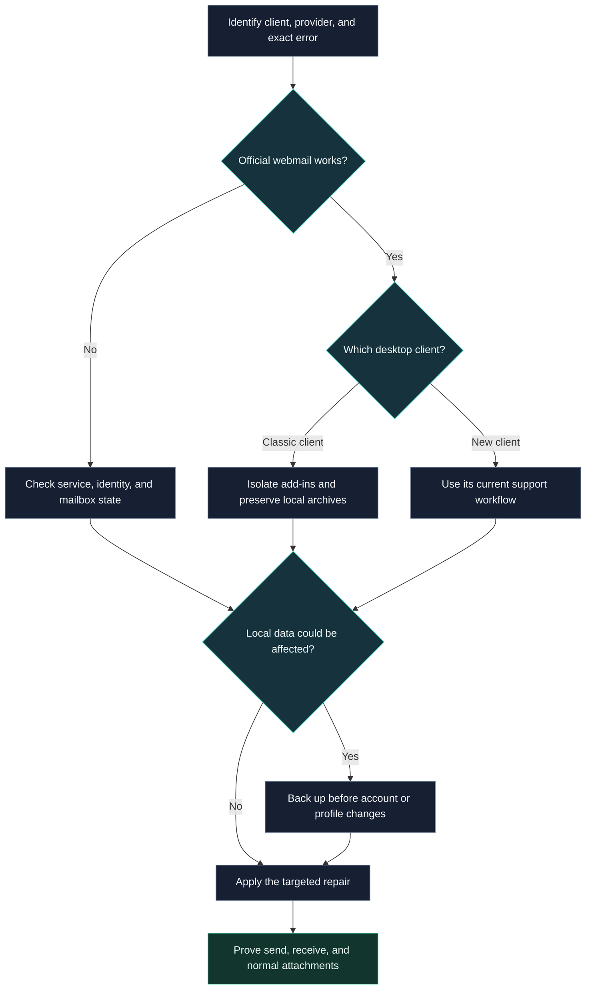

[🏠 Home](https://github.com/Herbertofury/INTA/wiki) · [🧭 Decision desk](https://github.com/Herbertofury/INTA/wiki/Decision-Desk) · [📚 Playbooks](https://github.com/Herbertofury/INTA/wiki/Playbooks) · [🧰 Tool directory](https://github.com/Herbertofury/INTA/wiki/Tool-Directory) · [✨ Open interactive hub](https://herbertofury.github.io/INTA/)

# ✉️ [Fix Outlook or email send/receive problems](https://github.com/Herbertofury/INTA/wiki/Job-outlook-email)

Separate service, authentication, mailbox, network, and local-client faults.

| Work area | Experience | Plan your time | Workflow |
| --- | --- | --- | --- |
| Identity & business systems | Intermediate | 20–60 min | 6 steps + acceptance |

**[▶ Open the interactive checklist](https://herbertofury.github.io/INTA/#job/outlook-email)** · [Decision route](#decision-route) · [Toolkit](#toolkit) · [Walkthrough](#walkthrough) · [Acceptance](#acceptance) · [Sources](#sources)

> [!TIP]
> **Your starting move:** Identify the mail provider and whether the user is in classic [Outlook](https://support.microsoft.com/outlook), new [Outlook](https://support.microsoft.com/outlook), or a browser. Their repair paths differ.

## 🧭 Choose the right branch

**Diagram routes:** [Continue this workflow](#walkthrough) · [Acceptance checks](#acceptance) · [Fix internet, DNS, or local-network problems](https://github.com/Herbertofury/INTA/wiki/Job-network-dns) · [Remove malware and browser hijackers](https://github.com/Herbertofury/INTA/wiki/Job-malware-removal) · [Prove a backup can actually restore](https://github.com/Herbertofury/INTA/wiki/Job-backup-restore)

| Checkpoint | What to carry forward |
| --- | --- |
| **Before changing anything** | Identify the client and protect mail that exists only on this device. |
| **Keep during the job** | Exact error, webmail comparison, rejected message, and account changes. |
| **Before handing back** | Two-way mail and the normal shared-mailbox/attachment task pass. |

## 🧰 Build the right toolkit

Choose the tools that answer the case’s next question. Opening a tool is a separate decision from changing the customer’s system.

| Tool / official download | Use it for | Platform & access | Documentation |
| --- | --- | --- | --- |
| [Microsoft Sysinternals Suite](https://learn.microsoft.com/en-us/sysinternals/downloads/sysinternals-suite) | The core portable [Windows](https://www.microsoft.com/windows) troubleshooting kit. | [Windows](https://www.microsoft.com/windows); Free Microsoft utilities | [Open guide](https://learn.microsoft.com/en-us/sysinternals/downloads/) |

## 🪜 Work the case

Work in order, record the result of each step, and change route when the evidence calls for it.

### 01 · Locate the failing layer

- [ ] Check the provider’s service status and test the same mailbox in its official webmail. Record the exact send/receive error, whether one or all accounts are affected, mailbox quota, and a specific message that fails. Do not expose credentials or message contents in public notes.

### 02 · Verify identity and addressing

- [ ] Confirm the account is signed in through the intended provider and that password/MFA changes have completed. For manually configured mail, compare SMTP/IMAP hostnames, ports, and encryption with the provider’s current settings. An internal directory domain is not automatically the outbound email domain.

### 03 · Check the message and network path

- [ ] Inspect Outbox for a stuck or oversized message and verify whether attachment size, recipient address, or a provider rejection explains the failure. Compare a small test message through webmail. Check VPN/proxy and DNS only when the symptom points there.

### 04 · Use the correct client-specific repair

- [ ] For classic [Outlook](https://support.microsoft.com/outlook), a safe-mode launch can isolate add-in problems; disable only the implicated add-in after testing. New [Outlook](https://support.microsoft.com/outlook) uses a different architecture and does not use the classic safe-mode/profile repair workflow. Follow the current support path for the actual client.

### 05 · Preserve local-only data before rebuilding

- [ ] Before removing an account, recreating a classic profile, or repairing data files, identify local PST archives, POP mail, unsent items, and anything not present on the server. Make a verified backup and retain the old profile until the replacement is proven.

### 06 · Prove both directions

- [ ] Send a small message to a test recipient and receive a reply, then test the user’s normal attachment and shared-mailbox workflow. Record whether the final fix was service-side, account configuration, add-in, profile, or network, and remove only temporary diagnostic changes.

## ✅ Prove the result

- [ ] A sent message arrives and a reply returns.
- [ ] Local-only mail and archives remain accessible.
- [ ] The normal attachment/shared-mailbox workflow passes.

> [!WARNING]
> **Pause this route and escalate when:**
> - A proposed profile or account deletion would remove unbacked-up local mail.
> - There are signs of account takeover, unexpected rules, or malicious forwarding.

## 🔀 Continue with the evidence

| Next playbook | What it resolves |
| --- | --- |
| [Fix internet, DNS, or local-network problems](https://github.com/Herbertofury/INTA/wiki/Job-network-dns) | Locate the failing layer before resetting adapters or changing the whole network. |
| [Remove malware and browser hijackers](https://github.com/Herbertofury/INTA/wiki/Job-malware-removal) | A measured cleanup workflow for a single [Windows](https://www.microsoft.com/windows) endpoint, with a separate path for a wider compromise. |
| [Prove a backup can actually restore](https://github.com/Herbertofury/INTA/wiki/Job-backup-restore) | Validate recovery credentials, data integrity, application usability, and recovery time. |

Found a reusable improvement? [Contribute the correction](https://github.com/Herbertofury/INTA/wiki/Contribute) and include the test that proved it.

## 🔎 Source trail

Official references and editorial review

- [Microsoft: classic Outlook not responding](https://support.microsoft.com/en-us/outlook/classic-outlook-not-responding-stuck-at-processing-stopped-working-or-freezes)
- [Microsoft: architecture changes in new Outlook](https://learn.microsoft.com/en-us/microsoft-365-apps/outlook/administration/architecture-changes-new-outlook)

Reviewed **2026-11-26**. Timing is a planning range. A successful command is evidence about that operation; acceptance belongs to the user’s original task.

---

**Source review: 2026-11-26.** Guidance review and tool release versions are separate. [Report a correction](https://github.com/Herbertofury/INTA/issues/new/choose) · [How we maintain this guide](https://github.com/Herbertofury/INTA/wiki/Knowledge-Standards)
