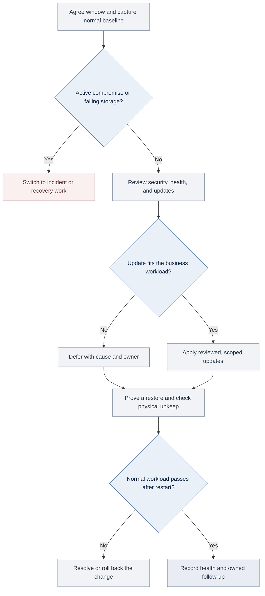

[INTA](https://github.com/Herbertofury/INTA/wiki) / [Decision desk](https://github.com/Herbertofury/INTA/wiki/Decision-Desk) · [Playbooks](https://github.com/Herbertofury/INTA/wiki/Playbooks) · [Tools](https://github.com/Herbertofury/INTA/wiki/Tool-Directory) · [Methods](https://github.com/Herbertofury/INTA/wiki/Methods) · [Open hub](https://herbertofury.github.io/INTA/)

<a id="-run-a-useful-workstation-maintenance-visit"></a>

# [Run a useful workstation maintenance visit](https://github.com/Herbertofury/INTA/wiki/Job-preventive-maintenance)

Check security, updates, hardware, backups, and usability without unnecessary cleanup rituals.

**Maintenance** · Intermediate · 30–60 min · 6 steps

[Tools and useful links](#working-kit) · [Quick answer](#quick-answer) · [Next action](#next-action) · [Decision route](#decision-route) · [Tools](#toolkit) · [Procedure](#walkthrough) · [Verification](#acceptance) · [Sources](#sources) · [Interactive checklist](https://herbertofury.github.io/INTA/#job/preventive-maintenance)

<a id="working-kit"></a>

## 🧰 Tools and links for this job

**[Open working view](https://herbertofury.github.io/INTA/#job/preventive-maintenance)** · Keep the tool panel beside the instructions.

**First move:** Agree the maintenance window and identify the user’s current problem. Verify a usable backup before changes.

| Use this for | Official tool + exact action |
| --- | --- |
| List and review application upgrades. | **[WinGet](https://learn.microsoft.com/en-us/windows/package-manager/winget/)** · [Official page](https://learn.microsoft.com/en-us/windows/package-manager/winget/) · **[Download App Installer · MSIXBUNDLE](https://github.com/microsoft/winget-cli/releases/download/v1.29.380/Microsoft.DesktopAppInstaller_8wekyb3d8bbwe.msixbundle)** |
| Review storage warnings before cleanup. | **[CrystalDiskInfo](https://crystalmark.info/en/software/crystaldiskinfo/)** · [Official page](https://crystalmark.info/en/software/crystaldiskinfo/) · **[Get Windows ZIP · 9.9.5](https://sourceforge.net/projects/crystaldiskinfo/files/9.9.5/CrystalDiskInfo9_9_5.zip/download)** |
| Find capacity use on a healthy drive. | **[WinDirStat](https://windirstat.net/)** · [Official page](https://windirstat.net/) · **[Download Windows x64 · MSI](https://github.com/windirstat/windirstat/releases/download/release/v2.9.3/WinDirStat-x64.msi)** |
| Locate a named local file or log without unnecessary cleanup. | **[Everything](https://www.voidtools.com/)** · [Official page](https://www.voidtools.com/) · **[Download Windows x64 EXE](https://www.voidtools.com/Everything-1.4.1.1032.x64-Setup.exe)** |

### Updates

| Open the exact resource | What to do there |
| --- | --- |
| **[Review WinGet upgrades](https://learn.microsoft.com/en-us/windows/package-manager/winget/upgrade)** | List available changes and select approved packages. |

### Recovery

| Open the exact resource | What to do there |
| --- | --- |
| **[Test the existing backup](https://github.com/Herbertofury/INTA/wiki/Job-backup-restore)** | Restore a representative item to a separate folder. |

### Find retained files

| Open the exact resource | What to do there |
| --- | --- |
| **[Everything desktop search guidance](https://www.voidtools.com/support/everything/)** | Limit indexing/search to approved local locations. |

### Handoff

| Open the exact resource | What to do there |
| --- | --- |
| **[Record changes and deferred work](https://github.com/Herbertofury/INTA/wiki/Technician-Handoff)** | Capture the observed result and follow-up owner. |

<a id="quick-answer"></a>

## ⚡ Quick answer

<a id="quick-maintain-a-pc"></a>

### 🛠️ Maintain a PC

**Agree a maintenance window and confirm the backup can restore files before changing software.**

1. Check storage health, free space, protection status and a representative backup restore.
2. Review available [Windows](https://www.microsoft.com/windows) and application updates; use [WinGet](https://learn.microsoft.com/en-us/windows/package-manager/winget/) only for approved package changes.
3. Reboot in the agreed window, retest essential tasks and record the versions and remaining issues.

**[WinGet](https://learn.microsoft.com/en-us/windows/package-manager/winget/)** · [Official page](https://learn.microsoft.com/en-us/windows/package-manager/winget/) · **[Download App Installer · MSIXBUNDLE](https://github.com/microsoft/winget-cli/releases/download/v1.29.380/Microsoft.DesktopAppInstaller_8wekyb3d8bbwe.msixbundle)**

<a id="quick-find-a-file"></a>

### 🔎 Find a file

**Search by the known filename or extension in approved local folders.**

1. Open the [Everything](https://www.voidtools.com/) desktop app and limit indexing to the locations needed for this case.
2. Search a distinctive part of the name, then check the result’s path and modification time.
3. Open the correct file and remove any temporary case-only indexing settings.

**[Everything](https://www.voidtools.com/)** · [Official page](https://www.voidtools.com/) · **[Download Windows x64 EXE](https://www.voidtools.com/Everything-1.4.1.1032.x64-Setup.exe)**

<a id="next-action"></a>

## 🧭 Match the symptom

| You see this | Do this next | You should get |
| --- | --- | --- |
| **The device has recurring failures or storage warnings** | Check [Reliability Monitor](https://learn.microsoft.com/en-us/windows-server/administration/windows-commands/perfmon) and drive health; move actual faults to their repair or recovery guide before routine maintenance. | The maintenance plan is based on observed faults rather than cleanup rituals. |
| **Application updates are available** | Run [winget](https://learn.microsoft.com/en-us/windows/package-manager/winget/) upgrade to list them, review compatibility and update only the approved packages in the maintenance window. | The selected versions are installed and any planned restart is completed. |
| **A full disk or missing local file is the concern** | Use [WinDirStat](https://windirstat.net/) for capacity or [Everything](https://www.voidtools.com/) for a filename; confirm ownership and retention before deleting or moving anything. | The relevant path is identified and any approved cleanup has a measured result. |
| **Backup jobs report success** | Restore a representative item to a separate location and open it with the intended application. | The backup is demonstrably usable, with its recovery point recorded. |
| **Changes are complete** | Restart as planned and repeat the user’s main app, network, printing and backup checks. | Normal work succeeds and all deferred issues have owners. |

### ✅ Finish the job

- [ ] Protection, hardware health and backup restoration have been checked.
- [ ] The normal workload works after maintenance and restart.
- [ ] Each unresolved item has an explicit next action and owner.

**Change route when:** Storage failure or active compromise changes the service route. · An unplanned critical workload would be interrupted.

> [!NOTE]
> **Start here.** Agree on the maintenance window and identify the user’s current pain points. Preserve a baseline of the system’s normal work.

<a id="decision-route"></a>

<a id="-choose-the-right-branch"></a>

## 🧭 Choose a route



**Route links:** [Continue this workflow](#walkthrough) · [Acceptance checks](#acceptance) · [Diagnose a slow, freezing, or hitching PC](https://github.com/Herbertofury/INTA/wiki/Job-slow-pc) · [Fix a failing Windows update](https://github.com/Herbertofury/INTA/wiki/Job-windows-update) · [Prove a backup can actually restore](https://github.com/Herbertofury/INTA/wiki/Job-backup-restore) · [Close a repair with a clear client handoff](https://github.com/Herbertofury/INTA/wiki/Job-client-handoff)

| Checkpoint | What to carry forward |
| --- | --- |
| **Before changing anything** | Agree the window and preserve normal-workload evidence. |
| **Keep during the job** | Health findings, reviewed updates, restore result, and deferred changes. |
| **Before handing back** | Normal work passes after restart and every open item has an owner. |

<a id="toolkit"></a>

<a id="-build-the-right-toolkit"></a>

## Recommended tools

Select a tool for the next diagnostic or repair step. Check its platform, access and licensing requirements before use.

| Tool / official page + download | Use it for | Platform & access | Documentation |
| --- | --- | --- | --- |
| **[WinGet](https://learn.microsoft.com/en-us/windows/package-manager/winget/)** · [Official page](https://learn.microsoft.com/en-us/windows/package-manager/winget/) · **[Download App Installer · MSIXBUNDLE](https://github.com/microsoft/winget-cli/releases/download/v1.29.380/Microsoft.DesktopAppInstaller_8wekyb3d8bbwe.msixbundle)** | List and review application upgrades. | [Windows](https://www.microsoft.com/windows); Free / open source | [Open guide](https://learn.microsoft.com/en-us/windows/package-manager/winget/) |
| **[CrystalDiskInfo](https://crystalmark.info/en/software/crystaldiskinfo/)** · [Official page](https://crystalmark.info/en/software/crystaldiskinfo/) · **[Get Windows ZIP · 9.9.5](https://sourceforge.net/projects/crystaldiskinfo/files/9.9.5/CrystalDiskInfo9_9_5.zip/download)** | Review storage warnings before cleanup. | [Windows](https://www.microsoft.com/windows); Free / open source | [Open guide](https://crystalmark.info/en/software/crystaldiskinfo/) |
| **[WinDirStat](https://windirstat.net/)** · [Official page](https://windirstat.net/) · **[Download Windows x64 · MSI](https://github.com/windirstat/windirstat/releases/download/release/v2.9.3/WinDirStat-x64.msi)** | Find capacity use on a healthy drive. | [Windows](https://www.microsoft.com/windows); Free / open source | [Open guide](https://github.com/windirstat/windirstat) |
| **[Everything](https://www.voidtools.com/)** · [Official page](https://www.voidtools.com/) · **[Download Windows x64 EXE](https://www.voidtools.com/Everything-1.4.1.1032.x64-Setup.exe)** | Locate a named local file or log without unnecessary cleanup. | [Windows](https://www.microsoft.com/windows); Freeware | [Open guide](https://www.voidtools.com/support/everything/) |
| **[HWiNFO](https://www.hwinfo.com/)** · [Official page](https://www.hwinfo.com/) · **[Download Windows x64 EXE](https://www.hwinfo.com/files/hwi64_860.exe)** | Investigating temperatures, clocks, power and component identity. | [Windows](https://www.microsoft.com/windows); Pro license for commercial use of 64/ARM64 editions | [Open guide](https://www.hwinfo.com/licenses/) |
| **[Microsoft Sysinternals Suite](https://learn.microsoft.com/en-us/sysinternals/)** · [Official page](https://learn.microsoft.com/en-us/sysinternals/) · **[Download Windows portable · ZIP](https://download.sysinternals.com/files/SysinternalsSuite.zip)** | The core portable [Windows](https://www.microsoft.com/windows) troubleshooting kit. | [Windows](https://www.microsoft.com/windows); Free Microsoft utilities | [Open guide](https://learn.microsoft.com/en-us/sysinternals/downloads/) |
| **[Veeam Agent for Microsoft Windows](https://www.veeam.com/products/free/microsoft-windows)** · [Official page](https://www.veeam.com/products/free/microsoft-windows) · **[Sign in for the Windows download](https://www.veeam.com/products/physical/windows-backup-recovery-download.html)** | Image backup and recovery media for a supported [Windows](https://www.microsoft.com/windows) endpoint. | [Windows](https://www.microsoft.com/windows); Free and paid editions; service-provider terms differ | [Open guide](https://helpcenter.veeam.com/docs/agentforwindows/userguide/overview.html) |
| **[WizTree](https://diskanalyzer.com/)** · [Official page](https://diskanalyzer.com/) · **[Download Windows portable · ZIP](https://diskanalyzer.com/files/wiztree_4_34_portable.zip)** | Finding the folders and files responsible for a capacity problem before selecting an approved cleanup. | [Windows](https://www.microsoft.com/windows), [macOS](https://support.apple.com/macos), [Linux](https://www.kernel.org/); Free for personal use; commercial supporter or enterprise license required by business site and staff size. | [Open guide](https://diskanalyzer.com/about) |
| **[WizFile](https://antibody-software.com/wizfile/)** · [Official page](https://antibody-software.com/wizfile/) · **[Download Windows portable · ZIP](https://antibody-software.com/files/wizfile_3_15_portable.zip)** | Locating a known file, log or recently changed group of files without guessing its folder. | [Windows](https://www.microsoft.com/windows); Free for personal use; commercial supporter or enterprise license required by business site and staff size. | [Open guide](https://antibody-software.com/wizfile/quick-start) |

<a id="walkthrough"></a>

<a id="-work-the-case"></a>

## Procedure

Work in order, record the result of each step, and change route when the evidence calls for it.

<a id="step-01"></a>

### 01 · Review health and recurring failures

- [ ] Check [Reliability Monitor](https://learn.microsoft.com/en-us/windows-server/administration/windows-commands/perfmon), storage health, available capacity, temperatures, and recent support history. Separate actionable errors from harmless noise. Investigate symptoms that affect the user before scheduling broad changes.

<a id="step-02"></a>

### 02 · Verify protection and access

- [ ] Confirm the intended real-time security product is healthy and current, firewall policy is intact, and approved remote-management access belongs to the right people. Review unwanted startup apps and browser extensions with the user; remove only what is understood.

<a id="step-03"></a>

### 03 · Review updates before applying them

- [ ] Check [Windows](https://www.microsoft.com/windows) and application updates, reboot requirements, vendor advisories, and line-of-business compatibility. [WinGet](https://learn.microsoft.com/en-us/windows/package-manager/winget/) with no target lists available upgrades; review that list and update the intended packages rather than blindly upgrading every application during production work.

**Command for the environment described above:**

```text
winget upgrade
```

**Command legend:** [WinGet upgrade](https://learn.microsoft.com/en-us/windows/package-manager/winget/upgrade) · [Return to the step context](#step-03).

<a id="step-04"></a>

### 04 · Check backups through a restore

- [ ] Read backup logs and capacity, then restore a small representative item to a separate folder. Confirm recovery-key access and that a coworker can follow the recovery path. If the backup is not restorable, treat that as a repair task with an owner.

<a id="step-05"></a>

### 05 · Handle storage and physical upkeep

- [ ] Use the system’s supported storage cleanup controls after reviewing what will be removed. Preserve downloads, local mail, and application data that may be unique. Clean physical dust using the device’s service guidance; avoid registry cleaners and indiscriminate driver-updater bundles. Use [WizTree](https://diskanalyzer.com/) to explain capacity use and [WizFile](https://antibody-software.com/wizfile/) to locate a specific retained file or log before cleanup. Compare the proposed deletion with the owner's retention needs and the available backup. Recheck free space and the original workload afterward; exit [WizFile](https://antibody-software.com/wizfile/) and remove any one-case startup setting so a temporary visit does not leave unplanned monitoring.

<a id="step-06"></a>

### 06 · Retest and schedule only real follow-up

- [ ] After the planned restart, test the user’s main applications, network, printers, backup, and remote access. Record versions and changes, measurable improvements, deferred work, and hardware replacement recommendations based on evidence.

<a id="acceptance"></a>

<a id="-prove-the-result"></a>

## Verification

- [ ] Security, updates, backup restore, and hardware health were reviewed.
- [ ] The normal workload works after maintenance and restart.
- [ ] Every deferred or failed item has an owner and next action.
- [ ] Storage cleanup has an explained target, retention decision and observed result; temporary search or capture utilities are closed.

> [!WARNING]
> **Pause this route and escalate when:**
> - The maintenance would interrupt an unplanned critical workload.
> - Storage failure or active compromise changes the job into recovery or [incident response](https://github.com/Herbertofury/INTA/wiki/Job-ransomware-response).

<a id="-continue-with-the-evidence"></a>

## Related playbooks

| Next playbook | What it resolves |
| --- | --- |
| [Diagnose a slow, freezing, or hitching PC](https://github.com/Herbertofury/INTA/wiki/Job-slow-pc) | Find the actual bottleneck and prove the improvement with the same workload. |
| [Fix a failing Windows update](https://github.com/Herbertofury/INTA/wiki/Job-windows-update) | Diagnose the update code, servicing state, and available space before broad reset scripts. |
| [Prove a backup can actually restore](https://github.com/Herbertofury/INTA/wiki/Job-backup-restore) | Validate recovery credentials, data integrity, application usability, and recovery time. |
| [Close a repair with a clear client handoff](https://github.com/Herbertofury/INTA/wiki/Job-client-handoff) | Turn completed technical work into proof the customer can use, with clean access and an actionable service record. |

<a id="sources"></a>

<a id="-source-trail"></a>

## Official sources

- [Microsoft: WinGet upgrade](https://learn.microsoft.com/en-us/windows/package-manager/winget/upgrade)
- [restic: restore a backup](https://restic.readthedocs.io/en/stable/050_restore.html)
- [Microsoft: Sysinternals Suite](https://learn.microsoft.com/en-us/sysinternals/downloads/sysinternals-suite)
- [WizTree: disk-space analysis and export](https://diskanalyzer.com/about)
- [WizFile: search filters and shutdown](https://antibody-software.com/wizfile/quick-start)

Reviewed **2026-11-26**. Timing is a planning range. A successful command is evidence about that operation; acceptance belongs to the user’s original task.


---

Editorial review: **2026-11-26** · [Review standard](https://github.com/Herbertofury/INTA/wiki/Knowledge-Standards) · [Suggest a correction](https://github.com/Herbertofury/INTA/issues/new/choose)
