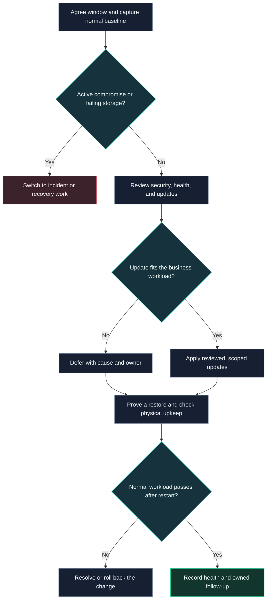

[🏠 Home](https://github.com/Herbertofury/INTA/wiki) · [🧭 Decision desk](https://github.com/Herbertofury/INTA/wiki/Decision-Desk) · [📚 Playbooks](https://github.com/Herbertofury/INTA/wiki/Playbooks) · [🧰 Tool directory](https://github.com/Herbertofury/INTA/wiki/Tool-Directory) · [✨ Open interactive hub](https://herbertofury.github.io/INTA/)

# 🧰 [Run a useful workstation maintenance visit](https://github.com/Herbertofury/INTA/wiki/Job-preventive-maintenance)

Check security, updates, hardware, backups, and usability without unnecessary cleanup rituals.

| Work area | Experience | Plan your time | Workflow |
| --- | --- | --- | --- |
| Maintenance | Intermediate | 30–60 min | 6 steps + acceptance |

**[▶ Open the interactive checklist](https://herbertofury.github.io/INTA/#job/preventive-maintenance)** · [Decision route](#decision-route) · [Toolkit](#toolkit) · [Walkthrough](#walkthrough) · [Acceptance](#acceptance) · [Sources](#sources)

> [!TIP]
> **Your starting move:** Agree on the maintenance window and identify the user’s current pain points. Preserve a baseline of the system’s normal work.

<a id="decision-route"></a>

## 🧭 Choose the right branch



**Diagram routes:** [Continue this workflow](#walkthrough) · [Acceptance checks](#acceptance) · [Diagnose a slow, freezing, or hitching PC](https://github.com/Herbertofury/INTA/wiki/Job-slow-pc) · [Fix a failing Windows update](https://github.com/Herbertofury/INTA/wiki/Job-windows-update) · [Prove a backup can actually restore](https://github.com/Herbertofury/INTA/wiki/Job-backup-restore) · [Close a repair with a clear client handoff](https://github.com/Herbertofury/INTA/wiki/Job-client-handoff)

| Checkpoint | What to carry forward |
| --- | --- |
| **Before changing anything** | Agree the window and preserve normal-workload evidence. |
| **Keep during the job** | Health findings, reviewed updates, restore result, and deferred changes. |
| **Before handing back** | Normal work passes after restart and every open item has an owner. |

<a id="toolkit"></a>

## 🧰 Build the right toolkit

Choose the tools that answer the case’s next question. Opening a tool is a separate decision from changing the customer’s system.

| Tool / official download | Use it for | Platform & access | Documentation |
| --- | --- | --- | --- |
| [WinGet](https://github.com/microsoft/winget-cli/releases/latest) | Repeatable application setup and individually reviewed updates. | [Windows](https://www.microsoft.com/windows); Free / open source | [Open guide](https://learn.microsoft.com/en-us/windows/package-manager/winget/) |
| [CrystalDiskInfo](https://crystalmark.info/en/download/) | First-pass HDD and SSD health inspection in [Windows](https://www.microsoft.com/windows). | [Windows](https://www.microsoft.com/windows); Free / open source | [Open guide](https://crystalmark.info/en/software/crystaldiskinfo/) |
| [HWiNFO](https://www.hwinfo.com/download/) | Investigating temperatures, clocks, power and component identity. | [Windows](https://www.microsoft.com/windows); Pro license for commercial use of 64/ARM64 editions | [Open guide](https://www.hwinfo.com/licenses/) |
| [Microsoft Sysinternals Suite](https://learn.microsoft.com/en-us/sysinternals/downloads/sysinternals-suite) | The core portable [Windows](https://www.microsoft.com/windows) troubleshooting kit. | [Windows](https://www.microsoft.com/windows); Free Microsoft utilities | [Open guide](https://learn.microsoft.com/en-us/sysinternals/downloads/) |
| [Veeam Agent for Microsoft Windows](https://www.veeam.com/products/free/microsoft-windows) | Image backup and recovery media for a supported [Windows](https://www.microsoft.com/windows) endpoint. | [Windows](https://www.microsoft.com/windows); Free and paid editions; service-provider terms differ | [Open guide](https://helpcenter.veeam.com/docs/agentforwindows/userguide/overview.html) |

<a id="walkthrough"></a>

## 🪜 Work the case

Work in order, record the result of each step, and change route when the evidence calls for it.

<a id="step-01"></a>

### 01 · Review health and recurring failures

- [ ] Check [Reliability Monitor](https://learn.microsoft.com/en-us/windows-server/administration/windows-commands/perfmon), storage health, available capacity, temperatures, and recent support history. Separate actionable errors from harmless noise. Investigate symptoms that affect the user before scheduling broad changes.

<a id="step-02"></a>

### 02 · Verify protection and access

- [ ] Confirm the intended real-time security product is healthy and current, firewall policy is intact, and approved remote-management access belongs to the right people. Review unwanted startup apps and browser extensions with the user; remove only what is understood.

<a id="step-03"></a>

### 03 · Review updates before applying them

- [ ] Check [Windows](https://www.microsoft.com/windows) and application updates, reboot requirements, vendor advisories, and line-of-business compatibility. [WinGet](https://learn.microsoft.com/en-us/windows/package-manager/winget/) with no target lists available upgrades; review that list and update the intended packages rather than blindly upgrading every application during production work.

**Command for the environment described above:**

```text
winget upgrade
```

**Command legend:** [WinGet upgrade](https://learn.microsoft.com/en-us/windows/package-manager/winget/upgrade) · [Return to the step context](#step-03).

<a id="step-04"></a>

### 04 · Check backups through a restore

- [ ] Read backup logs and capacity, then restore a small representative item to a separate folder. Confirm recovery-key access and that a coworker can follow the recovery path. If the backup is not restorable, treat that as a repair task with an owner.

<a id="step-05"></a>

### 05 · Handle storage and physical upkeep

- [ ] Use the system’s supported storage cleanup controls after reviewing what will be removed. Preserve downloads, local mail, and application data that may be unique. Clean physical dust using the device’s service guidance; avoid registry cleaners and indiscriminate driver-updater bundles.

<a id="step-06"></a>

### 06 · Retest and schedule only real follow-up

- [ ] After the planned restart, test the user’s main applications, network, printers, backup, and remote access. Record versions and changes, measurable improvements, deferred work, and hardware replacement recommendations based on evidence.

<a id="acceptance"></a>

## ✅ Prove the result

- [ ] Security, updates, backup restore, and hardware health were reviewed.
- [ ] The normal workload works after maintenance and restart.
- [ ] Every deferred or failed item has an owner and next action.

> [!WARNING]
> **Pause this route and escalate when:**
> - The maintenance would interrupt an unplanned critical workload.
> - Storage failure or active compromise changes the job into recovery or [incident response](https://github.com/Herbertofury/INTA/wiki/Job-ransomware-response).

## 🔀 Continue with the evidence

| Next playbook | What it resolves |
| --- | --- |
| [Diagnose a slow, freezing, or hitching PC](https://github.com/Herbertofury/INTA/wiki/Job-slow-pc) | Find the actual bottleneck and prove the improvement with the same workload. |
| [Fix a failing Windows update](https://github.com/Herbertofury/INTA/wiki/Job-windows-update) | Diagnose the update code, servicing state, and available space before broad reset scripts. |
| [Prove a backup can actually restore](https://github.com/Herbertofury/INTA/wiki/Job-backup-restore) | Validate recovery credentials, data integrity, application usability, and recovery time. |
| [Close a repair with a clear client handoff](https://github.com/Herbertofury/INTA/wiki/Job-client-handoff) | Turn completed technical work into proof the customer can use, with clean access and an actionable service record. |

Found a reusable improvement? [Contribute the correction](https://github.com/Herbertofury/INTA/wiki/Contribute) and include the test that proved it.

<a id="sources"></a>

## 🔎 Source trail

<details>
<summary>Official references and editorial review</summary>

- [Microsoft: WinGet upgrade](https://learn.microsoft.com/en-us/windows/package-manager/winget/upgrade)
- [restic: restore a backup](https://restic.readthedocs.io/en/stable/050_restore.html)

Reviewed **2026-11-26**. Timing is a planning range. A successful command is evidence about that operation; acceptance belongs to the user’s original task.

</details>

---

**Source review: 2026-11-26.** Guidance review and tool release versions are separate. [Report a correction](https://github.com/Herbertofury/INTA/issues/new/choose) · [How we maintain this guide](https://github.com/Herbertofury/INTA/wiki/Knowledge-Standards)
