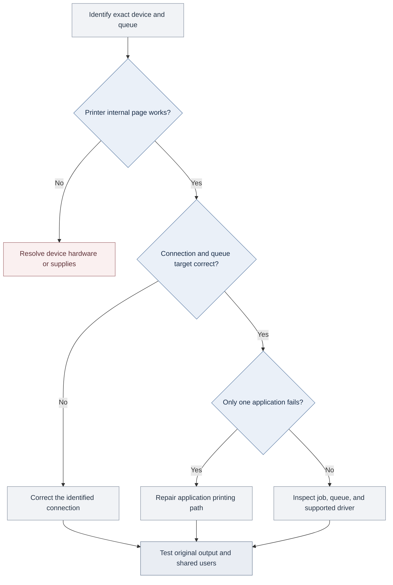

[INTA](https://github.com/Herbertofury/INTA/wiki) / [Decision desk](https://github.com/Herbertofury/INTA/wiki/Decision-Desk) · [Playbooks](https://github.com/Herbertofury/INTA/wiki/Playbooks) · [Tools](https://github.com/Herbertofury/INTA/wiki/Tool-Directory) · [Methods](https://github.com/Herbertofury/INTA/wiki/Methods) · [Open hub](https://herbertofury.github.io/INTA/)

# [Restore printing without breaking other queues](https://github.com/Herbertofury/INTA/wiki/Job-printer-repair)

Isolate printer hardware, network reachability, queue state, driver, and application behavior.

**Devices & peripherals** · Starter · 15–45 min · 6 steps

[Decision route](#decision-route) · [Tools](#toolkit) · [Procedure](#walkthrough) · [Verification](#acceptance) · [Sources](#sources) · [Interactive checklist](https://herbertofury.github.io/INTA/#job/printer-repair)

> [!NOTE]
> **Start here.** Identify the exact printer and queue. Check whether another user or application can print to the same device.

## 🧭 Choose a route

View the decision map and escalation routes

**Route links:** [Continue this workflow](#walkthrough) · [Acceptance checks](#acceptance) · [Fix internet, DNS, or local-network problems](https://github.com/Herbertofury/INTA/wiki/Job-network-dns) · [Set up a dependable new workstation](https://github.com/Herbertofury/INTA/wiki/Job-new-pc) · [Close a repair with a clear client handoff](https://github.com/Herbertofury/INTA/wiki/Job-client-handoff)

| Checkpoint | What to carry forward |
| --- | --- |
| **Before changing anything** | Confirm the target queue and coordinate shared-service changes. |
| **Keep during the job** | Internal page, [Windows](https://www.microsoft.com/windows) test page, port, driver, and affected users. |
| **Before handing back** | Original output, required options, scanning, and other users pass. |

## Recommended tools

Select a tool for the next diagnostic or repair step. Check its platform, access and licensing requirements before use.

| Tool / official download | Use it for | Platform & access | Documentation |
| --- | --- | --- | --- |
| [Microsoft Sysinternals Suite](https://learn.microsoft.com/en-us/sysinternals/downloads/sysinternals-suite) | The core portable [Windows](https://www.microsoft.com/windows) troubleshooting kit. | [Windows](https://www.microsoft.com/windows); Free Microsoft utilities | [Open guide](https://learn.microsoft.com/en-us/sysinternals/downloads/) |

## Procedure

Work in order, record the result of each step, and change route when the evidence calls for it.

### 01 · Check the printer itself

- [ ] Inspect its display, paper path, consumables, and connection. Print the device’s internal test or configuration page when available. If that fails, work on the hardware state before changing [Windows](https://www.microsoft.com/windows) drivers.

### 02 · Verify the connection and queue

- [ ] Confirm USB connection or the printer’s current network address against the queue’s configured port. Check that the intended queue is selected, not an old duplicate or offline copy. A changed DHCP address can leave a working printer behind an obsolete port.

### 03 · Separate application and queue faults

- [ ] Print a [Windows](https://www.microsoft.com/windows) test page and a simple document from another application. If only one application fails, troubleshoot its print settings or installation. If all jobs fail, inspect queue status and run the [Windows](https://www.microsoft.com/windows) printer troubleshooter.

### 04 · Clear the specific obstruction

- [ ] Cancel only the affected user’s stuck job when possible. Coordinate before restarting the Print Spooler because that affects other queues. On a shared print server, identify all affected users and obtain a service window before clearing queues or replacing a shared driver.

### 05 · Use the supported driver path

- [ ] Install or repair the manufacturer-supported driver for the exact model and [Windows](https://www.microsoft.com/windows) architecture, or the supported [Windows](https://www.microsoft.com/windows) class driver where appropriate. Preserve existing ports and options; document any queue replacement so duplex, trays, and scanning are not lost.

### 06 · Verify real output

- [ ] Print the original document and check page size, orientation, color, duplex, and selected tray. Test another user on shared printers, and verify scanning separately if the device is multifunction. Remove obsolete duplicate queues only after the working one is confirmed.

## Verification

- [ ] The printer’s internal page and [Windows](https://www.microsoft.com/windows)/application test output are correct.
- [ ] Required trays, duplex, color, and scanning still work.
- [ ] Other users and shared queues remain functional.

> [!WARNING]
> **Pause this route and escalate when:**
> - The device has a hardware fault or unsafe condition.
> - A shared spooler/driver change would disrupt uncoordinated production jobs.

## Related playbooks

| Next playbook | What it resolves |
| --- | --- |
| [Fix internet, DNS, or local-network problems](https://github.com/Herbertofury/INTA/wiki/Job-network-dns) | Locate the failing layer before resetting adapters or changing the whole network. |
| [Set up a dependable new workstation](https://github.com/Herbertofury/INTA/wiki/Job-new-pc) | Build a usable, recoverable workstation around the employee’s actual job. |
| [Close a repair with a clear client handoff](https://github.com/Herbertofury/INTA/wiki/Job-client-handoff) | Turn completed technical work into proof the customer can use, with clean access and an actionable service record. |

## Official sources

References and review notes

- [Microsoft: printer connection and printing problems](https://support.microsoft.com/en-us/windows/hardware/printer/fix-printer-connection-and-printing-problems-in-windows)
- [Microsoft: print jobs stuck in the queue](https://support.microsoft.com/en-us/windows/hardware/printer/fix-print-job-stuck-in-queue-errors-in-windows)

Reviewed **2026-11-26**. Timing is a planning range. A successful command is evidence about that operation; acceptance belongs to the user’s original task.

---

Editorial review: **2026-11-26** · [Review standard](https://github.com/Herbertofury/INTA/wiki/Knowledge-Standards) · [Suggest a correction](https://github.com/Herbertofury/INTA/issues/new/choose)
