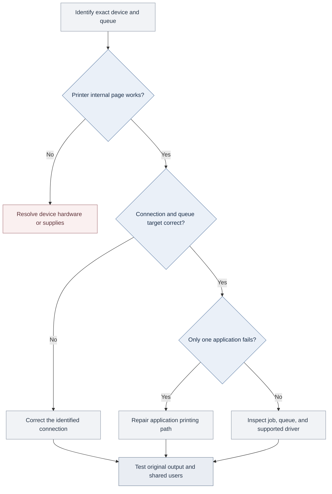

[INTA](https://github.com/Herbertofury/INTA/wiki) / [Decision desk](https://github.com/Herbertofury/INTA/wiki/Decision-Desk) · [Service map](https://github.com/Herbertofury/INTA/wiki/Service-Map) · [Playbooks](https://github.com/Herbertofury/INTA/wiki/Playbooks) · [Tools](https://github.com/Herbertofury/INTA/wiki/Tool-Directory) · [Methods](https://github.com/Herbertofury/INTA/wiki/Methods) · [Open hub](https://herbertofury.github.io/INTA/)

<a id="️-restore-printing-without-breaking-other-queues"></a>
<a id="-restore-printing-without-breaking-other-queues"></a>

# [Restore printing without breaking other queues](https://github.com/Herbertofury/INTA/wiki/Job-printer-repair)

Isolate printer hardware, network reachability, queue state, driver, and application behavior.

**Devices & peripherals** · Starter · 15–45 min · 8 steps

[Tools and useful links](#working-kit) · [Quick answer](#quick-answer) · [Next action](#next-action) · [Specific fixes](#specific-fixes) · [Decision route](#decision-route) · [Tools](#toolkit) · [Procedure](#walkthrough) · [Verification](#acceptance) · [Sources](#sources) · [Interactive checklist](https://herbertofury.github.io/INTA/#job/printer-repair)

<a id="tool-choices"></a>

## 🧰 Choose the tool for this job

Choose by the task shown in the first column. Each option includes its acquisition route and access boundary.

| Need | Official tool + exact action | Why this choice / access |
| --- | --- | --- |
| **Printer diagnostic** | **<a href="https://support.microsoft.com/en-us/support/get-help/about-get-help" title="Open Windows Get Help official download or service page" aria-label="Open Windows Get Help official download or service page" data-inta-brand="get-help"></a> [Windows Get Help](https://support.microsoft.com/en-us/support/get-help/about-get-help)** · **<a href="https://support.microsoft.com/en-us/support/get-help/about-get-help" title="Open Windows Get Help official download or service page" aria-label="Open Windows Get Help official download or service page" data-inta-brand="get-help"></a> [Start the printer troubleshooter](https://aka.ms/PrinterConnection)** | Start the printer-specific diagnostic after confirming the physical device and connection. **Access:** Included with supported <a href="https://www.microsoft.com/windows" title="Open Windows official download or service page" aria-label="Open Windows official download or service page" data-inta-brand="app-windows"></a> [Windows](https://www.microsoft.com/windows) |
| **Exact-model driver** | **<a href="https://support.microsoft.com/en-us/windows/hardware/drivers/update-drivers-through-device-manager-in-windows" title="Open Official OEM driver and firmware portals official download or service page" aria-label="Open Official OEM driver and firmware portals official download or service page" data-inta-brand="oem-drivers"></a> [Official OEM driver and firmware portals](https://support.microsoft.com/en-us/windows/hardware/drivers/update-drivers-through-device-manager-in-windows)** · **<a href="https://support.microsoft.com/en-us/windows/hardware/drivers/update-drivers-through-device-manager-in-windows" title="Open Official OEM driver and firmware portals official download or service page" aria-label="Open Official OEM driver and firmware portals official download or service page" data-inta-brand="oem-drivers"></a> [Find the correct printer driver](https://support.microsoft.com/en-us/windows/hardware/printer/download-and-install-the-latest-printer-drivers)** | Use the manufacturer/model/OS route when that driver path is supported; check protected print mode first. **Access:** Vendor downloads; match model, architecture and policy. |
| **Find the printer IP** | **<a href="https://www.advanced-ip-scanner.com/" title="Open Advanced IP Scanner official download or service page" aria-label="Open Advanced IP Scanner official download or service page" data-inta-brand="advanced-ip-scanner"></a> [Advanced IP Scanner](https://www.advanced-ip-scanner.com/)** · **<a href="https://www.microsoft.com/windows" title="Open Windows official download or service page" aria-label="Open Windows official download or service page" data-inta-brand="app-windows"></a> [Download Windows scanner · EXE](https://download.advanced-ip-scanner.com/download/files/Advanced_IP_Scanner_2.5.4594.1.exe)** | Identify the printer on the authorized local subnet, then match its model or MAC to the queue. **Access:** Free <a href="https://www.microsoft.com/windows" title="Open Windows official download or service page" aria-label="Open Windows official download or service page" data-inta-brand="app-windows"></a> [Windows](https://www.microsoft.com/windows) tool; scan only an approved subnet. |
| **Scanner and ADF test** | **<a href="https://www.naps2.com/" title="Open NAPS2 official download or service page" aria-label="Open NAPS2 official download or service page" data-inta-brand="naps2"></a> [NAPS2](https://www.naps2.com/)** · **<a href="https://www.microsoft.com/windows" title="Open Windows official download or service page" aria-label="Open Windows official download or service page" data-inta-brand="app-windows"></a> [Download Windows x64 portable · ZIP](https://github.com/cyanfish/naps2/releases/download/v8.6.1/naps2-8.6.1-win-x64.zip)** | Test flatbed, feeder and multipage output independently of the printer queue. **Access:** Free and open source |

**[Current selection evidence](https://github.com/Herbertofury/INTA/wiki/Current-Tool-Choices)**

<a id="working-kit"></a>

## 🧰 Tools and links for this job

**[Open working view](https://herbertofury.github.io/INTA/#job/printer-repair)** · Keep the tool panel beside the instructions.

**First move:** Read the make/model and IP from the printer’s own network/configuration report. On the PC open Settings > Bluetooth & devices > Printers & scanners and select the intended queue.

**Driver shortcuts:** **<a href="https://support.hp.com/us-en/drivers" title="Open HP official download or service page" aria-label="Open HP official download or service page" data-inta-brand="web-hp"></a> [HP printer drivers](https://support.hp.com/us-en/drivers/printers)** · **<a href="https://support.brother.com/" title="Open Brother official download or service page" aria-label="Open Brother official download or service page" data-inta-brand="web-brother"></a> [Brother printer drivers](https://www.brother-usa.com/support/drivers)** · **<a href="https://www.usa.canon.com/support/software-and-drivers" title="Open Canon official download or service page" aria-label="Open Canon official download or service page" data-inta-brand="web-canon"></a> [Canon printer drivers](https://www.usa.canon.com/support/software-and-drivers)** · **<a href="https://epson.com/Support/sl/s" title="Open Epson official download or service page" aria-label="Open Epson official download or service page" data-inta-brand="web-epson"></a> [Epson printer support](https://support.epson.com/)** · **<a href="https://www.support.xerox.com/en-us" title="Open Xerox official download or service page" aria-label="Open Xerox official download or service page" data-inta-brand="web-xerox"></a> [Xerox printer drivers](https://www.support.xerox.com/en-us)** · **<a href="https://www.ricoh-usa.com/en/support-and-download" title="Open Ricoh official download or service page" aria-label="Open Ricoh official download or service page" data-inta-brand="web-ricoh"></a> [Ricoh drivers and downloads](https://www.ricoh-usa.com/en/support-and-download)** · **<a href="https://support.lexmark.com/en_us/drivers-downloads.html" title="Open Lexmark official download or service page" aria-label="Open Lexmark official download or service page" data-inta-brand="web-lexmark"></a> [Lexmark printer drivers](https://support.lexmark.com/en_us/drivers-downloads.html)** · **<a href="https://www.kyoceradocumentsolutions.us/en/support/downloads.html" title="Open Kyocera official download or service page" aria-label="Open Kyocera official download or service page" data-inta-brand="web-kyocera"></a> [Kyocera download center](https://www.kyoceradocumentsolutions.us/en/support/downloads.html)** · **<a href="https://kmbs.konicaminolta.us/support-downloads/" title="Open Konica Minolta official download or service page" aria-label="Open Konica Minolta official download or service page" data-inta-brand="web-konica-minolta"></a> [Konica Minolta model search](https://onyxweb.mykonicaminolta.com/OneStopProductSupport?appMode=Public)** · **<a href="https://business.sharpusa.com/product-downloads" title="Open Sharp official download or service page" aria-label="Open Sharp official download or service page" data-inta-brand="web-sharp"></a> [Sharp product downloads](https://business.sharpusa.com/product-downloads)** · **<a href="https://www.zebra.com/us/en/support-downloads.html" title="Open Zebra official download or service page" aria-label="Open Zebra official download or service page" data-inta-brand="web-zebra"></a> [Zebra printer support](https://www.zebra.com/us/en/support-downloads/printers.html)**

| Use this for | Official tool + exact action |
| --- | --- |
| Run the supported printer diagnostic. | **<a href="https://support.microsoft.com/en-us/support/get-help/about-get-help" title="Open Windows Get Help official download or service page" aria-label="Open Windows Get Help official download or service page" data-inta-brand="get-help"></a> [Windows Get Help](https://support.microsoft.com/en-us/support/get-help/about-get-help)** · <a href="https://support.microsoft.com/en-us/support/get-help/about-get-help" title="Open Windows Get Help official download or service page" aria-label="Open Windows Get Help official download or service page" data-inta-brand="get-help"></a> [Official page](https://support.microsoft.com/en-us/support/get-help/about-get-help) · **<a href="https://support.microsoft.com/en-us/support/get-help/about-get-help" title="Open Windows Get Help official download or service page" aria-label="Open Windows Get Help official download or service page" data-inta-brand="get-help"></a> [Start the printer troubleshooter](https://aka.ms/PrinterConnection)** |
| Find the printer’s current address within an approved local subnet. | **<a href="https://www.advanced-ip-scanner.com/" title="Open Advanced IP Scanner official download or service page" aria-label="Open Advanced IP Scanner official download or service page" data-inta-brand="advanced-ip-scanner"></a> [Advanced IP Scanner](https://www.advanced-ip-scanner.com/)** · <a href="https://www.advanced-ip-scanner.com/" title="Open Advanced IP Scanner official download or service page" aria-label="Open Advanced IP Scanner official download or service page" data-inta-brand="advanced-ip-scanner"></a> [Official page](https://www.advanced-ip-scanner.com/) · **<a href="https://www.microsoft.com/windows" title="Open Windows official download or service page" aria-label="Open Windows official download or service page" data-inta-brand="app-windows"></a> [Download Windows scanner · EXE](https://download.advanced-ip-scanner.com/download/files/Advanced_IP_Scanner_2.5.4594.1.exe)** |
| Read the exact installed queue, driver and port. | **<a href="https://learn.microsoft.com/en-us/powershell/" title="Open PowerShell official download or service page" aria-label="Open PowerShell official download or service page" data-inta-brand="powershell"></a> [PowerShell](https://learn.microsoft.com/en-us/powershell/)** · <a href="https://learn.microsoft.com/en-us/powershell/" title="Open PowerShell official download or service page" aria-label="Open PowerShell official download or service page" data-inta-brand="powershell"></a> [Official page](https://learn.microsoft.com/en-us/powershell/) · **<a href="https://learn.microsoft.com/en-us/powershell/scripting/windows-powershell/starting-windows-powershell" title="Open Windows PowerShell 5.1 official download or service page" aria-label="Open Windows PowerShell 5.1 official download or service page" data-inta-brand="app-windows-powershell-51"></a> [Use Windows PowerShell 5.1](https://learn.microsoft.com/en-us/powershell/scripting/windows-powershell/starting-windows-powershell)** |
| Test scanner, feeder and multipage PDF output. | **<a href="https://www.naps2.com/" title="Open NAPS2 official download or service page" aria-label="Open NAPS2 official download or service page" data-inta-brand="naps2"></a> [NAPS2](https://www.naps2.com/)** · <a href="https://www.naps2.com/" title="Open NAPS2 official download or service page" aria-label="Open NAPS2 official download or service page" data-inta-brand="naps2"></a> [Official page](https://www.naps2.com/) · **<a href="https://www.microsoft.com/windows" title="Open Windows official download or service page" aria-label="Open Windows official download or service page" data-inta-brand="app-windows"></a> [Download Windows x64 portable · ZIP](https://github.com/cyanfish/naps2/releases/download/v8.6.1/naps2-8.6.1-win-x64.zip)** |
| Identifying the actual USB port, hub, device and negotiated connection when a printer, scanner or peripheral disconnects or runs slowly. | **<a href="https://www.uwe-sieber.de/usbtreeview_e.html" title="Open USB Device Tree Viewer official download or service page" aria-label="Open USB Device Tree Viewer official download or service page" data-inta-brand="usb-device-tree-view"></a> [USB Device Tree Viewer](https://www.uwe-sieber.de/usbtreeview_e.html)** · <a href="https://www.uwe-sieber.de/usbtreeview_e.html" title="Open USB Device Tree Viewer official download or service page" aria-label="Open USB Device Tree Viewer official download or service page" data-inta-brand="usb-device-tree-view"></a> [Official page](https://www.uwe-sieber.de/usbtreeview_e.html) · **<a href="https://www.microsoft.com/windows" title="Open Windows official download or service page" aria-label="Open Windows official download or service page" data-inta-brand="app-windows"></a> [Download Windows x64 portable · ZIP](https://www.uwe-sieber.de/files/UsbTreeView_x64.zip)** |
| Testing the same known-good PDF through an independent renderer to separate an application-specific print fault from the queue or printer. | **<a href="https://www.sumatrapdfreader.org/" title="Open SumatraPDF official download or service page" aria-label="Open SumatraPDF official download or service page" data-inta-brand="sumatrapdf"></a> [SumatraPDF](https://www.sumatrapdfreader.org/)** · <a href="https://www.sumatrapdfreader.org/" title="Open SumatraPDF official download or service page" aria-label="Open SumatraPDF official download or service page" data-inta-brand="sumatrapdf"></a> [Official page](https://www.sumatrapdfreader.org/) · **<a href="https://www.microsoft.com/windows" title="Open Windows official download or service page" aria-label="Open Windows official download or service page" data-inta-brand="app-windows"></a> [Download Windows x64 portable · ZIP](https://www.sumatrapdfreader.org/dl/rel/3.6.1/SumatraPDF-3.6.1-64.zip)** |
| Use the manufacturer/model/OS route when that driver path is supported; check protected print mode first. | **<a href="https://support.microsoft.com/en-us/windows/hardware/drivers/update-drivers-through-device-manager-in-windows" title="Open Official OEM driver and firmware portals official download or service page" aria-label="Open Official OEM driver and firmware portals official download or service page" data-inta-brand="oem-drivers"></a> [Official OEM driver and firmware portals](https://support.microsoft.com/en-us/windows/hardware/drivers/update-drivers-through-device-manager-in-windows)** · <a href="https://support.microsoft.com/en-us/windows/hardware/drivers/update-drivers-through-device-manager-in-windows" title="Open Official OEM driver and firmware portals official download or service page" aria-label="Open Official OEM driver and firmware portals official download or service page" data-inta-brand="oem-drivers"></a> [Official page](https://support.microsoft.com/en-us/windows/hardware/drivers/update-drivers-through-device-manager-in-windows) · **<a href="https://support.microsoft.com/en-us/windows/hardware/drivers/update-drivers-through-device-manager-in-windows" title="Open Official OEM driver and firmware portals official download or service page" aria-label="Open Official OEM driver and firmware portals official download or service page" data-inta-brand="oem-drivers"></a> [Find the correct printer driver](https://support.microsoft.com/en-us/windows/hardware/printer/download-and-install-the-latest-printer-drivers)** |

### Before driver changes

| Open the exact resource | What to do there |
| --- | --- |
| **<a href="https://www.microsoft.com/windows" title="Open Windows official download or service page" aria-label="Open Windows official download or service page" data-inta-brand="app-windows"></a> [Windows printer-driver selection](https://support.microsoft.com/en-us/windows/hardware/printer/download-and-install-the-latest-printer-drivers)** | Check <a href="https://learn.microsoft.com/en-us/windows/deployment/update/" title="Open Windows Update official download or service page" aria-label="Open Windows Update official download or service page" data-inta-brand="app-windows-update"></a> [Windows Update](https://learn.microsoft.com/en-us/windows/deployment/update/), exact model, operating system and architecture. |
| **<a href="https://learn.microsoft.com/en-us/windows/modern-print/windows-protected-print-mode/windows-protected-print-mode" title="Open Windows protected print mode official download or service page" aria-label="Open Windows protected print mode official download or service page" data-inta-brand="app-windows-protected-print-mode"></a> [Windows protected print mode](https://learn.microsoft.com/en-us/windows/modern-print/windows-protected-print-mode/windows-protected-print-mode)** | <a href="https://learn.microsoft.com/en-us/windows/modern-print/windows-protected-print-mode/windows-protected-print-mode" title="Open Windows protected print mode official download or service page" aria-label="Open Windows protected print mode official download or service page" data-inta-brand="app-windows-protected-print-mode"></a> [WPP](https://learn.microsoft.com/en-us/windows/modern-print/windows-protected-print-mode/windows-protected-print-mode) uses the modern print stack and removes or blocks third-party drivers. |

### Find the printer

| Open the exact resource | What to do there |
| --- | --- |
| **<a href="https://learn.microsoft.com/en-us/powershell/" title="Open PowerShell official download or service page" aria-label="Open PowerShell official download or service page" data-inta-brand="powershell"></a> [Read installed printer ports](https://learn.microsoft.com/en-us/powershell/module/printmanagement/get-printerport)** | Compare the configured port/address with the printer’s network report. |
| **<a href="https://learn.microsoft.com/en-us/powershell/" title="Open PowerShell official download or service page" aria-label="Open PowerShell official download or service page" data-inta-brand="powershell"></a> [Read installed queues and drivers](https://learn.microsoft.com/en-us/powershell/module/printmanagement/get-printer)** | Identify the exact queue, port and driver before changing it. |

### Printer drivers by manufacturer

| Open the exact resource | What to do there |
| --- | --- |
| **<a href="https://support.hp.com/us-en/drivers" title="Open HP official download or service page" aria-label="Open HP official download or service page" data-inta-brand="web-hp"></a> [HP printer drivers](https://support.hp.com/us-en/drivers/printers)** | Identify the exact printer and supported package for this PC. |
| **<a href="https://support.brother.com/" title="Open Brother official download or service page" aria-label="Open Brother official download or service page" data-inta-brand="web-brother"></a> [Brother printer drivers](https://www.brother-usa.com/support/drivers)** | Search the model, then select its supported operating system. |
| **<a href="https://www.usa.canon.com/support/software-and-drivers" title="Open Canon official download or service page" aria-label="Open Canon official download or service page" data-inta-brand="web-canon"></a> [Canon printer drivers](https://www.usa.canon.com/support/software-and-drivers)** | Match the exact model and driver/software category. |
| **<a href="https://epson.com/Support/sl/s" title="Open Epson official download or service page" aria-label="Open Epson official download or service page" data-inta-brand="web-epson"></a> [Epson printer support](https://support.epson.com/)** | Find the printer model in the current support search. |
| **<a href="https://www.support.xerox.com/en-us" title="Open Xerox official download or service page" aria-label="Open Xerox official download or service page" data-inta-brand="web-xerox"></a> [Xerox printer drivers](https://www.support.xerox.com/en-us)** | Search the device and review its OS-specific downloads. |
| **<a href="https://www.ricoh-usa.com/en/support-and-download" title="Open Ricoh official download or service page" aria-label="Open Ricoh official download or service page" data-inta-brand="web-ricoh"></a> [Ricoh drivers and downloads](https://www.ricoh-usa.com/en/support-and-download)** | Choose the exact device before selecting a supported driver. |
| **<a href="https://support.lexmark.com/en_us/drivers-downloads.html" title="Open Lexmark official download or service page" aria-label="Open Lexmark official download or service page" data-inta-brand="web-lexmark"></a> [Lexmark printer drivers](https://support.lexmark.com/en_us/drivers-downloads.html)** | Review the model and supported print/scan options. |
| **<a href="https://www.kyoceradocumentsolutions.us/en/support/downloads.html" title="Open Kyocera official download or service page" aria-label="Open Kyocera official download or service page" data-inta-brand="web-kyocera"></a> [Kyocera download center](https://www.kyoceradocumentsolutions.us/en/support/downloads.html)** | Locate the model and match its supported <a href="https://www.microsoft.com/windows" title="Open Windows official download or service page" aria-label="Open Windows official download or service page" data-inta-brand="app-windows"></a> [Windows](https://www.microsoft.com/windows) package. |
| **<a href="https://kmbs.konicaminolta.us/support-downloads/" title="Open Konica Minolta official download or service page" aria-label="Open Konica Minolta official download or service page" data-inta-brand="web-konica-minolta"></a> [Konica Minolta model search](https://onyxweb.mykonicaminolta.com/OneStopProductSupport?appMode=Public)** | Search the device in the publisher-linked driver portal. |
| **<a href="https://business.sharpusa.com/product-downloads" title="Open Sharp official download or service page" aria-label="Open Sharp official download or service page" data-inta-brand="web-sharp"></a> [Sharp product downloads](https://business.sharpusa.com/product-downloads)** | Choose the product and required driver or utility. |
| **<a href="https://www.zebra.com/us/en/support-downloads.html" title="Open Zebra official download or service page" aria-label="Open Zebra official download or service page" data-inta-brand="web-zebra"></a> [Zebra printer support](https://www.zebra.com/us/en/support-downloads/printers.html)** | Select the printer model before downloading its setup tools. |

### Scan verification

| Open the exact resource | What to do there |
| --- | --- |
| **<a href="https://www.naps2.com/" title="Open NAPS2 official download or service page" aria-label="Open NAPS2 official download or service page" data-inta-brand="naps2"></a> [NAPS2 scanning instructions](https://www.naps2.com/windows-scanning)** | Create a profile; use supported WIA/TWAIN drivers or an eSCL-capable network scanner. |

### Queue repair

| Open the exact resource | What to do there |
| --- | --- |
| **<a href="https://support.microsoft.com/" title="Open support.microsoft.com official download or service page" aria-label="Open support.microsoft.com official download or service page" data-inta-brand="site-support-microsoft-com"></a> [Clear a blocked print queue](https://support.microsoft.com/en-us/windows/hardware/printer/fix-print-job-stuck-in-queue-errors-in-windows)** | Cancel the affected job, then use the documented spooler recovery only if needed. |

### Connection diagnosis

| Open the exact resource | What to do there |
| --- | --- |
| **<a href="https://support.hp.com/" title="Open support.hp.com official download or service page" aria-label="Open support.hp.com official download or service page" data-inta-brand="site-support-hp-com"></a> [Printer discovery and Wi-Fi isolation](https://support.hp.com/us-en/document/ish_8085688-8063994-16)** | Check trusted versus guest networking when both devices have internet but cannot reach each other. |

<a id="quick-answer"></a>

## ⚡ Quick answer

<a id="quick-fix-a-printer"></a>

### 🖨️ Fix a printer

**Check that the intended printer is powered on, ready and connected before changing its queue or driver.**

1. Check paper, ink or toner, displayed errors and the selected printer; compare a device test page if available.
2. Run the printer troubleshooter in <a href="https://support.microsoft.com/en-us/support/get-help/about-get-help" title="Open Windows Get Help official download or service page" aria-label="Open Windows Get Help official download or service page" data-inta-brand="get-help"></a> [Windows Get Help](https://support.microsoft.com/en-us/support/get-help/about-get-help) on the affected PC and review the exact queue or connection finding.
3. Apply the indicated repair, then print a test page and the user’s original document.

**<a href="https://support.microsoft.com/en-us/support/get-help/about-get-help" title="Open Windows Get Help official download or service page" aria-label="Open Windows Get Help official download or service page" data-inta-brand="get-help"></a> [Windows Get Help](https://support.microsoft.com/en-us/support/get-help/about-get-help)** · <a href="https://support.microsoft.com/en-us/support/get-help/about-get-help" title="Open Windows Get Help official download or service page" aria-label="Open Windows Get Help official download or service page" data-inta-brand="get-help"></a> [Official page](https://support.microsoft.com/en-us/support/get-help/about-get-help) · **<a href="https://support.microsoft.com/en-us/support/get-help/about-get-help" title="Open Windows Get Help official download or service page" aria-label="Open Windows Get Help official download or service page" data-inta-brand="get-help"></a> [Start the printer troubleshooter](https://aka.ms/PrinterConnection)**

<a id="next-action"></a>

## 🧭 Match the symptom

| You see this | Do this next | You should get |
| --- | --- | --- |
| **The printer cannot print its own internal page** | Resolve paper, consumables, displayed errors and hardware state before changing the PC. | The device produces its own clean test/configuration page. |
| **The printer IP is unknown** | Print the printer’s network report or check its approved DHCP record. If still needed, scan only the authorized local subnet with <a href="https://www.advanced-ip-scanner.com/" title="Open Advanced IP Scanner official download or service page" aria-label="Open Advanced IP Scanner official download or service page" data-inta-brand="advanced-ip-scanner"></a> [Advanced IP Scanner](https://www.advanced-ip-scanner.com/) and match the device using its physical model and MAC address. | The address is tied to the intended printer, not merely an open port. |
| **The queue is offline or targets an old address** | Run Get-Printer \| Format-Table Name,PortName,DriverName and Get-PrinterPort in <a href="https://learn.microsoft.com/en-us/powershell/scripting/windows-powershell/starting-windows-powershell" title="Open Windows PowerShell 5.1 official download or service page" aria-label="Open Windows PowerShell 5.1 official download or service page" data-inta-brand="app-windows-powershell-51"></a> [Windows PowerShell 5.1](https://learn.microsoft.com/en-us/powershell/scripting/windows-powershell/starting-windows-powershell); compare the target with the network report. | The selected queue uses the correct live device and connection. |
| **A driver reinstall or vendor package is being considered** | Check Settings > Bluetooth & devices > Printers & scanners for <a href="https://learn.microsoft.com/en-us/windows/modern-print/windows-protected-print-mode/windows-protected-print-mode" title="Open Windows protected print mode official download or service page" aria-label="Open Windows protected print mode official download or service page" data-inta-brand="app-windows-protected-print-mode"></a> [Windows protected print mode](https://learn.microsoft.com/en-us/windows/modern-print/windows-protected-print-mode/windows-protected-print-mode) and managed policy; use supported IPP/Mopria and a vendor <a href="https://learn.microsoft.com/en-us/windows/modern-print/windows-protected-print-mode/windows-protected-mode-faq" title="Open Print Support Apps official download or service page" aria-label="Open Print Support Apps official download or service page" data-inta-brand="app-print-support-apps"></a> [Print Support App](https://learn.microsoft.com/en-us/windows/modern-print/windows-protected-print-mode/windows-protected-mode-faq) when <a href="https://learn.microsoft.com/en-us/windows/modern-print/windows-protected-print-mode/windows-protected-print-mode" title="Open Windows protected print mode official download or service page" aria-label="Open Windows protected print mode official download or service page" data-inta-brand="app-windows-protected-print-mode"></a> [WPP](https://learn.microsoft.com/en-us/windows/modern-print/windows-protected-print-mode/windows-protected-print-mode) applies. | The chosen print path is compatible with the active security mode; a legacy package is not forced onto <a href="https://learn.microsoft.com/en-us/windows/modern-print/windows-protected-print-mode/windows-protected-print-mode" title="Open Windows protected print mode official download or service page" aria-label="Open Windows protected print mode official download or service page" data-inta-brand="app-windows-protected-print-mode"></a> [WPP](https://learn.microsoft.com/en-us/windows/modern-print/windows-protected-print-mode/windows-protected-print-mode). |
| **A conventional driver is actually required** | Use <a href="https://learn.microsoft.com/en-us/windows/deployment/update/" title="Open Windows Update official download or service page" aria-label="Open Windows Update official download or service page" data-inta-brand="app-windows-update"></a> [Windows Update](https://learn.microsoft.com/en-us/windows/deployment/update/) or the exact manufacturer link above; match model, <a href="https://www.microsoft.com/windows" title="Open Windows official download or service page" aria-label="Open Windows official download or service page" data-inta-brand="app-windows"></a> [Windows](https://www.microsoft.com/windows) version and x64/ARM architecture before installation. | The supported driver installs for this device and retains required trays, duplex and color options. |
| **One job or application fails** | Cancel only the affected stuck job when appropriate, test a <a href="https://www.microsoft.com/windows" title="Open Windows official download or service page" aria-label="Open Windows official download or service page" data-inta-brand="app-windows"></a> [Windows](https://www.microsoft.com/windows) test page and print from another app before changing a shared queue. | The failing job/application is distinguished from a device-wide or queue-wide fault. |
| **Printing works but scanning fails** | In <a href="https://www.naps2.com/" title="Open NAPS2 official download or service page" aria-label="Open NAPS2 official download or service page" data-inta-brand="naps2"></a> [NAPS2](https://www.naps2.com/) choose New Profile > Choose device. Select a supported WIA/TWAIN device, or eSCL for a compatible network scanner; scan a page and save/open the PDF. Test the feeder and duplex if required. | The saved PDF contains every intended page in the correct order; scanning works independently of the print queue. |

### ✅ Finish the job

- [ ] The original document prints with correct page size, tray, duplex and color.
- [ ] Another user can still print through any shared queue.
- [ ] Required scan/ADF output opens correctly and the model, IP, port and driver are recorded.

**Change route when:** Changing a shared spooler/driver would interrupt other users without coordination. · Protected-print policy, ARM compatibility or unsupported hardware requires the managed print owner.

### 🎯 Go straight to a specific fix

- **[Match a stale printer port to the current device](#fix-printer-offline-after-router-change)** — A network printer went offline after a router change, lease change or network move.
- **[Resolve an incompatible printer-driver package](#fix-printer-driver-rejected-on-arm-or-wpp)** — A vendor installer is rejected on an ARM PC or a protected-print device.
- **[Fix streaks that occur only through the feeder](#fix-printer-adf-lines-flatbed-clean)** — Scans or copies show a vertical line from the ADF, while a flatbed copy is clean.
- **[Make the scanner appear in the scan profile](#fix-printer-scanner-missing-from-app)** — Printing works, but the scan application cannot find the multifunction device.
- **[Separate a bad document from a broken printer](#fix-printer-one-pdf-will-not-print)** — A single PDF fails, but the printer’s internal page and other documents print.
- **[Clear a print job that blocks later documents](#fix-printer-stuck-job-blocks-the-queue)** — New documents remain behind one stuck job even though the printer is reachable.
- **[Find a printer hidden by guest Wi-Fi isolation](#fix-printer-guest-wifi-isolates-the-device)** — The printer and laptop both have internet, but discovery and local printing fail.

> [!NOTE]
> **Start here.** Identify the exact printer and queue. Check whether another user or application can print to the same device.

<a id="decision-route"></a>

<a id="-choose-the-right-branch"></a>

## 🧭 Choose a route



**Route links:** [Continue this workflow](#walkthrough) · [Acceptance checks](#acceptance) · [Fix internet, DNS, or local-network problems](https://github.com/Herbertofury/INTA/wiki/Job-network-dns) · [Set up a dependable new workstation](https://github.com/Herbertofury/INTA/wiki/Job-new-pc) · [Close a repair with a clear client handoff](https://github.com/Herbertofury/INTA/wiki/Job-client-handoff)

| Checkpoint | What to carry forward |
| --- | --- |
| **Before changing anything** | Confirm the target queue and coordinate shared-service changes. |
| **Keep during the job** | Internal page, <a href="https://www.microsoft.com/windows" title="Open Windows official download or service page" aria-label="Open Windows official download or service page" data-inta-brand="app-windows"></a> [Windows](https://www.microsoft.com/windows) test page, port, driver, and affected users. |
| **Before handing back** | Original output, required options, scanning, and other users pass. |

<a id="toolkit"></a>

<a id="-build-the-right-toolkit"></a>

## Recommended tools

Select a tool for the next diagnostic or repair step. Check its platform, access and licensing requirements before use.

| Tool / official page + download | Use it for | Platform & access | Documentation |
| --- | --- | --- | --- |
| **<a href="https://support.microsoft.com/en-us/support/get-help/about-get-help" title="Open Windows Get Help official download or service page" aria-label="Open Windows Get Help official download or service page" data-inta-brand="get-help"></a> [Windows Get Help](https://support.microsoft.com/en-us/support/get-help/about-get-help)** · <a href="https://support.microsoft.com/en-us/support/get-help/about-get-help" title="Open Windows Get Help official download or service page" aria-label="Open Windows Get Help official download or service page" data-inta-brand="get-help"></a> [Official page](https://support.microsoft.com/en-us/support/get-help/about-get-help) · **<a href="https://support.microsoft.com/en-us/support/get-help/about-get-help" title="Open Windows Get Help official download or service page" aria-label="Open Windows Get Help official download or service page" data-inta-brand="get-help"></a> [Start the printer troubleshooter](https://aka.ms/PrinterConnection)** | Run the supported printer diagnostic. | <a href="https://www.microsoft.com/windows" title="Open Windows official download or service page" aria-label="Open Windows official download or service page" data-inta-brand="app-windows"></a> [Windows](https://www.microsoft.com/windows); Included with supported <a href="https://www.microsoft.com/windows" title="Open Windows official download or service page" aria-label="Open Windows official download or service page" data-inta-brand="app-windows"></a> [Windows](https://www.microsoft.com/windows); assisted support availability depends on the account and support agreement. | <a href="https://support.microsoft.com/en-us/support/get-help/about-get-help" title="Open Windows Get Help official download or service page" aria-label="Open Windows Get Help official download or service page" data-inta-brand="get-help"></a> [Open guide](https://support.microsoft.com/en-us/support/get-help/windows-troubleshooters) |
| **<a href="https://www.advanced-ip-scanner.com/" title="Open Advanced IP Scanner official download or service page" aria-label="Open Advanced IP Scanner official download or service page" data-inta-brand="advanced-ip-scanner"></a> [Advanced IP Scanner](https://www.advanced-ip-scanner.com/)** · <a href="https://www.advanced-ip-scanner.com/" title="Open Advanced IP Scanner official download or service page" aria-label="Open Advanced IP Scanner official download or service page" data-inta-brand="advanced-ip-scanner"></a> [Official page](https://www.advanced-ip-scanner.com/) · **<a href="https://www.microsoft.com/windows" title="Open Windows official download or service page" aria-label="Open Windows official download or service page" data-inta-brand="app-windows"></a> [Download Windows scanner · EXE](https://download.advanced-ip-scanner.com/download/files/Advanced_IP_Scanner_2.5.4594.1.exe)** | Find the printer’s current address within an approved local subnet. | <a href="https://www.microsoft.com/windows" title="Open Windows official download or service page" aria-label="Open Windows official download or service page" data-inta-brand="app-windows"></a> [Windows](https://www.microsoft.com/windows); Publisher-advertised freeware for network scanning; Radmin remote control is a separate product | <a href="https://www.advanced-ip-scanner.com/" title="Open Advanced IP Scanner official download or service page" aria-label="Open Advanced IP Scanner official download or service page" data-inta-brand="advanced-ip-scanner"></a> [Open guide](https://www.advanced-ip-scanner.com/help/) |
| **<a href="https://learn.microsoft.com/en-us/powershell/" title="Open PowerShell official download or service page" aria-label="Open PowerShell official download or service page" data-inta-brand="powershell"></a> [PowerShell](https://learn.microsoft.com/en-us/powershell/)** · <a href="https://learn.microsoft.com/en-us/powershell/" title="Open PowerShell official download or service page" aria-label="Open PowerShell official download or service page" data-inta-brand="powershell"></a> [Official page](https://learn.microsoft.com/en-us/powershell/) · **<a href="https://learn.microsoft.com/en-us/powershell/scripting/windows-powershell/starting-windows-powershell" title="Open Windows PowerShell 5.1 official download or service page" aria-label="Open Windows PowerShell 5.1 official download or service page" data-inta-brand="app-windows-powershell-51"></a> [Use Windows PowerShell 5.1](https://learn.microsoft.com/en-us/powershell/scripting/windows-powershell/starting-windows-powershell)** | Read the exact installed queue, driver and port. | <a href="https://www.microsoft.com/windows" title="Open Windows official download or service page" aria-label="Open Windows official download or service page" data-inta-brand="app-windows"></a> [Windows](https://www.microsoft.com/windows), <a href="https://www.kernel.org/" title="Open Linux official download or service page" aria-label="Open Linux official download or service page" data-inta-brand="app-linux"></a> [Linux](https://www.kernel.org/), <a href="https://support.apple.com/macos" title="Open macOS official download or service page" aria-label="Open macOS official download or service page" data-inta-brand="app-macos"></a> [macOS](https://support.apple.com/macos); Free / open source | <a href="https://learn.microsoft.com/en-us/powershell/" title="Open PowerShell official download or service page" aria-label="Open PowerShell official download or service page" data-inta-brand="powershell"></a> [Open guide](https://learn.microsoft.com/en-us/powershell/) |
| **<a href="https://www.naps2.com/" title="Open NAPS2 official download or service page" aria-label="Open NAPS2 official download or service page" data-inta-brand="naps2"></a> [NAPS2](https://www.naps2.com/)** · <a href="https://www.naps2.com/" title="Open NAPS2 official download or service page" aria-label="Open NAPS2 official download or service page" data-inta-brand="naps2"></a> [Official page](https://www.naps2.com/) · **<a href="https://www.microsoft.com/windows" title="Open Windows official download or service page" aria-label="Open Windows official download or service page" data-inta-brand="app-windows"></a> [Download Windows x64 portable · ZIP](https://github.com/cyanfish/naps2/releases/download/v8.6.1/naps2-8.6.1-win-x64.zip)** | Test scanner, feeder and multipage PDF output. | <a href="https://www.microsoft.com/windows" title="Open Windows official download or service page" aria-label="Open Windows official download or service page" data-inta-brand="app-windows"></a> [Windows](https://www.microsoft.com/windows), <a href="https://support.apple.com/macos" title="Open macOS official download or service page" aria-label="Open macOS official download or service page" data-inta-brand="app-macos"></a> [macOS](https://support.apple.com/macos), <a href="https://www.kernel.org/" title="Open Linux official download or service page" aria-label="Open Linux official download or service page" data-inta-brand="app-linux"></a> [Linux](https://www.kernel.org/); Free and open source for individuals and businesses | <a href="https://www.naps2.com/" title="Open NAPS2 official download or service page" aria-label="Open NAPS2 official download or service page" data-inta-brand="naps2"></a> [Open guide](https://www.naps2.com/windows-scanning) |
| **<a href="https://learn.microsoft.com/en-us/sysinternals/" title="Open Microsoft Sysinternals Suite official download or service page" aria-label="Open Microsoft Sysinternals Suite official download or service page" data-inta-brand="sysinternals"></a> [Microsoft Sysinternals Suite](https://learn.microsoft.com/en-us/sysinternals/)** · <a href="https://learn.microsoft.com/en-us/sysinternals/" title="Open Microsoft Sysinternals Suite official download or service page" aria-label="Open Microsoft Sysinternals Suite official download or service page" data-inta-brand="sysinternals"></a> [Official page](https://learn.microsoft.com/en-us/sysinternals/) · **<a href="https://www.microsoft.com/windows" title="Open Windows official download or service page" aria-label="Open Windows official download or service page" data-inta-brand="app-windows"></a> [Download Windows portable · ZIP](https://download.sysinternals.com/files/SysinternalsSuite.zip)** | The core portable <a href="https://www.microsoft.com/windows" title="Open Windows official download or service page" aria-label="Open Windows official download or service page" data-inta-brand="app-windows"></a> [Windows](https://www.microsoft.com/windows) troubleshooting kit. | <a href="https://www.microsoft.com/windows" title="Open Windows official download or service page" aria-label="Open Windows official download or service page" data-inta-brand="app-windows"></a> [Windows](https://www.microsoft.com/windows); Free Microsoft utilities | <a href="https://learn.microsoft.com/en-us/sysinternals/" title="Open Microsoft Sysinternals Suite official download or service page" aria-label="Open Microsoft Sysinternals Suite official download or service page" data-inta-brand="sysinternals"></a> [Open guide](https://learn.microsoft.com/en-us/sysinternals/downloads/) |
| **<a href="https://www.uwe-sieber.de/usbtreeview_e.html" title="Open USB Device Tree Viewer official download or service page" aria-label="Open USB Device Tree Viewer official download or service page" data-inta-brand="usb-device-tree-view"></a> [USB Device Tree Viewer](https://www.uwe-sieber.de/usbtreeview_e.html)** · <a href="https://www.uwe-sieber.de/usbtreeview_e.html" title="Open USB Device Tree Viewer official download or service page" aria-label="Open USB Device Tree Viewer official download or service page" data-inta-brand="usb-device-tree-view"></a> [Official page](https://www.uwe-sieber.de/usbtreeview_e.html) · **<a href="https://www.microsoft.com/windows" title="Open Windows official download or service page" aria-label="Open Windows official download or service page" data-inta-brand="app-windows"></a> [Download Windows x64 portable · ZIP](https://www.uwe-sieber.de/files/UsbTreeView_x64.zip)** | Identifying the actual USB port, hub, device and negotiated connection when a printer, scanner or peripheral disconnects or runs slowly. | <a href="https://www.microsoft.com/windows" title="Open Windows official download or service page" aria-label="Open Windows official download or service page" data-inta-brand="app-windows"></a> [Windows](https://www.microsoft.com/windows); Freeware; publisher explicitly permits use in commercial environments | <a href="https://www.uwe-sieber.de/usbtreeview_e.html" title="Open USB Device Tree Viewer official download or service page" aria-label="Open USB Device Tree Viewer official download or service page" data-inta-brand="usb-device-tree-view"></a> [Open guide](https://www.uwe-sieber.de/usbtreeview_e.html) |
| **<a href="https://www.sumatrapdfreader.org/" title="Open SumatraPDF official download or service page" aria-label="Open SumatraPDF official download or service page" data-inta-brand="sumatrapdf"></a> [SumatraPDF](https://www.sumatrapdfreader.org/)** · <a href="https://www.sumatrapdfreader.org/" title="Open SumatraPDF official download or service page" aria-label="Open SumatraPDF official download or service page" data-inta-brand="sumatrapdf"></a> [Official page](https://www.sumatrapdfreader.org/) · **<a href="https://www.microsoft.com/windows" title="Open Windows official download or service page" aria-label="Open Windows official download or service page" data-inta-brand="app-windows"></a> [Download Windows x64 portable · ZIP](https://www.sumatrapdfreader.org/dl/rel/3.6.1/SumatraPDF-3.6.1-64.zip)** | Testing the same known-good PDF through an independent renderer to separate an application-specific print fault from the queue or printer. | <a href="https://www.microsoft.com/windows" title="Open Windows official download or service page" aria-label="Open Windows official download or service page" data-inta-brand="app-windows"></a> [Windows](https://www.microsoft.com/windows); Free and open source under GPL-3.0 | <a href="https://www.sumatrapdfreader.org/" title="Open SumatraPDF official download or service page" aria-label="Open SumatraPDF official download or service page" data-inta-brand="sumatrapdf"></a> [Open guide](https://www.sumatrapdfreader.org/docs/SumatraPDF-documentation) |

<a id="walkthrough"></a>

<a id="-work-the-case"></a>

## Procedure

Work in order, record the result of each step, and change route when the evidence calls for it.

<a id="step-01"></a>

### 01 · Check the printer itself

- [ ] Inspect its display, paper path, consumables, and connection. Print the device’s internal test or configuration page when available. If that fails, work on the hardware state before changing <a href="https://www.microsoft.com/windows" title="Open Windows official download or service page" aria-label="Open Windows official download or service page" data-inta-brand="app-windows"></a> [Windows](https://www.microsoft.com/windows) drivers.

<a id="step-02"></a>

### 02 · Verify the connection and queue

- [ ] Confirm USB connection or the printer’s current network address against the queue’s configured port. Check that the intended queue is selected, not an old duplicate or offline copy. A changed DHCP address can leave a working printer behind an obsolete port.

<a id="step-read-printer-queue-driver-port"></a>

### 03 · Read the installed queue, driver and port

- [ ] On the affected <a href="https://www.microsoft.com/windows" title="Open Windows official download or service page" aria-label="Open Windows official download or service page" data-inta-brand="app-windows"></a> [Windows](https://www.microsoft.com/windows) PC, open <a href="https://learn.microsoft.com/en-us/powershell/scripting/windows-powershell/starting-windows-powershell" title="Open Windows PowerShell 5.1 official download or service page" aria-label="Open Windows PowerShell 5.1 official download or service page" data-inta-brand="app-windows-powershell-51"></a> [Windows PowerShell 5.1](https://learn.microsoft.com/en-us/powershell/scripting/windows-powershell/starting-windows-powershell). This read-only command does not require administrator rights. Find the intended queue and compare its exact driver and port with the physical printer; keep real device names and addresses in the private case record.

**<a href="https://learn.microsoft.com/en-us/powershell/" title="Open PowerShell official download or service page" aria-label="Open PowerShell official download or service page" data-inta-brand="powershell"></a> [PowerShell](https://learn.microsoft.com/en-us/powershell/) · List configured printers, ports and spooler state before deciding whether a queue or service needs attention.:**

```text
Get-Printer | Format-Table Name,DriverName,PortName -AutoSize
Get-PrinterPort | Format-List Name,PrinterHostAddress,PortNumber
Get-Service -Name Spooler | Format-List Name,Status,StartType
```

> **Before running:** Read-only diagnostics. Do not restart the spooler until active print jobs and shared-printer impact have been checked.

**Official command reference:** <a href="https://learn.microsoft.com/en-us/powershell/" title="Open PowerShell official download or service page" aria-label="Open PowerShell official download or service page" data-inta-brand="powershell"></a> [Microsoft PrintManagement PowerShell documentation](https://learn.microsoft.com/en-us/powershell/module/printmanagement/get-printer)

**Command legend:** <a href="https://learn.microsoft.com/en-us/powershell/" title="Open PowerShell official download or service page" aria-label="Open PowerShell official download or service page" data-inta-brand="powershell"></a> [Microsoft PrintManagement PowerShell documentation](https://learn.microsoft.com/en-us/powershell/module/printmanagement/get-printer) · [Return to the step context](#step-read-printer-queue-driver-port).

<a id="step-read-printer-port-details"></a>

### 04 · Compare the port with the current printer address

- [ ] Run this read-only command in the same local <a href="https://learn.microsoft.com/en-us/powershell/scripting/windows-powershell/starting-windows-powershell" title="Open Windows PowerShell 5.1 official download or service page" aria-label="Open Windows PowerShell 5.1 official download or service page" data-inta-brand="app-windows-powershell-51"></a> [Windows PowerShell 5.1](https://learn.microsoft.com/en-us/powershell/scripting/windows-powershell/starting-windows-powershell) session. Match the PortName from the previous output. A TCP/IP port should point to the printer’s current address from its network report; WSD and USB use different bindings. Investigate a mismatch before changing only the affected queue. The output includes local network details and belongs in the private case record.

**<a href="https://learn.microsoft.com/en-us/powershell/" title="Open PowerShell official download or service page" aria-label="Open PowerShell official download or service page" data-inta-brand="powershell"></a> [PowerShell](https://learn.microsoft.com/en-us/powershell/) · Inspect configured printer port details to compare the configured destination with the printer's current address.:**

```text
Get-PrinterPort | Format-List *
```

> **Before running:** Read-only diagnostic. Confirm the printer identity and current address before changing a port or queue.

**Official command reference:** <a href="https://learn.microsoft.com/en-us/powershell/" title="Open PowerShell official download or service page" aria-label="Open PowerShell official download or service page" data-inta-brand="powershell"></a> [Microsoft Get-PrinterPort documentation](https://learn.microsoft.com/en-us/powershell/module/printmanagement/get-printerport)

**Command legend:** <a href="https://learn.microsoft.com/en-us/powershell/" title="Open PowerShell official download or service page" aria-label="Open PowerShell official download or service page" data-inta-brand="powershell"></a> [Microsoft Get-PrinterPort documentation](https://learn.microsoft.com/en-us/powershell/module/printmanagement/get-printerport) · [Return to the step context](#step-read-printer-port-details).

<a id="step-03"></a>

<a id="03--separate-application-and-queue-faults"></a>

### 05 · Separate application and queue faults

- [ ] Print a <a href="https://www.microsoft.com/windows" title="Open Windows official download or service page" aria-label="Open Windows official download or service page" data-inta-brand="app-windows"></a> [Windows](https://www.microsoft.com/windows) test page and a simple document from another application. If only one application fails, troubleshoot its print settings or installation. If all jobs fail, inspect queue status and run the <a href="https://www.microsoft.com/windows" title="Open Windows official download or service page" aria-label="Open Windows official download or service page" data-inta-brand="app-windows"></a> [Windows](https://www.microsoft.com/windows) printer troubleshooter.

<a id="step-04"></a>

<a id="04--clear-the-specific-obstruction"></a>

### 06 · Clear the specific obstruction

- [ ] Cancel only the affected user’s stuck job when possible. Coordinate before restarting the Print Spooler because that affects other queues. On a shared print server, identify all affected users and obtain a service window before clearing queues or replacing a shared driver.

<a id="step-05"></a>

<a id="05--use-the-supported-driver-path"></a>

### 07 · Use the supported driver path

- [ ] Install or repair the manufacturer-supported driver for the exact model and <a href="https://www.microsoft.com/windows" title="Open Windows official download or service page" aria-label="Open Windows official download or service page" data-inta-brand="app-windows"></a> [Windows](https://www.microsoft.com/windows) architecture, or the supported <a href="https://www.microsoft.com/windows" title="Open Windows official download or service page" aria-label="Open Windows official download or service page" data-inta-brand="app-windows"></a> [Windows](https://www.microsoft.com/windows) class driver where appropriate. Preserve existing ports and options; document any queue replacement so duplex, trays, and scanning are not lost.

<a id="step-06"></a>

<a id="06--verify-real-output"></a>

### 08 · Verify real output

- [ ] Print the original document and check page size, orientation, color, duplex, and selected tray. Test another user on shared printers, and verify scanning separately if the device is multifunction. Remove obsolete duplicate queues only after the working one is confirmed.

<a id="acceptance"></a>

<a id="-prove-the-result"></a>

## Verification

- [ ] The printer’s internal page and <a href="https://www.microsoft.com/windows" title="Open Windows official download or service page" aria-label="Open Windows official download or service page" data-inta-brand="app-windows"></a> [Windows](https://www.microsoft.com/windows)/application test output are correct.
- [ ] Required trays, duplex, color, and scanning still work.
- [ ] Other users and shared queues remain functional.

> [!WARNING]
> **Pause this route and escalate when:**
> - The device has a hardware fault or unsafe condition.
> - A shared spooler/driver change would disrupt uncoordinated production jobs.

<a id="specific-fixes"></a>

## 🎯 Specific fixes

Choose the case that matches the evidence. Each case gives a first action, a short procedure and a result to prove.

<a id="fix-printer-offline-after-router-change"></a>

### Match a stale printer port to the current device

**Use when:** A network printer went offline after a router change, lease change or network move.

**Start here:** Print the printer’s own network report and match its model/MAC to the intended device.

**<a href="https://www.advanced-ip-scanner.com/" title="Open Advanced IP Scanner official download or service page" aria-label="Open Advanced IP Scanner official download or service page" data-inta-brand="advanced-ip-scanner"></a> [Advanced IP Scanner](https://www.advanced-ip-scanner.com/)** · <a href="https://www.advanced-ip-scanner.com/" title="Open Advanced IP Scanner official download or service page" aria-label="Open Advanced IP Scanner official download or service page" data-inta-brand="advanced-ip-scanner"></a> [Official page](https://www.advanced-ip-scanner.com/) · **<a href="https://www.microsoft.com/windows" title="Open Windows official download or service page" aria-label="Open Windows official download or service page" data-inta-brand="app-windows"></a> [Download Windows scanner · EXE](https://download.advanced-ip-scanner.com/download/files/Advanced_IP_Scanner_2.5.4594.1.exe)**

**<a href="https://learn.microsoft.com/en-us/powershell/" title="Open PowerShell official download or service page" aria-label="Open PowerShell official download or service page" data-inta-brand="powershell"></a> [PowerShell](https://learn.microsoft.com/en-us/powershell/)** · <a href="https://learn.microsoft.com/en-us/powershell/" title="Open PowerShell official download or service page" aria-label="Open PowerShell official download or service page" data-inta-brand="powershell"></a> [Official page](https://learn.microsoft.com/en-us/powershell/) · **<a href="https://learn.microsoft.com/en-us/powershell/scripting/windows-powershell/starting-windows-powershell" title="Open Windows PowerShell 5.1 official download or service page" aria-label="Open Windows PowerShell 5.1 official download or service page" data-inta-brand="app-windows-powershell-51"></a> [Use Windows PowerShell 5.1](https://learn.microsoft.com/en-us/powershell/scripting/windows-powershell/starting-windows-powershell)**

**<a href="https://support.microsoft.com/en-us/support/get-help/about-get-help" title="Open Windows Get Help official download or service page" aria-label="Open Windows Get Help official download or service page" data-inta-brand="get-help"></a> [Windows Get Help](https://support.microsoft.com/en-us/support/get-help/about-get-help)** · <a href="https://support.microsoft.com/en-us/support/get-help/about-get-help" title="Open Windows Get Help official download or service page" aria-label="Open Windows Get Help official download or service page" data-inta-brand="get-help"></a> [Official page](https://support.microsoft.com/en-us/support/get-help/about-get-help) · **<a href="https://support.microsoft.com/en-us/support/get-help/about-get-help" title="Open Windows Get Help official download or service page" aria-label="Open Windows Get Help official download or service page" data-inta-brand="get-help"></a> [Start the printer troubleshooter](https://aka.ms/PrinterConnection)**

1. Read the selected queue’s PortName with Get-Printer and inspect that port with Get-PrinterPort in <a href="https://learn.microsoft.com/en-us/powershell/scripting/windows-powershell/starting-windows-powershell" title="Open Windows PowerShell 5.1 official download or service page" aria-label="Open Windows PowerShell 5.1 official download or service page" data-inta-brand="app-windows-powershell-51"></a> [Windows PowerShell 5.1](https://learn.microsoft.com/en-us/powershell/scripting/windows-powershell/starting-windows-powershell).
2. Compare the current device address with the configured TCP/IP port; use the supported queue/port settings to correct only the proven mismatch.
3. Test the <a href="https://www.microsoft.com/windows" title="Open Windows official download or service page" aria-label="Open Windows official download or service page" data-inta-brand="app-windows"></a> [Windows](https://www.microsoft.com/windows) page and original document, then coordinate any reservation or managed-address correction with the network owner.

**Prove it worked:** The intended queue reaches the correct physical device and keeps its trays, duplex and other required options.

**If this does not resolve it:** WSD, shared-server and USB queues use different bindings. Do not rewrite all ports or assign an arbitrary static address.

**Official evidence:** <a href="https://learn.microsoft.com/en-us/powershell/" title="Open PowerShell official download or service page" aria-label="Open PowerShell official download or service page" data-inta-brand="powershell"></a> [Source 1](https://learn.microsoft.com/en-us/powershell/module/printmanagement/get-printerport) · <a href="https://support.microsoft.com/" title="Open support.microsoft.com official download or service page" aria-label="Open support.microsoft.com official download or service page" data-inta-brand="site-support-microsoft-com"></a> [Source 2](https://support.microsoft.com/en-us/windows/hardware/printer/troubleshooting-offline-printer-problems-in-windows) · Reviewed 2026-11-26

[Back to specific fixes](#specific-fixes) · [Full procedure](#walkthrough)

<a id="fix-printer-driver-rejected-on-arm-or-wpp"></a>

### Resolve an incompatible printer-driver package

**Use when:** A vendor installer is rejected on an ARM PC or a protected-print device.

**Start here:** Check Settings > System > About and the active <a href="https://learn.microsoft.com/en-us/windows/modern-print/windows-protected-print-mode/windows-protected-print-mode" title="Open Windows protected print mode official download or service page" aria-label="Open Windows protected print mode official download or service page" data-inta-brand="app-windows-protected-print-mode"></a> [Windows protected print mode](https://learn.microsoft.com/en-us/windows/modern-print/windows-protected-print-mode/windows-protected-print-mode) policy.

**<a href="https://support.microsoft.com/en-us/windows/hardware/drivers/update-drivers-through-device-manager-in-windows" title="Open Official OEM driver and firmware portals official download or service page" aria-label="Open Official OEM driver and firmware portals official download or service page" data-inta-brand="oem-drivers"></a> [Official OEM driver and firmware portals](https://support.microsoft.com/en-us/windows/hardware/drivers/update-drivers-through-device-manager-in-windows)** · <a href="https://support.microsoft.com/en-us/windows/hardware/drivers/update-drivers-through-device-manager-in-windows" title="Open Official OEM driver and firmware portals official download or service page" aria-label="Open Official OEM driver and firmware portals official download or service page" data-inta-brand="oem-drivers"></a> [Official page](https://support.microsoft.com/en-us/windows/hardware/drivers/update-drivers-through-device-manager-in-windows) · **<a href="https://support.microsoft.com/en-us/windows/hardware/drivers/update-drivers-through-device-manager-in-windows" title="Open Official OEM driver and firmware portals official download or service page" aria-label="Open Official OEM driver and firmware portals official download or service page" data-inta-brand="oem-drivers"></a> [Find the correct printer driver](https://support.microsoft.com/en-us/windows/hardware/printer/download-and-install-the-latest-printer-drivers)**

**<a href="https://support.microsoft.com/en-us/support/get-help/about-get-help" title="Open Windows Get Help official download or service page" aria-label="Open Windows Get Help official download or service page" data-inta-brand="get-help"></a> [Windows Get Help](https://support.microsoft.com/en-us/support/get-help/about-get-help)** · <a href="https://support.microsoft.com/en-us/support/get-help/about-get-help" title="Open Windows Get Help official download or service page" aria-label="Open Windows Get Help official download or service page" data-inta-brand="get-help"></a> [Official page](https://support.microsoft.com/en-us/support/get-help/about-get-help) · **<a href="https://support.microsoft.com/en-us/support/get-help/about-get-help" title="Open Windows Get Help official download or service page" aria-label="Open Windows Get Help official download or service page" data-inta-brand="get-help"></a> [Start the printer troubleshooter](https://aka.ms/PrinterConnection)**

1. If protected print mode applies, choose the supported IPP/Mopria path and the appropriate <a href="https://learn.microsoft.com/en-us/windows/modern-print/windows-protected-print-mode/windows-protected-mode-faq" title="Open Print Support Apps official download or service page" aria-label="Open Print Support Apps official download or service page" data-inta-brand="app-print-support-apps"></a> [Print Support App](https://learn.microsoft.com/en-us/windows/modern-print/windows-protected-print-mode/windows-protected-mode-faq) rather than forcing a legacy third-party driver.
2. If a conventional package is appropriate, use the exact OEM model page and match <a href="https://www.microsoft.com/windows" title="Open Windows official download or service page" aria-label="Open Windows official download or service page" data-inta-brand="app-windows"></a> [Windows](https://www.microsoft.com/windows) version plus native architecture.
3. Verify a real document and required device options before removing the old working queue.

**Prove it worked:** The selected print path is supported by the device architecture and active security mode.

**If this does not resolve it:** If the printer depends on an unsupported driver, involve the managed print owner; do not casually disable protected print mode.

**Official evidence:** <a href="https://support.microsoft.com/" title="Open support.microsoft.com official download or service page" aria-label="Open support.microsoft.com official download or service page" data-inta-brand="site-support-microsoft-com"></a> [Source 1](https://support.microsoft.com/en-us/windows/experience/platform-variants/windows-arm-based-pcs-faq) · <a href="https://learn.microsoft.com/en-us/windows/modern-print/windows-protected-print-mode/windows-protected-print-mode" title="Open Windows protected print mode official download or service page" aria-label="Open Windows protected print mode official download or service page" data-inta-brand="app-windows-protected-print-mode"></a> [Source 2](https://learn.microsoft.com/en-us/windows/modern-print/windows-protected-print-mode/windows-protected-print-mode) · Reviewed 2026-11-26

[Back to specific fixes](#specific-fixes) · [Full procedure](#walkthrough)

<a id="fix-printer-adf-lines-flatbed-clean"></a>

### Fix streaks that occur only through the feeder

**Use when:** Scans or copies show a vertical line from the ADF, while a flatbed copy is clean.

**Start here:** Copy the same clean original once from the flatbed and once from the feeder, marking which is which.

**<a href="https://www.naps2.com/" title="Open NAPS2 official download or service page" aria-label="Open NAPS2 official download or service page" data-inta-brand="naps2"></a> [NAPS2](https://www.naps2.com/)** · <a href="https://www.naps2.com/" title="Open NAPS2 official download or service page" aria-label="Open NAPS2 official download or service page" data-inta-brand="naps2"></a> [Official page](https://www.naps2.com/) · **<a href="https://www.microsoft.com/windows" title="Open Windows official download or service page" aria-label="Open Windows official download or service page" data-inta-brand="app-windows"></a> [Download Windows x64 portable · ZIP](https://github.com/cyanfish/naps2/releases/download/v8.6.1/naps2-8.6.1-win-x64.zip)**

1. Use the exact model’s cleaning instructions to locate its narrow ADF glass strip and backing surface.
2. Power down or disconnect as the manufacturer instructs and clean only the specified surfaces with the approved method; do not spray liquid into the unit.
3. Repeat the paired flatbed/ADF test and save a sample of the corrected multipage output.

**Prove it worked:** The feeder-specific line disappears while the flatbed and normal printing remain correct.

**If this does not resolve it:** Persistent lines on both paths or damaged glass need the model’s service procedure, not another <a href="https://www.microsoft.com/windows" title="Open Windows official download or service page" aria-label="Open Windows official download or service page" data-inta-brand="app-windows"></a> [Windows](https://www.microsoft.com/windows) driver installation.

**Official evidence:** <a href="https://support.hp.com/" title="Open support.hp.com official download or service page" aria-label="Open support.hp.com official download or service page" data-inta-brand="site-support-hp-com"></a> [Source 1](https://support.hp.com/us-en/document/c03231457) · <a href="https://support.hp.com/" title="Open support.hp.com official download or service page" aria-label="Open support.hp.com official download or service page" data-inta-brand="site-support-hp-com"></a> [Source 2](https://support.hp.com/ee-en/document/c06432233) · Reviewed 2026-11-26

[Back to specific fixes](#specific-fixes) · [Full procedure](#walkthrough)

<a id="fix-printer-scanner-missing-from-app"></a>

### Make the scanner appear in the scan profile

**Use when:** Printing works, but the scan application cannot find the multifunction device.

**Start here:** Confirm the scanner’s connection and the actual OS architecture independently of the print queue.

**<a href="https://www.naps2.com/" title="Open NAPS2 official download or service page" aria-label="Open NAPS2 official download or service page" data-inta-brand="naps2"></a> [NAPS2](https://www.naps2.com/)** · <a href="https://www.naps2.com/" title="Open NAPS2 official download or service page" aria-label="Open NAPS2 official download or service page" data-inta-brand="naps2"></a> [Official page](https://www.naps2.com/) · **<a href="https://www.microsoft.com/windows" title="Open Windows official download or service page" aria-label="Open Windows official download or service page" data-inta-brand="app-windows"></a> [Download Windows x64 portable · ZIP](https://github.com/cyanfish/naps2/releases/download/v8.6.1/naps2-8.6.1-win-x64.zip)**

**<a href="https://support.microsoft.com/en-us/windows/hardware/drivers/update-drivers-through-device-manager-in-windows" title="Open Official OEM driver and firmware portals official download or service page" aria-label="Open Official OEM driver and firmware portals official download or service page" data-inta-brand="oem-drivers"></a> [Official OEM driver and firmware portals](https://support.microsoft.com/en-us/windows/hardware/drivers/update-drivers-through-device-manager-in-windows)** · <a href="https://support.microsoft.com/en-us/windows/hardware/drivers/update-drivers-through-device-manager-in-windows" title="Open Official OEM driver and firmware portals official download or service page" aria-label="Open Official OEM driver and firmware portals official download or service page" data-inta-brand="oem-drivers"></a> [Official page](https://support.microsoft.com/en-us/windows/hardware/drivers/update-drivers-through-device-manager-in-windows) · **<a href="https://support.microsoft.com/en-us/windows/hardware/drivers/update-drivers-through-device-manager-in-windows" title="Open Official OEM driver and firmware portals official download or service page" aria-label="Open Official OEM driver and firmware portals official download or service page" data-inta-brand="oem-drivers"></a> [Find the correct printer driver](https://support.microsoft.com/en-us/windows/hardware/printer/download-and-install-the-latest-printer-drivers)**

1. In <a href="https://www.naps2.com/" title="Open NAPS2 official download or service page" aria-label="Open NAPS2 official download or service page" data-inta-brand="naps2"></a> [NAPS2](https://www.naps2.com/) choose New Profile > Choose device and inspect the supported WIA, TWAIN and eSCL choices.
2. Use the correct manufacturer scan driver for WIA/TWAIN, or eSCL for a compatible network scanner; do not assume a working print driver supplies scanning.
3. Scan and save one page, then test the required ADF/duplex workflow and open the saved PDF.

**Prove it worked:** The intended scanner is selectable and the saved file contains every requested page in order.

**If this does not resolve it:** If the device is not supported through the chosen protocol or policy blocks discovery, use the exact OEM scan path or managed network owner.

**Official evidence:** <a href="https://www.naps2.com/" title="Open NAPS2 official download or service page" aria-label="Open NAPS2 official download or service page" data-inta-brand="naps2"></a> [Source 1](https://www.naps2.com/windows-scanning) · Reviewed 2026-11-26

[Back to specific fixes](#specific-fixes) · [Full procedure](#walkthrough)

<a id="fix-printer-one-pdf-will-not-print"></a>

### Separate a bad document from a broken printer

**Use when:** A single PDF fails, but the printer’s internal page and other documents print.

**Start here:** Keep the original file and test a simple one-page document on the same queue.

**<a href="https://www.sumatrapdfreader.org/" title="Open SumatraPDF official download or service page" aria-label="Open SumatraPDF official download or service page" data-inta-brand="sumatrapdf"></a> [SumatraPDF](https://www.sumatrapdfreader.org/)** · <a href="https://www.sumatrapdfreader.org/" title="Open SumatraPDF official download or service page" aria-label="Open SumatraPDF official download or service page" data-inta-brand="sumatrapdf"></a> [Official page](https://www.sumatrapdfreader.org/) · **<a href="https://www.microsoft.com/windows" title="Open Windows official download or service page" aria-label="Open Windows official download or service page" data-inta-brand="app-windows"></a> [Download Windows x64 portable · ZIP](https://www.sumatrapdfreader.org/dl/rel/3.6.1/SumatraPDF-3.6.1-64.zip)**

1. Open the PDF in <a href="https://www.sumatrapdfreader.org/" title="Open SumatraPDF official download or service page" aria-label="Open SumatraPDF official download or service page" data-inta-brand="sumatrapdf"></a> [SumatraPDF](https://www.sumatrapdfreader.org/) and use Ctrl+P to try a single page with the same paper size and queue.
2. Compare page rendering and the exact print error; check whether only particular pages, fonts or embedded content trigger it.
3. Use the document/viewer’s supported correction or obtain a clean source copy, then print the required pages and confirm layout.

**Prove it worked:** The test identifies a document/viewer-specific failure without changing every user’s driver or spooler.

**If this does not resolve it:** If all applications fail, return to the queue/device branch. Preserve confidential document contents when escalating to the author.

**Official evidence:** <a href="https://www.sumatrapdfreader.org/" title="Open SumatraPDF official download or service page" aria-label="Open SumatraPDF official download or service page" data-inta-brand="sumatrapdf"></a> [Source 1](https://www.sumatrapdfreader.org/docs/SumatraPDF-documentation) · <a href="https://support.microsoft.com/en-us/support/get-help/about-get-help" title="Open Windows Get Help official download or service page" aria-label="Open Windows Get Help official download or service page" data-inta-brand="get-help"></a> [Source 2](https://support.microsoft.com/en-us/windows/hardware/printer/fix-printer-connection-and-printing-problems-in-windows) · Reviewed 2026-11-26

[Back to specific fixes](#specific-fixes) · [Full procedure](#walkthrough)

<a id="fix-printer-stuck-job-blocks-the-queue"></a>

### Clear a print job that blocks later documents

**Use when:** New documents remain behind one stuck job even though the printer is reachable.

**Start here:** Open Settings > Bluetooth & devices > Printers & scanners, select the affected printer, and open its print queue.

**<a href="https://support.microsoft.com/en-us/support/get-help/about-get-help" title="Open Windows Get Help official download or service page" aria-label="Open Windows Get Help official download or service page" data-inta-brand="get-help"></a> [Windows Get Help](https://support.microsoft.com/en-us/support/get-help/about-get-help)** · <a href="https://support.microsoft.com/en-us/support/get-help/about-get-help" title="Open Windows Get Help official download or service page" aria-label="Open Windows Get Help official download or service page" data-inta-brand="get-help"></a> [Official page](https://support.microsoft.com/en-us/support/get-help/about-get-help) · **<a href="https://support.microsoft.com/en-us/support/get-help/about-get-help" title="Open Windows Get Help official download or service page" aria-label="Open Windows Get Help official download or service page" data-inta-brand="get-help"></a> [Start the printer troubleshooter](https://aka.ms/PrinterConnection)**

1. Record the failed document and cancel that job; check whether the next small test document prints.
2. If jobs remain stuck, arrange the brief interruption with anyone using this computer as a print host, then restart Print Spooler in services.msc.
3. If cancellation still fails, stop Print Spooler and clear files inside C:\<a href="https://www.microsoft.com/windows" title="Open Windows official download or service page" aria-label="Open Windows official download or service page" data-inta-brand="app-windows"></a> [Windows](https://www.microsoft.com/windows)\System32\spool\PRINTERS only after confirming all affected pending jobs can be discarded; start the service again. The spool directory belongs to the host, not just the selected printer.
4. Resubmit one known-good document before the original large or complex job.

**Prove it worked:** The queue empties and a new document physically prints once.

**If this does not resolve it:** If the service stops again or one document repeatedly stalls it, retain the error and investigate the exact driver/document; do not keep clearing every queue.

**Official evidence:** <a href="https://support.microsoft.com/" title="Open support.microsoft.com official download or service page" aria-label="Open support.microsoft.com official download or service page" data-inta-brand="site-support-microsoft-com"></a> [Source 1](https://support.microsoft.com/en-us/windows/hardware/printer/fix-print-job-stuck-in-queue-errors-in-windows) · Reviewed 2026-11-26

[Back to specific fixes](#specific-fixes) · [Full procedure](#walkthrough)

<a id="fix-printer-guest-wifi-isolates-the-device"></a>

### Find a printer hidden by guest Wi-Fi isolation

**Use when:** The printer and laptop both have internet, but discovery and local printing fail.

**Start here:** Read the printer network report and compare its network with the computer, including guest versus trusted Wi-Fi.

**<a href="https://www.advanced-ip-scanner.com/" title="Open Advanced IP Scanner official download or service page" aria-label="Open Advanced IP Scanner official download or service page" data-inta-brand="advanced-ip-scanner"></a> [Advanced IP Scanner](https://www.advanced-ip-scanner.com/)** · <a href="https://www.advanced-ip-scanner.com/" title="Open Advanced IP Scanner official download or service page" aria-label="Open Advanced IP Scanner official download or service page" data-inta-brand="advanced-ip-scanner"></a> [Official page](https://www.advanced-ip-scanner.com/) · **<a href="https://www.microsoft.com/windows" title="Open Windows official download or service page" aria-label="Open Windows official download or service page" data-inta-brand="app-windows"></a> [Download Windows scanner · EXE](https://download.advanced-ip-scanner.com/download/files/Advanced_IP_Scanner_2.5.4594.1.exe)**

**<a href="https://support.microsoft.com/en-us/windows/hardware/drivers/update-drivers-through-device-manager-in-windows" title="Open Official OEM driver and firmware portals official download or service page" aria-label="Open Official OEM driver and firmware portals official download or service page" data-inta-brand="oem-drivers"></a> [Official OEM driver and firmware portals](https://support.microsoft.com/en-us/windows/hardware/drivers/update-drivers-through-device-manager-in-windows)** · <a href="https://support.microsoft.com/en-us/windows/hardware/drivers/update-drivers-through-device-manager-in-windows" title="Open Official OEM driver and firmware portals official download or service page" aria-label="Open Official OEM driver and firmware portals official download or service page" data-inta-brand="oem-drivers"></a> [Official page](https://support.microsoft.com/en-us/windows/hardware/drivers/update-drivers-through-device-manager-in-windows) · **<a href="https://support.microsoft.com/en-us/windows/hardware/drivers/update-drivers-through-device-manager-in-windows" title="Open Official OEM driver and firmware portals official download or service page" aria-label="Open Official OEM driver and firmware portals official download or service page" data-inta-brand="oem-drivers"></a> [Find the correct printer driver](https://support.microsoft.com/en-us/windows/hardware/printer/download-and-install-the-latest-printer-drivers)**

1. Confirm the devices are on the intended local network; internet access alone does not prove they can communicate.
2. Check the router documentation for AP, client or wireless isolation. Keep guest separation intact and move the printer and authorized client to the supported trusted network when appropriate.
3. If the network must stay isolated, use the model-supported direct or wired printing route, or ask the network owner for a scoped printing path.
4. Add the verified printer again and test the actual print and scan tasks.

**Prove it worked:** The correct printer is discovered or reachable through the approved path, and a document prints.

**If this does not resolve it:** If discovery still fails, compare the device address, VPN path and model-specific setup requirements before reinstalling drivers.

**Official evidence:** <a href="https://support.hp.com/" title="Open support.hp.com official download or service page" aria-label="Open support.hp.com official download or service page" data-inta-brand="site-support-hp-com"></a> [Source 1](https://support.hp.com/us-en/document/ish_8085688-8063994-16) · Reviewed 2026-11-26

[Back to specific fixes](#specific-fixes) · [Full procedure](#walkthrough)


<a id="-continue-with-the-evidence"></a>

## Related playbooks

| Next playbook | What it resolves |
| --- | --- |
| [Fix internet, DNS, or local-network problems](https://github.com/Herbertofury/INTA/wiki/Job-network-dns) | Locate the failing layer before resetting adapters or changing the whole network. |
| [Set up a dependable new workstation](https://github.com/Herbertofury/INTA/wiki/Job-new-pc) | Build a usable, recoverable workstation around the employee’s actual job. |
| [Close a repair with a clear client handoff](https://github.com/Herbertofury/INTA/wiki/Job-client-handoff) | Turn completed technical work into proof the customer can use, with clean access and an actionable service record. |

<a id="sources"></a>

<a id="-source-trail"></a>

## Official sources

- <a href="https://support.microsoft.com/en-us/support/get-help/about-get-help" title="Open Windows Get Help official download or service page" aria-label="Open Windows Get Help official download or service page" data-inta-brand="get-help"></a> [Microsoft: printer connection and printing problems](https://support.microsoft.com/en-us/windows/hardware/printer/fix-printer-connection-and-printing-problems-in-windows)
- <a href="https://support.microsoft.com/" title="Open support.microsoft.com official download or service page" aria-label="Open support.microsoft.com official download or service page" data-inta-brand="site-support-microsoft-com"></a> [Microsoft: print jobs stuck in the queue](https://support.microsoft.com/en-us/windows/hardware/printer/fix-print-job-stuck-in-queue-errors-in-windows)

Reviewed **2026-11-26**. Timing is a planning range. A successful command is evidence about that operation; acceptance belongs to the user’s original task.


---

Editorial review: **2026-11-26** · [Review standard](https://github.com/Herbertofury/INTA/wiki/Knowledge-Standards) · [Suggest a correction](https://github.com/Herbertofury/INTA/issues/new/choose)
