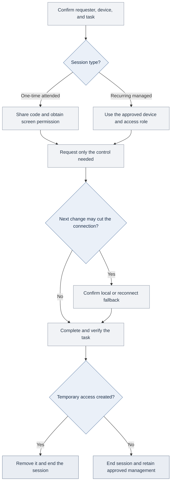

[INTA](https://github.com/Herbertofury/INTA/wiki) / [Decision desk](https://github.com/Herbertofury/INTA/wiki/Decision-Desk) · [Service map](https://github.com/Herbertofury/INTA/wiki/Service-Map) · [Playbooks](https://github.com/Herbertofury/INTA/wiki/Playbooks) · [Tools](https://github.com/Herbertofury/INTA/wiki/Tool-Directory) · [Methods](https://github.com/Herbertofury/INTA/wiki/Methods) · [Open hub](https://herbertofury.github.io/INTA/)

# [Start and finish a clean remote-support session](https://github.com/Herbertofury/INTA/wiki/Job-remote-support)

Choose the right attended or managed tool and leave a clear, auditable handoff.

**[Remote support](https://github.com/Herbertofury/INTA/wiki/Job-remote-support)** · Starter · 5–15 min setup · 9 steps

[Tools and useful links](#working-kit) · [Quick answer](#quick-answer) · [Next action](#next-action) · [Specific fixes](#specific-fixes) · [Decision route](#decision-route) · [Tools](#toolkit) · [Procedure](#walkthrough) · [Verification](#acceptance) · [Sources](#sources) · [Interactive checklist](https://herbertofury.github.io/INTA/#job/remote-support)

## 🧰 Choose the tool for this job

Choose by the task shown in the first column. Each option includes its acquisition route and access boundary.

| Need | Official tool + exact action | Why this choice / access |
| --- | --- | --- |
| **Attended [Windows](https://www.microsoft.com/windows) help** | **[Microsoft Quick Assist](https://learn.microsoft.com/en-us/windows/client-management/client-tools/quick-assist)** · **[Get Quick Assist in Microsoft Store](https://apps.microsoft.com/detail/9P7BP5VNWKX5)** | Use a short-lived approved session with a user present to share and authorize control. **Access:** Included app; helper Microsoft account required. |
| **Cross-platform support** | **[RustDesk](https://rustdesk.com/)** · **[Download Windows x64 · EXE](https://github.com/rustdesk/rustdesk/releases/download/1.5.3/rustdesk-1.5.3-x86_64.exe)** | Use the approved client/server configuration for cross-platform desktop support. **Access:** Open-source components; Pro and hosting costs vary. |
| **Existing managed fleet** | **[MeshCentral](https://meshcentral.com/)** · **[Open server installation instructions](https://github.com/Ylianst/MeshCentral#installation)** | Use the organization’s existing server and enrolled device for managed access. **Access:** Open source; hosting and operation are separate. |
| **[Linux](https://www.kernel.org/) remote client** | **[Remmina](https://remmina.org/)** · **[Install Linux package · Flatpak or distribution](https://www.remmina.org/how-to-install-remmina/)** | Connect a [Linux](https://www.kernel.org/) technician workstation to an already configured RDP, VNC or SSH service. **Access:** Free and open source |

**[Current selection evidence](https://github.com/Herbertofury/INTA/wiki/Current-Tool-Choices)**

## 🧰 Tools and links for this job

**[Open working view](https://herbertofury.github.io/INTA/#job/remote-support)** · Keep the tool panel beside the instructions.

**First move:** Confirm the user and helper through the existing support channel. Decide whether the session is attended or requires an approved managed agent.

| Use this for | Official tool + exact action |
| --- | --- |
| One-time attended [Windows](https://www.microsoft.com/windows) help. | **[Microsoft Quick Assist](https://learn.microsoft.com/en-us/windows/client-management/client-tools/quick-assist)** · [Official page](https://learn.microsoft.com/en-us/windows/client-management/client-tools/quick-assist) · **[Get Quick Assist in Microsoft Store](https://apps.microsoft.com/detail/9P7BP5VNWKX5)** |
| Approved cross-platform or self-hosted support. | **[RustDesk](https://rustdesk.com/)** · [Official page](https://rustdesk.com/) · **[Download Windows x64 · EXE](https://github.com/rustdesk/rustdesk/releases/download/1.5.3/rustdesk-1.5.3-x86_64.exe)** |
| Existing managed-device access and service oversight. | **[MeshCentral](https://meshcentral.com/)** · [Official page](https://meshcentral.com/) · **[Open server installation instructions](https://github.com/Ylianst/MeshCentral#installation)** |
| Connecting a [Linux](https://www.kernel.org/) technician workstation to an already configured remote desktop or server. | **[Remmina](https://remmina.org/)** · [Official page](https://remmina.org/) · **[Install Linux package · Flatpak or distribution](https://www.remmina.org/how-to-install-remmina/)** |

### Attended session

| Open the exact resource | What to do there |
| --- | --- |
| **[Quick Assist support-staff workflow](https://learn.microsoft.com/en-us/windows/client-management/client-tools/quick-assist)** | Code, helper sign-in, user approval and audit-log limits. |

### Approved alternative

| Open the exact resource | What to do there |
| --- | --- |
| **[RustDesk platform instructions](https://rustdesk.com/docs/en/)** | Use the approved server and required platform permissions. |

### Managed access

| Open the exact resource | What to do there |
| --- | --- |
| **[MeshCentral administration](https://docs.meshcentral.com/)** | Use the organization’s existing device group and access controls. |

## ⚡ Quick answer

### 🖥️ Help remotely

**Confirm the user and support technician through the existing support channel before sharing a session code.**

1. Open [Microsoft Quick Assist](https://learn.microsoft.com/en-us/windows/client-management/client-tools/quick-assist) on both [Windows](https://www.microsoft.com/windows) PCs; the helper signs in and supplies the temporary code.
2. Have the user approve screen sharing and any separately requested control before making the agreed change.
3. Test the original task with the user, end the session and record the work in the service ticket.

**[Microsoft Quick Assist](https://learn.microsoft.com/en-us/windows/client-management/client-tools/quick-assist)** · [Official page](https://learn.microsoft.com/en-us/windows/client-management/client-tools/quick-assist) · **[Get Quick Assist in Microsoft Store](https://apps.microsoft.com/detail/9P7BP5VNWKX5)**

## 🧭 Match the symptom

| You see this | Do this next | You should get |
| --- | --- | --- |
| **A [Windows](https://www.microsoft.com/windows) user is present and can approve a session** | Open [Microsoft Quick Assist](https://learn.microsoft.com/en-us/windows/client-management/client-tools/quick-assist) on both PCs, exchange the temporary code and have the user approve sharing and any separate control request. | The correct screen is visible and the user understands the control state. |
| **The task requires unattended access or durable audit records** | Use the approved managed tool and existing device identity; verify the technician’s role before connecting. | The session is tied to the intended asset and required audit record. |
| **Elevation or a secure-desktop prompt blocks work** | Have the authorized local user respond or use the approved managed elevation workflow; do not ask for credentials in chat. | The required action is approved without disclosing credentials or bypassing consent. |
| **The repair appears complete** | Repeat the original task with the user, end the session and remove any case-only access setting. | The user confirms the outcome and temporary control has ended. |

### ✅ Finish the job

- [ ] The original task works in the user’s session.
- [ ] The session is closed and authorized persistent access is documented.

**Change route when:** The user/helper identity or device target cannot be verified. · Requested access exceeds the approved session or exposes an active compromise.

### 🎯 Go straight to a specific fix

- **[Move a required file through an approved route](#fix-remote-copy-route-not-proven)** — Screen control works, but the required installer or diagnostic file cannot be transferred.
- **[Restore Mac screen sharing and control](#fix-remote-mac-screen-or-control-permission)** — A [RustDesk](https://rustdesk.com/) session connects to a Mac but the screen is blank or input does not work.
- **[Avoid losing the session during a restart](#fix-remote-reboot-needs-a-reconnect-plan)** — The next repair requires rebooting, changing the network adapter or restarting security software.

> [!NOTE]
> **Start here.** Confirm the customer, intended device, and requested task through the established service channel before exchanging a session code.

## 🧭 Choose a route

**Route links:** [Continue this workflow](#walkthrough) · [Acceptance checks](#acceptance) · [Start here: triage any computer problem](https://github.com/Herbertofury/INTA/wiki/Job-intake-triage) · [Fix internet, DNS, or local-network problems](https://github.com/Herbertofury/INTA/wiki/Job-network-dns) · [Close a repair with a clear client handoff](https://github.com/Herbertofury/INTA/wiki/Job-client-handoff)

| Checkpoint | What to carry forward |
| --- | --- |
| **Before changing anything** | Confirm identity, device, scope, and a reconnection fallback. |
| **Keep during the job** | Session tool, access scope, changes, and user acceptance. |
| **Before handing back** | Session ended; temporary access removed; managed access scoped. |

## Recommended tools

Select a tool for the next diagnostic or repair step. Check its platform, access and licensing requirements before use.

| Tool / official page + download | Use it for | Platform & access | Documentation |
| --- | --- | --- | --- |
| **[Microsoft Quick Assist](https://learn.microsoft.com/en-us/windows/client-management/client-tools/quick-assist)** · [Official page](https://learn.microsoft.com/en-us/windows/client-management/client-tools/quick-assist) · **[Get Quick Assist in Microsoft Store](https://apps.microsoft.com/detail/9P7BP5VNWKX5)** | One-time attended [Windows](https://www.microsoft.com/windows) help. | [Windows](https://www.microsoft.com/windows); Free Microsoft app | [Open guide](https://learn.microsoft.com/en-us/windows/client-management/client-tools/quick-assist) |
| **[RustDesk](https://rustdesk.com/)** · [Official page](https://rustdesk.com/) · **[Download Windows x64 · EXE](https://github.com/rustdesk/rustdesk/releases/download/1.5.3/rustdesk-1.5.3-x86_64.exe)** | Approved cross-platform or self-hosted support. | [Windows](https://www.microsoft.com/windows), [Linux](https://www.kernel.org/), [macOS](https://support.apple.com/macos); Open-source components; paid Server Pro features | [Open guide](https://rustdesk.com/docs/en/) |
| **[MeshCentral](https://meshcentral.com/)** · [Official page](https://meshcentral.com/) · **[Open server installation instructions](https://github.com/Ylianst/MeshCentral#installation)** | Existing managed-device access and service oversight. | [Windows](https://www.microsoft.com/windows), [Linux](https://www.kernel.org/), [macOS](https://support.apple.com/macos); Free / open source; hosting has a cost | [Open guide](https://docs.meshcentral.com/) |
| **[Chrome Remote Desktop](https://remotedesktop.google.com/)** · [Official page](https://remotedesktop.google.com/) · **[Open remote support](https://remotedesktop.google.com/support)** | Attended support or an explicitly configured personal remote-access endpoint. | [Windows](https://www.microsoft.com/windows), [Linux](https://www.kernel.org/), [macOS](https://support.apple.com/macos); Free service | [Open guide](https://support.google.com/chrome/answer/1649523) |
| **[Remmina](https://remmina.org/)** · [Official page](https://remmina.org/) · **[Install Linux package · Flatpak or distribution](https://www.remmina.org/how-to-install-remmina/)** | Connecting a [Linux](https://www.kernel.org/) technician workstation to an already configured remote desktop or server. | [Linux](https://www.kernel.org/); Free and open source under GPL-2.0-or-later | [Open guide](https://www.remmina.org/how-to-install-remmina/) |

## Procedure

Work in order, record the result of each step, and change route when the evidence calls for it.

### 01 · Choose the session type

- [ ] For a one-time [Windows](https://www.microsoft.com/windows) session, [Quick Assist](https://learn.microsoft.com/en-us/windows/client-management/client-tools/quick-assist) offers attended sharing and a separate control request. Use the organization’s approved [RustDesk](https://rustdesk.com/) or [MeshCentral](https://meshcentral.com/) deployment for recurring managed support. Cross-platform support needs a tool explicitly supporting both endpoints. Apply [remote capability preflight](https://github.com/Herbertofury/INTA/wiki/Job-remote-support) before choosing: identify who will be present, both operating systems, the required control and file-transfer capabilities, how elevated prompts will be handled, and the approved end state for access. Use the [Tool Selection](https://github.com/Herbertofury/INTA/wiki/Tool-Selection) guide for the decision matrix.

### 02 · Use an official client and the right endpoint

- [ ] Open the tool from the official catalog link or the already managed installation. Confirm the device label with the user and close unrelated sensitive windows. Do not install a second unattended agent merely to avoid fixing an existing approved connection.

### 03 · Prove the needed capabilities before repair

- [ ] Start in the least-permissive mode that supports the task. Test pointer or view access, a harmless control action if needed, the approved transfer route, and the reconnect plan before changing the machine. [Quick Assist](https://learn.microsoft.com/en-us/windows/client-management/client-tools/quick-assist) is an attended [Windows](https://www.microsoft.com/windows) path for INTA; its [macOS](https://support.apple.com/macos) client and browser support path are restricted to Microsoft Support. For [Chrome Remote Desktop](https://remotedesktop.google.com/), distinguish the one-use support code from persistent PIN-based access, and keep the user available for renewed sharing confirmation.

### 04 · Connect with the user present

- [ ] For [Quick Assist](https://learn.microsoft.com/en-us/windows/client-management/client-tools/quick-assist), the helper shares the code, the recipient allows screen sharing, and the helper requests control separately. Explain the immediate action before taking control. Let the user enter passwords or handle protected prompts when the tool requires it.

### 05 · Transfer only the files required for this case

- [ ] Agree on file direction, destination, scope and retention before transfer. Prefer an official publisher download on the target for installers. Use an approved private transfer channel for diagnostic evidence; do not copy unrelated customer folders. [RustDesk](https://rustdesk.com/) has a file-transfer permission, while [MeshCentral](https://meshcentral.com/) exposes a separate Files channel. Enable only the needed capability and confirm the actual transfer on the selected clients. The presence of a desktop session alone does not prove the transfer route works.

### 06 · Maintain a recovery path

- [ ] Before a reboot, adapter change, VPN modification, or security-product restart, confirm how the session will resume and whether someone can act locally. Record work in the private ticket and capture only the evidence needed for the repair.

### 07 · Handle recurring access deliberately

- [ ] For an explicitly managed endpoint, use named technician accounts, the deployment’s access roles, MFA where supported, and a documented device owner. Review existing access rather than sharing one permanent password across coworkers.

### 08 · Close and verify

- [ ] Ask the user to perform the original task, end the session, and remove temporary access if it was created only for this case. Confirm any approved persistent agent remains assigned to the correct customer and that the user knows how to contact support again.

### 09 · Leave evidence that access matches the agreement

- [ ] Perform [temporary access revocation](https://github.com/Herbertofury/INTA/wiki/Job-remote-support): close desktop, file and terminal channels; end the support session; remove any one-case unattended credential or temporary enrollment through the approved workflow. Record the ended-session time and access removed, without storing codes or passwords in the ticket. If continuing access is authorized, record its named owner, device group, scope and review date instead. A closed browser tab is not evidence that an installed agent or permanent credential was removed. Use [Service Evidence](https://github.com/Herbertofury/INTA/wiki/Service-Evidence) for the acceptance record.

## Verification

- [ ] The intended device was reached and the user’s original task succeeds.
- [ ] The session is ended and temporary access is removed.
- [ ] Persistent access, if requested, has a named owner and correct access scope.
- [ ] The chosen client, platform, user-presence model, transfer route and reconnect behavior were checked before the repair.
- [ ] The transfer record states purpose and destination, and case-only files or access have a documented retention or removal decision.
- [ ] Desktop, file and terminal channels are closed; any continuing access is explicitly owned and authorized.

> [!WARNING]
> **Pause this route and escalate when:**
> - The device or caller identity does not match the service request.
> - The next action could disconnect a critical system without a local recovery path.
> - The requested session would create unattended access, expose files, or use a business plan outside the agreed service scope.

## 🎯 Specific fixes

Choose the case that matches the evidence. Each case gives a first action, a short procedure and a result to prove.

### Move a required file through an approved route

**Use when:** Screen control works, but the required installer or diagnostic file cannot be transferred.

**Start here:** Confirm the exact file, transfer direction and approved destination with the user.

**[Microsoft Quick Assist](https://learn.microsoft.com/en-us/windows/client-management/client-tools/quick-assist)** · [Official page](https://learn.microsoft.com/en-us/windows/client-management/client-tools/quick-assist) · **[Get Quick Assist in Microsoft Store](https://apps.microsoft.com/detail/9P7BP5VNWKX5)**

**[RustDesk](https://rustdesk.com/)** · [Official page](https://rustdesk.com/) · **[Download Windows x64 · EXE](https://github.com/rustdesk/rustdesk/releases/download/1.5.3/rustdesk-1.5.3-x86_64.exe)**

**[MeshCentral](https://meshcentral.com/)** · [Official page](https://meshcentral.com/) · **[Open server installation instructions](https://github.com/Ylianst/MeshCentral#installation)**

1. For an installer, open the verified publisher link on the target PC where possible instead of assuming clipboard copy is file transfer.
2. For private evidence, verify the chosen client’s file-transfer capability and permission or use the approved private transfer service.
3. Check the received file’s identity and readable content, then apply the agreed retention/removal decision.

**Prove it worked:** The intended file reaches the correct private destination without copying unrelated customer data.

**If this does not resolve it:** If the selected session lacks the necessary capability, change to an approved route; do not deploy an unplanned unattended agent.

**Official evidence:** [Source 1](https://learn.microsoft.com/en-us/windows/client-management/client-tools/quick-assist) · [Source 2](https://rustdesk.com/docs/en/client/) · [Source 3](https://github.com/Ylianst/MeshCentral) · Reviewed 2026-11-26

[Back to specific fixes](#specific-fixes) · [Full procedure](#walkthrough)

### Restore Mac screen sharing and control

**Use when:** A [RustDesk](https://rustdesk.com/) session connects to a Mac but the screen is blank or input does not work.

**Start here:** Have the authorized local user inspect the permissions on the controlled Mac.

**[RustDesk](https://rustdesk.com/)** · [Official page](https://rustdesk.com/) · **[Download Windows x64 · EXE](https://github.com/rustdesk/rustdesk/releases/download/1.5.3/rustdesk-1.5.3-x86_64.exe)**

1. Follow the current [RustDesk](https://rustdesk.com/) [macOS](https://support.apple.com/macos) installation guidance, including the intended Applications location and helper installation where required.
2. Grant the required Screen Recording and Accessibility permissions in System Settings > Privacy & Security; apply any documented Input Monitoring requirement for that setup.
3. Restart the app/session when prompted and test screen visibility and one harmless control action.

**Prove it worked:** The correct screen is visible and the authorized control action works with the user’s consent.

**If this does not resolve it:** If local approval is unavailable or management policy blocks the permission, arrange an approved local/managed-support path instead of bypassing it.

**Official evidence:** [Source 1](https://rustdesk.com/docs/en/client/mac/) · Reviewed 2026-11-26

[Back to specific fixes](#specific-fixes) · [Full procedure](#walkthrough)

### Avoid losing the session during a restart

**Use when:** The next repair requires rebooting, changing the network adapter or restarting security software.

**Start here:** Agree how the user and technician will reconnect before making the change.

**[Microsoft Quick Assist](https://learn.microsoft.com/en-us/windows/client-management/client-tools/quick-assist)** · [Official page](https://learn.microsoft.com/en-us/windows/client-management/client-tools/quick-assist) · **[Get Quick Assist in Microsoft Store](https://apps.microsoft.com/detail/9P7BP5VNWKX5)**

**[MeshCentral](https://meshcentral.com/)** · [Official page](https://meshcentral.com/) · **[Open server installation instructions](https://github.com/Ylianst/MeshCentral#installation)**

**[RustDesk](https://rustdesk.com/)** · [Official page](https://rustdesk.com/) · **[Download Windows x64 · EXE](https://github.com/rustdesk/rustdesk/releases/download/1.5.3/rustdesk-1.5.3-x86_64.exe)**

1. For an attended code-based session, keep the user available to reopen the app and approve a new connection when needed.
2. For existing managed access, verify the assigned device, service startup and approved reconnect behavior before restarting.
3. After reconnecting, confirm the same machine and user context and retest the original repair outcome.

**Prove it worked:** The session resumes through the agreed route without creating unplanned permanent access.

**If this does not resolve it:** If the only connection would be lost and no local person or recovery channel exists, defer the disruptive action.

**Official evidence:** [Source 1](https://learn.microsoft.com/en-us/windows/client-management/client-tools/quick-assist) · [Source 2](https://github.com/Ylianst/MeshCentral) · Reviewed 2026-11-26

[Back to specific fixes](#specific-fixes) · [Full procedure](#walkthrough)

## Related playbooks

| Next playbook | What it resolves |
| --- | --- |
| [Start here: triage any computer problem](https://github.com/Herbertofury/INTA/wiki/Job-intake-triage) | Turn a vague symptom into a clear next action, a protected data set, and a useful service record. |
| [Fix internet, DNS, or local-network problems](https://github.com/Herbertofury/INTA/wiki/Job-network-dns) | Locate the failing layer before resetting adapters or changing the whole network. |
| [Close a repair with a clear client handoff](https://github.com/Herbertofury/INTA/wiki/Job-client-handoff) | Turn completed technical work into proof the customer can use, with clean access and an actionable service record. |

## Official sources

- [Microsoft: Quick Assist](https://support.microsoft.com/en-us/windows/apps/solve-pc-problems-remotely-using-quick-assist)
- [Microsoft: Quick Assist requirements and enterprise limitations](https://learn.microsoft.com/en-us/windows/client-management/client-tools/quick-assist)
- [Google: support codes, confirmation and removal of remote access](https://support.google.com/chrome/answer/1649523)
- [RustDesk: incoming permissions](https://rustdesk.com/docs/en/self-host/client-configuration/advanced-settings/)
- [MeshCentral: desktop, files and events](https://docs.meshcentral.com/meshcentral/devicetabs/)
- [INTA: Tool Selection](https://github.com/Herbertofury/INTA/wiki/Tool-Selection)
- [INTA: Service Evidence](https://github.com/Herbertofury/INTA/wiki/Service-Evidence)

Reviewed **2026-11-26**. Timing is a planning range. A successful command is evidence about that operation; acceptance belongs to the user’s original task.

---

Editorial review: **2026-11-26** · [Review standard](https://github.com/Herbertofury/INTA/wiki/Knowledge-Standards) · [Suggest a correction](https://github.com/Herbertofury/INTA/issues/new/choose)
