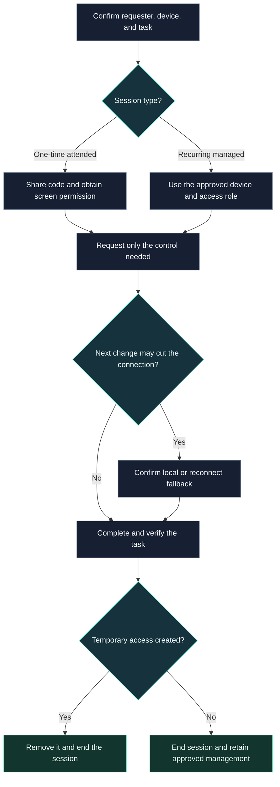

[🏠 Home](https://github.com/Herbertofury/INTA/wiki) · [🧭 Decision desk](https://github.com/Herbertofury/INTA/wiki/Decision-Desk) · [📚 Playbooks](https://github.com/Herbertofury/INTA/wiki/Playbooks) · [🧰 Tool directory](https://github.com/Herbertofury/INTA/wiki/Tool-Directory) · [✨ Open interactive hub](https://herbertofury.github.io/INTA/)

# 🖥️ [Start and finish a clean remote-support session](https://github.com/Herbertofury/INTA/wiki/Job-remote-support)

Choose the right attended or managed tool and leave a clear, auditable handoff.

| Work area | Experience | Plan your time | Workflow |
| --- | --- | --- | --- |
| [Remote support](https://github.com/Herbertofury/INTA/wiki/Job-remote-support) | Starter | 5–15 min setup | 6 steps + acceptance |

**[▶ Open the interactive checklist](https://herbertofury.github.io/INTA/#job/remote-support)** · [Decision route](#decision-route) · [Toolkit](#toolkit) · [Walkthrough](#walkthrough) · [Acceptance](#acceptance) · [Sources](#sources)

> [!TIP]
> **Your starting move:** Confirm the customer, intended device, and requested task through the established service channel before exchanging a session code.

## 🧭 Choose the right branch

**Diagram routes:** [Continue this workflow](#walkthrough) · [Acceptance checks](#acceptance) · [Start here: triage any computer problem](https://github.com/Herbertofury/INTA/wiki/Job-intake-triage) · [Fix internet, DNS, or local-network problems](https://github.com/Herbertofury/INTA/wiki/Job-network-dns) · [Close a repair with a clear client handoff](https://github.com/Herbertofury/INTA/wiki/Job-client-handoff)

| Checkpoint | What to carry forward |
| --- | --- |
| **Before changing anything** | Confirm identity, device, scope, and a reconnection fallback. |
| **Keep during the job** | Session tool, access scope, changes, and user acceptance. |
| **Before handing back** | Session ended; temporary access removed; managed access scoped. |

## 🧰 Build the right toolkit

Choose the tools that answer the case’s next question. Opening a tool is a separate decision from changing the customer’s system.

| Tool / official download | Use it for | Platform & access | Documentation |
| --- | --- | --- | --- |
| [Microsoft Quick Assist](https://apps.microsoft.com/detail/9P7BP5VNWKX5) | A quick one-time [Windows](https://www.microsoft.com/windows) support session without deploying an RMM agent. | [Windows](https://www.microsoft.com/windows); Free Microsoft app | [Open guide](https://learn.microsoft.com/en-us/windows/client-management/client-tools/quick-assist) |
| [RustDesk](https://github.com/rustdesk/rustdesk/releases/latest) | A flexible remote-control option across mixed client platforms. | [Windows](https://www.microsoft.com/windows), [Linux](https://www.kernel.org/), [macOS](https://support.apple.com/macos); Open-source components; paid Server Pro features | [Open guide](https://rustdesk.com/docs/en/) |
| [MeshCentral](https://github.com/Ylianst/MeshCentral) | INTA-managed unattended support with its own server and device groups. | [Windows](https://www.microsoft.com/windows), [Linux](https://www.kernel.org/), [macOS](https://support.apple.com/macos); Free / open source; hosting has a cost | [Open guide](https://docs.meshcentral.com/) |
| [Chrome Remote Desktop](https://remotedesktop.google.com/support) | Attended support or an explicitly configured personal remote-access endpoint. | [Windows](https://www.microsoft.com/windows), [Linux](https://www.kernel.org/), [macOS](https://support.apple.com/macos); Free service | [Open guide](https://support.google.com/chrome/answer/1649523) |

## 🪜 Work the case

Work in order, record the result of each step, and change route when the evidence calls for it.

### 01 · Choose the session type

- [ ] For a one-time [Windows](https://www.microsoft.com/windows) session, [Quick Assist](https://learn.microsoft.com/en-us/windows/client-management/client-tools/quick-assist) offers attended sharing and a separate control request. Use the organization’s approved [RustDesk](https://rustdesk.com/) or [MeshCentral](https://meshcentral.com/) deployment for recurring managed support. Cross-platform support needs a tool explicitly supporting both endpoints.

### 02 · Use an official client and the right endpoint

- [ ] Open the tool from the official catalog link or the already managed installation. Confirm the device label with the user and close unrelated sensitive windows. Do not install a second unattended agent merely to avoid fixing an existing approved connection.

### 03 · Connect with the user present

- [ ] For [Quick Assist](https://learn.microsoft.com/en-us/windows/client-management/client-tools/quick-assist), the helper shares the code, the recipient allows screen sharing, and the helper requests control separately. Explain the immediate action before taking control. Let the user enter passwords or handle protected prompts when the tool requires it.

### 04 · Maintain a recovery path

- [ ] Before a reboot, adapter change, VPN modification, or security-product restart, confirm how the session will resume and whether someone can act locally. Record work in the private ticket and capture only the evidence needed for the repair.

### 05 · Handle recurring access deliberately

- [ ] For an explicitly managed endpoint, use named technician accounts, the deployment’s access roles, MFA where supported, and a documented device owner. Review existing access rather than sharing one permanent password across coworkers.

### 06 · Close and verify

- [ ] Ask the user to perform the original task, end the session, and remove temporary access if it was created only for this case. Confirm any approved persistent agent remains assigned to the correct customer and that the user knows how to contact support again.

## ✅ Prove the result

- [ ] The intended device was reached and the user’s original task succeeds.
- [ ] The session is ended and temporary access is removed.
- [ ] Persistent access, if requested, has a named owner and correct access scope.

> [!WARNING]
> **Pause this route and escalate when:**
> - The device or caller identity does not match the service request.
> - The next action could disconnect a critical system without a local recovery path.

## 🔀 Continue with the evidence

| Next playbook | What it resolves |
| --- | --- |
| [Start here: triage any computer problem](https://github.com/Herbertofury/INTA/wiki/Job-intake-triage) | Turn a vague symptom into a clear next action, a protected data set, and a useful service record. |
| [Fix internet, DNS, or local-network problems](https://github.com/Herbertofury/INTA/wiki/Job-network-dns) | Locate the failing layer before resetting adapters or changing the whole network. |
| [Close a repair with a clear client handoff](https://github.com/Herbertofury/INTA/wiki/Job-client-handoff) | Turn completed technical work into proof the customer can use, with clean access and an actionable service record. |

Found a reusable improvement? [Contribute the correction](https://github.com/Herbertofury/INTA/wiki/Contribute) and include the test that proved it.

## 🔎 Source trail

Official references and editorial review

- [Microsoft: Quick Assist](https://support.microsoft.com/en-us/windows/apps/solve-pc-problems-remotely-using-quick-assist)

Reviewed **2026-11-26**. Timing is a planning range. A successful command is evidence about that operation; acceptance belongs to the user’s original task.

---

**Source review: 2026-11-26.** Guidance review and tool release versions are separate. [Report a correction](https://github.com/Herbertofury/INTA/issues/new/choose) · [How we maintain this guide](https://github.com/Herbertofury/INTA/wiki/Knowledge-Standards)
