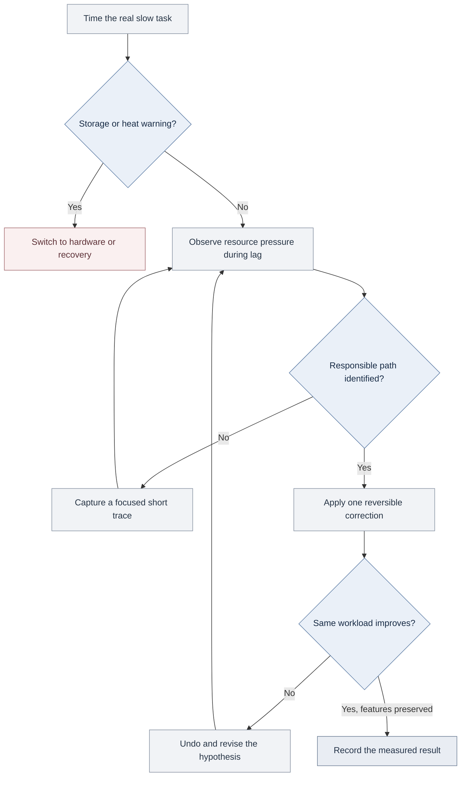

[INTA](https://github.com/Herbertofury/INTA/wiki) / [Decision desk](https://github.com/Herbertofury/INTA/wiki/Decision-Desk) · [Service map](https://github.com/Herbertofury/INTA/wiki/Service-Map) · [Playbooks](https://github.com/Herbertofury/INTA/wiki/Playbooks) · [Tools](https://github.com/Herbertofury/INTA/wiki/Tool-Directory) · [Methods](https://github.com/Herbertofury/INTA/wiki/Methods) · [Open hub](https://herbertofury.github.io/INTA/)

<a id="-diagnose-a-slow-freezing-or-hitching-pc"></a>

# [Diagnose a slow, freezing, or hitching PC](https://github.com/Herbertofury/INTA/wiki/Job-slow-pc)

Find the actual bottleneck and prove the improvement with the same workload.

**[Windows](https://www.microsoft.com/windows) & performance** · Intermediate · 20–60 min · 6 steps

[Tools and useful links](#working-kit) · [Quick answer](#quick-answer) · [Next action](#next-action) · [Specific fixes](#specific-fixes) · [Decision route](#decision-route) · [Tools](#toolkit) · [Procedure](#walkthrough) · [Verification](#acceptance) · [Sources](#sources) · [Interactive checklist](https://herbertofury.github.io/INTA/#job/slow-pc)

<a id="tool-choices"></a>

## 🧰 Choose the tool for this job

Choose by the task shown in the first column. Each option includes its acquisition route and access boundary.

| Need | Official tool + exact action | Why this choice / access |
| --- | --- | --- |
| **Find the busy process** | **[Process Explorer](https://learn.microsoft.com/en-us/sysinternals/downloads/process-explorer)** · **[Download Windows portable · ZIP](https://download.sysinternals.com/files/ProcessExplorer.zip)** | Identify the process responsible for sustained CPU, memory or handle pressure before changing software. **Access:** Free Microsoft utility |
| **Explain an I/O stall** | **[Process Monitor](https://learn.microsoft.com/en-us/sysinternals/downloads/procmon)** · **[Download Windows portable · ZIP](https://download.sysinternals.com/files/ProcessMonitor.zip)** | Capture a short filtered trace of the reproducible file or registry delay. **Access:** Free Microsoft utility |
| **Check storage warnings** | **[CrystalDiskInfo](https://crystalmark.info/en/software/crystaldiskinfo/)** · **[Get Windows ZIP · 9.9.5](https://sourceforge.net/projects/crystaldiskinfo/files/9.9.5/CrystalDiskInfo9_9_5.zip/download)** | Check supported drive-health indicators before ordinary performance repair or stress tests. **Access:** Free and open source |
| **Complete diagnostic kit** | **[Microsoft Sysinternals Suite](https://learn.microsoft.com/en-us/sysinternals/)** · **[Download Windows portable · ZIP](https://download.sysinternals.com/files/SysinternalsSuite.zip)** | Keep the full utility suite available when the next evidence-backed branch needs another component. **Access:** Free Microsoft utilities |

**[Current selection evidence](https://github.com/Herbertofury/INTA/wiki/Current-Tool-Choices)**

<a id="working-kit"></a>

## 🧰 Tools and links for this job

**[Open working view](https://herbertofury.github.io/INTA/#job/slow-pc)** · Keep the tool panel beside the instructions.

**First move:** Time one slow action. Press Ctrl+Shift+Esc and watch CPU, memory and disk while reproducing it; check drive health before a heavy scan.

| Use this for | Official tool + exact action |
| --- | --- |
| Identify the busy process and its owner. | **[Process Explorer](https://learn.microsoft.com/en-us/sysinternals/downloads/process-explorer)** · [Official page](https://learn.microsoft.com/en-us/sysinternals/downloads/process-explorer) · **[Download Windows portable · ZIP](https://download.sysinternals.com/files/ProcessExplorer.zip)** |
| Capture a short, filtered file or registry stall. | **[Process Monitor](https://learn.microsoft.com/en-us/sysinternals/downloads/procmon)** · [Official page](https://learn.microsoft.com/en-us/sysinternals/downloads/procmon) · **[Download Windows portable · ZIP](https://download.sysinternals.com/files/ProcessMonitor.zip)** |
| Explain capacity use on healthy storage. | **[WinDirStat](https://windirstat.net/)** · [Official page](https://windirstat.net/) · **[Download Windows x64 · MSI](https://github.com/windirstat/windirstat/releases/download/release/v2.9.3/WinDirStat-x64.msi)** |
| Separate storage warnings from ordinary software lag. | **[CrystalDiskInfo](https://crystalmark.info/en/software/crystaldiskinfo/)** · [Official page](https://crystalmark.info/en/software/crystaldiskinfo/) · **[Get Windows ZIP · 9.9.5](https://sourceforge.net/projects/crystaldiskinfo/files/9.9.5/CrystalDiskInfo9_9_5.zip/download)** |
| Collecting battery and sleep evidence before changing hardware or power policy. | **[powercfg](https://learn.microsoft.com/en-us/windows-hardware/design/device-experiences/powercfg-command-line-options)** · [Official page](https://learn.microsoft.com/en-us/windows-hardware/design/device-experiences/powercfg-command-line-options) · **[Open built-in battery and sleep diagnostics](https://learn.microsoft.com/en-us/windows-hardware/design/device-experiences/powercfg-command-line-options)** |
| Measure a reproducible storage-performance problem on healthy media with a bounded test file. | **[DiskSpd](https://github.com/microsoft/diskspd)** · [Official page](https://github.com/microsoft/diskspd) · **[Download Windows x64/ARM64 tools · ZIP](https://github.com/microsoft/diskspd/releases/download/v2.3/DiskSpd.ZIP)** |
| Keep the full utility suite available when the next evidence-backed branch needs another component. | **[Microsoft Sysinternals Suite](https://learn.microsoft.com/en-us/sysinternals/)** · [Official page](https://learn.microsoft.com/en-us/sysinternals/) · **[Download Windows portable · ZIP](https://download.sysinternals.com/files/SysinternalsSuite.zip)** |
| Use its supported disk analysis when the technician has the appropriate commercial entitlement. | **[WizTree](https://diskanalyzer.com/)** · [Official page](https://diskanalyzer.com/) · **[Download Windows portable · ZIP](https://diskanalyzer.com/files/wiztree_4_34_portable.zip)** |

### Find the cause

| Open the exact resource | What to do there |
| --- | --- |
| **[Process Explorer usage](https://learn.microsoft.com/en-us/sysinternals/downloads/process-explorer)** | Inspect the exact process before stopping or changing it. |
| **[Process Monitor filtering](https://learn.microsoft.com/en-us/sysinternals/downloads/procmon)** | Limit capture to the affected process and interval. |

### Advanced

| Open the exact resource | What to do there |
| --- | --- |
| **[Windows performance tracing](https://learn.microsoft.com/en-us/windows-hardware/test/wpt/)** | Use a measured trace when ordinary process views do not explain the delay. |

<a id="quick-answer"></a>

## ⚡ Quick answer

<a id="quick-slow-pc"></a>

### 🐢 Fix a slow PC

**Reproduce one slow task and check storage health before applying cleanup or startup changes.**

1. Use [Process Explorer](https://learn.microsoft.com/en-us/sysinternals/downloads/process-explorer) to identify the CPU, memory or I/O bottleneck during that task.
2. Inspect the relevant process or startup entry with [Microsoft Sysinternals Suite](https://learn.microsoft.com/en-us/sysinternals/) and make one justified change.
3. Repeat the same task and compare its duration, resource use and responsiveness.

**[Microsoft Sysinternals Suite](https://learn.microsoft.com/en-us/sysinternals/)** · [Official page](https://learn.microsoft.com/en-us/sysinternals/) · **[Download Windows portable · ZIP](https://download.sysinternals.com/files/SysinternalsSuite.zip)**

<a id="quick-disk-space"></a>

### 📊 Free disk space

**Confirm the disk is healthy and choose the drive to inspect before deleting any files.**

1. Scan that drive with [WinDirStat](https://windirstat.net/) and identify the largest folders and file types.
2. Confirm ownership and recovery options, then remove only approved files or application-managed caches.
3. Recheck free space and open the affected application to confirm it still works.

**[WinDirStat](https://windirstat.net/)** · [Official page](https://windirstat.net/) · **[Download Windows x64 · MSI](https://github.com/windirstat/windirstat/releases/download/release/v2.9.3/WinDirStat-x64.msi)**

<a id="next-action"></a>

## 🧭 Match the symptom

| You see this | Do this next | You should get |
| --- | --- | --- |
| **CPU stays high during the slow task** | Sort by CPU in [Task Manager](https://support.microsoft.com/en-us/windows/experience/system-configuration-tools-in-windows); inspect the identified process in [Process Explorer](https://learn.microsoft.com/en-us/sysinternals/downloads/process-explorer) and check its image path and owner. | One process or service correlates with the delay. |
| **Memory pressure rises as responsiveness falls** | Check [Task Manager](https://support.microsoft.com/en-us/windows/experience/system-configuration-tools-in-windows) > Performance > Memory, then close an agreed nonessential workload and repeat the task. | The before/after result distinguishes workload pressure from another cause. |
| **Disk activity stalls the system** | Check health first; on stable media use a short [Process Monitor](https://learn.microsoft.com/en-us/sysinternals/downloads/procmon) capture filtered to the affected process and path. | The slow I/O path is identified, or failing storage is routed to recovery. |
| **The healthy system drive is nearly full** | Use [WinDirStat](https://windirstat.net/) to identify the largest owned folders; remove only approved content through supported cleanup controls. | Free space improves and the original application still works. |
| **Only a task using a share or online service is slow** | Compare an approved local equivalent and follow the network guide for the remote dependency. | The evidence separates local performance from service or network latency. |

### ✅ Finish the job

- [ ] The same workload has a recorded before/after result.
- [ ] The improvement survives restart without breaking protection, backup or required apps.

**Change route when:** Drive disconnects, read errors or physical damage appear. · A proposed optimization disables required functionality without evidence.

### 🎯 Go straight to a specific fix

- **[Separate useful cache from memory pressure](#fix-slow-pc-standby-memory-is-not-a-leak)** — A PC shows high memory use and someone proposes a RAM-cleaning utility.
- **[Find the optional app delaying sign-in](#fix-slow-pc-startup-app-delay)** — The desktop appears quickly but the user must wait before starting normal work.
- **[Find what an app is waiting for](#fix-slow-pc-filter-a-short-io-trace)** — One application freezes while disk or network-file activity continues.
- **[Explain a laptop that slows down on battery](#fix-slow-pc-only-on-battery)** — The same application is responsive on AC power but slow when unplugged.

> [!NOTE]
> **Start here.** Reproduce the exact slow action and measure it before changing anything. Ask whether the slowdown began after an update, new drive, app, or security product.

<a id="decision-route"></a>

<a id="-choose-the-right-branch"></a>

## 🧭 Choose a route



**Route links:** [Continue this workflow](#walkthrough) · [Acceptance checks](#acceptance) · [Rescue data from a failing or unreadable drive](https://github.com/Herbertofury/INTA/wiki/Job-failing-drive) · [Diagnose crashes, blue screens, and overheating](https://github.com/Herbertofury/INTA/wiki/Job-hardware-bsod) · [Repair Windows component or system-file corruption](https://github.com/Herbertofury/INTA/wiki/Job-windows-repair) · [Run a useful workstation maintenance visit](https://github.com/Herbertofury/INTA/wiki/Job-preventive-maintenance)

| Checkpoint | What to carry forward |
| --- | --- |
| **Before changing anything** | Save a comparable baseline and check storage health. |
| **Keep during the job** | Workload timings, resource evidence, trace scope, and one change at a time. |
| **Before handing back** | Repeatable improvement with all required functions retained. |

<a id="toolkit"></a>

<a id="-build-the-right-toolkit"></a>

## Recommended tools

Select a tool for the next diagnostic or repair step. Check its platform, access and licensing requirements before use.

| Tool / official page + download | Use it for | Platform & access | Documentation |
| --- | --- | --- | --- |
| **[Process Explorer](https://learn.microsoft.com/en-us/sysinternals/downloads/process-explorer)** · [Official page](https://learn.microsoft.com/en-us/sysinternals/downloads/process-explorer) · **[Download Windows portable · ZIP](https://download.sysinternals.com/files/ProcessExplorer.zip)** | Identify the busy process and its owner. | [Windows](https://www.microsoft.com/windows); Free Microsoft utility | [Open guide](https://learn.microsoft.com/en-us/sysinternals/downloads/process-explorer) |
| **[Process Monitor](https://learn.microsoft.com/en-us/sysinternals/downloads/procmon)** · [Official page](https://learn.microsoft.com/en-us/sysinternals/downloads/procmon) · **[Download Windows portable · ZIP](https://download.sysinternals.com/files/ProcessMonitor.zip)** | Capture a short, filtered file or registry stall. | [Windows](https://www.microsoft.com/windows); Free Microsoft utility | [Open guide](https://learn.microsoft.com/en-us/sysinternals/downloads/procmon) |
| **[WinDirStat](https://windirstat.net/)** · [Official page](https://windirstat.net/) · **[Download Windows x64 · MSI](https://github.com/windirstat/windirstat/releases/download/release/v2.9.3/WinDirStat-x64.msi)** | Explain capacity use on healthy storage. | [Windows](https://www.microsoft.com/windows); Free / open source | [Open guide](https://github.com/windirstat/windirstat) |
| **[CrystalDiskInfo](https://crystalmark.info/en/software/crystaldiskinfo/)** · [Official page](https://crystalmark.info/en/software/crystaldiskinfo/) · **[Get Windows ZIP · 9.9.5](https://sourceforge.net/projects/crystaldiskinfo/files/9.9.5/CrystalDiskInfo9_9_5.zip/download)** | Separate storage warnings from ordinary software lag. | [Windows](https://www.microsoft.com/windows); Free / open source | [Open guide](https://crystalmark.info/en/software/crystaldiskinfo/) |
| **[Microsoft Sysinternals Suite](https://learn.microsoft.com/en-us/sysinternals/)** · [Official page](https://learn.microsoft.com/en-us/sysinternals/) · **[Download Windows portable · ZIP](https://download.sysinternals.com/files/SysinternalsSuite.zip)** | Keep the full utility suite available when the next evidence-backed branch needs another component. | [Windows](https://www.microsoft.com/windows); Free Microsoft utilities | [Open guide](https://learn.microsoft.com/en-us/sysinternals/downloads/) |
| **[HWiNFO](https://www.hwinfo.com/)** · [Official page](https://www.hwinfo.com/) · **[Download Windows x64 EXE](https://www.hwinfo.com/files/hwi64_860.exe)** | Investigating temperatures, clocks, power and component identity. | [Windows](https://www.microsoft.com/windows); Pro license for commercial use of 64/ARM64 editions | [Open guide](https://www.hwinfo.com/licenses/) |
| **[Windows Performance Toolkit](https://learn.microsoft.com/en-us/windows-hardware/test/wpt/)** · [Official page](https://learn.microsoft.com/en-us/windows-hardware/test/wpt/) · **[Download Windows ADK setup · EXE](https://go.microsoft.com/fwlink/?linkid=2289980)** | Investigating intermittent CPU, storage or application responsiveness problems with evidence. | [Windows](https://www.microsoft.com/windows); Free Microsoft toolkit | [Open guide](https://learn.microsoft.com/en-us/windows-hardware/test/wpt/) |
| **[WizTree](https://diskanalyzer.com/)** · [Official page](https://diskanalyzer.com/) · **[Download Windows portable · ZIP](https://diskanalyzer.com/files/wiztree_4_34_portable.zip)** | Use its supported disk analysis when the technician has the appropriate commercial entitlement. | [Windows](https://www.microsoft.com/windows), [macOS](https://support.apple.com/macos), [Linux](https://www.kernel.org/); Free for personal use; commercial supporter or enterprise license required by business site and staff size. | [Open guide](https://diskanalyzer.com/about) |
| **[WizFile](https://antibody-software.com/wizfile/)** · [Official page](https://antibody-software.com/wizfile/) · **[Download Windows portable · ZIP](https://antibody-software.com/files/wizfile_3_15_portable.zip)** | Locating a known file, log or recently changed group of files without guessing its folder. | [Windows](https://www.microsoft.com/windows); Free for personal use; commercial supporter or enterprise license required by business site and staff size. | [Open guide](https://antibody-software.com/wizfile/quick-start) |
| **[powercfg](https://learn.microsoft.com/en-us/windows-hardware/design/device-experiences/powercfg-command-line-options)** · [Official page](https://learn.microsoft.com/en-us/windows-hardware/design/device-experiences/powercfg-command-line-options) · **[Open built-in battery and sleep diagnostics](https://learn.microsoft.com/en-us/windows-hardware/design/device-experiences/powercfg-command-line-options)** | Collecting battery and sleep evidence before changing hardware or power policy. | [Windows](https://www.microsoft.com/windows); Included with [Windows](https://www.microsoft.com/windows) | [Open guide](https://learn.microsoft.com/en-us/windows-hardware/design/device-experiences/powercfg-command-line-options) |
| **[DiskSpd](https://github.com/microsoft/diskspd)** · [Official page](https://github.com/microsoft/diskspd) · **[Download Windows x64/ARM64 tools · ZIP](https://github.com/microsoft/diskspd/releases/download/v2.3/DiskSpd.ZIP)** | Measure a reproducible storage-performance problem on healthy media with a bounded test file. | [Windows](https://www.microsoft.com/windows), [Windows Server](https://learn.microsoft.com/en-us/windows-server/); Free and open source under MIT license | [Open guide](https://github.com/microsoft/diskspd/wiki) |

<a id="walkthrough"></a>

<a id="-work-the-case"></a>

## Procedure

Work in order, record the result of each step, and change route when the evidence calls for it.

<a id="step-01"></a>

### 01 · Capture a repeatable baseline

- [ ] Time sign-in and the specific failing task separately. Note AC power, current applications, storage connections, network state, and background updates. Repeat the same short workload after each change so an apparent improvement is comparable.

<a id="step-02"></a>

### 02 · Inspect pressure while the lag happens

- [ ] Use [Task Manager](https://support.microsoft.com/en-us/windows/experience/system-configuration-tools-in-windows) or [Resource Monitor](https://learn.microsoft.com/en-us/windows-server/administration/windows-commands/perfmon) to identify CPU, committed memory, disk response, and network pressure. A high percentage alone is not a diagnosis: correlate it with the lag and the responsible process, path, or service.

**Command for the environment described above:**

```text
resmon
```

**Command legend:** [Resource Monitor](https://learn.microsoft.com/en-us/windows-server/administration/windows-commands/perfmon) · [Return to the step context](#step-02).

<a id="step-03"></a>

### 03 · Check storage and hardware first

- [ ] Review drive health and temperatures. If a disk disappears, clicks, reports I/O errors, or stalls the system when accessed, stop repair scans and use the failing-drive guide. Check a suspect external drive separately after outstanding writes have finished; preserve the user’s files. For a healthy drive with a capacity problem, use [WizTree](https://diskanalyzer.com/) to identify the largest folders and distinguish allocation from the specific files the user needs. Use [WizFile](https://antibody-software.com/wizfile/) when the question is where a named file, log or recently changed file lives. Neither lookup proves that an item should be deleted; record the owner and retention need before using supported cleanup controls.

<a id="step-04"></a>

### 04 · Trace the responsible application

- [ ] Use [Process Explorer](https://learn.microsoft.com/en-us/sysinternals/downloads/process-explorer) for process detail and a short, filtered [Process Monitor](https://learn.microsoft.com/en-us/sysinternals/downloads/procmon) capture for file or registry stalls. Capture only the affected interval, stop recording, and save the trace privately. Inspect missing paths, repeated failures, or excessive work before choosing a fix. [Microsoft Sysinternals Suite](https://learn.microsoft.com/en-us/sysinternals/) supplies these process and I/O diagnostics; it answers a different question from a disk-space treemap or filename lookup.

<a id="step-05"></a>

### 05 · Apply one reversible correction

- [ ] Fix the observed cause: a failing device, incompatible driver, misconfigured backup, unwanted startup app, or software regression. Use vendor-supported settings. Do not apply blanket registry cleaners, remove needed services, or disable endpoint protection simply to improve a benchmark.

<a id="step-06"></a>

### 06 · Measure and keep the evidence

- [ ] Repeat the baseline workload with the same data and conditions. Check functionality, responsiveness, and resource use together. Restore changes that did not help and record the measured before/after result plus anything still reproducible.

<a id="acceptance"></a>

<a id="-prove-the-result"></a>

## Verification

- [ ] The original task is measurably faster or the root cause is clearly identified.
- [ ] Required applications, protection, backup, and peripherals still work.
- [ ] The improvement survives a restart and the normal user workload.
- [ ] If capacity or file location was part of the problem, the identified path, ownership decision and before/after free-space or task result are recorded.

> [!WARNING]
> **Pause this route and escalate when:**
> - Storage-health symptoms appear during testing.
> - A proposed optimization removes required functionality or only hides the symptom.

<a id="specific-fixes"></a>

## 🎯 Specific fixes

Choose the case that matches the evidence. Each case gives a first action, a short procedure and a result to prove.

<a id="fix-slow-pc-standby-memory-is-not-a-leak"></a>

### Separate useful cache from memory pressure

**Use when:** A PC shows high memory use and someone proposes a RAM-cleaning utility.

**Start here:** Reproduce the slowdown while watching [Task Manager](https://support.microsoft.com/en-us/windows/experience/system-configuration-tools-in-windows) > Performance > Memory.

**[RAMMap](https://learn.microsoft.com/en-us/sysinternals/downloads/rammap)** · [Official page](https://learn.microsoft.com/en-us/sysinternals/downloads/rammap) · **[Download Windows portable · ZIP](https://download.sysinternals.com/files/RAMMap.zip)**

**[Process Explorer](https://learn.microsoft.com/en-us/sysinternals/downloads/process-explorer)** · [Official page](https://learn.microsoft.com/en-us/sysinternals/downloads/process-explorer) · **[Download Windows portable · ZIP](https://download.sysinternals.com/files/ProcessExplorer.zip)**

1. Compare available memory and committed memory with the workload; use [RAMMap](https://learn.microsoft.com/en-us/sysinternals/downloads/rammap) to distinguish active usage from standby/file-cache pages.
2. Close one agreed nonessential application and repeat the same task, keeping the before/after observations.
3. If one process grows repeatedly without releasing memory, collect its identity and reproduction for the application owner rather than routinely emptying caches.

**Prove it worked:** The evidence identifies actual workload pressure or a growing process, rather than treating every cached page as lost RAM.

**If this does not resolve it:** If memory pressure does not correlate with the delay, return to CPU, storage and network evidence.

**Official evidence:** [Source 1](https://learn.microsoft.com/en-us/sysinternals/downloads/rammap) · Reviewed 2026-11-26

[Back to specific fixes](#specific-fixes) · [Full procedure](#walkthrough)

<a id="fix-slow-pc-startup-app-delay"></a>

### Find the optional app delaying sign-in

**Use when:** The desktop appears quickly but the user must wait before starting normal work.

**Start here:** Time the same sign-in-to-ready task before making changes.

**[Autoruns](https://learn.microsoft.com/en-us/sysinternals/downloads/autoruns)** · [Official page](https://learn.microsoft.com/en-us/sysinternals/downloads/autoruns) · **[Download Windows portable · ZIP](https://download.sysinternals.com/files/Autoruns.zip)**

1. Open [Task Manager](https://support.microsoft.com/en-us/windows/experience/system-configuration-tools-in-windows) > Startup apps and record enabled entries and their reported impact.
2. Disable one agreed optional item, keeping required security, accessibility and managed-support software in place, then repeat the same restart/sign-in test.
3. Keep only the evidenced change, and re-enable entries that did not improve the measured task.

**Prove it worked:** The user’s real ready-to-work time improves and required background functions still run.

**If this does not resolve it:** If delays occur before sign-in or persist with the candidate disabled, investigate boot, domain, storage or profile dependencies.

**Official evidence:** [Source 1](https://support.microsoft.com/en-us/windows/experience/startup-boot/configure-startup-applications-in-windows) · Reviewed 2026-11-26

[Back to specific fixes](#specific-fixes) · [Full procedure](#walkthrough)

<a id="fix-slow-pc-filter-a-short-io-trace"></a>

### Find what an app is waiting for

**Use when:** One application freezes while disk or network-file activity continues.

**Start here:** Check storage health before recording a short trace on healthy storage.

**[Process Monitor](https://learn.microsoft.com/en-us/sysinternals/downloads/procmon)** · [Official page](https://learn.microsoft.com/en-us/sysinternals/downloads/procmon) · **[Download Windows portable · ZIP](https://download.sysinternals.com/files/ProcessMonitor.zip)**

**[CrystalDiskInfo](https://crystalmark.info/en/software/crystaldiskinfo/)** · [Official page](https://crystalmark.info/en/software/crystaldiskinfo/) · **[Get Windows ZIP · 9.9.5](https://sourceforge.net/projects/crystaldiskinfo/files/9.9.5/CrystalDiskInfo9_9_5.zip/download)**

1. In [Process Monitor](https://learn.microsoft.com/en-us/sysinternals/downloads/procmon), filter to the affected process and reproduce the pause once; stop capture immediately afterward.
2. Compare the pause time with repeated file, registry or network-path operations and their durations; a single ACCESS DENIED or NAME NOT FOUND is not automatically the cause.
3. Test the specific blocked path or dependency, then repeat the same application action with the scoped correction.

**Prove it worked:** A particular wait or repeated failing operation correlates with the freeze and the corrected task is measurably better.

**If this does not resolve it:** Escalate an unresolved trace to the application owner with a private, bounded capture; stop tracing if the disk becomes unstable.

**Official evidence:** [Source 1](https://learn.microsoft.com/en-us/sysinternals/downloads/procmon) · Reviewed 2026-11-26

[Back to specific fixes](#specific-fixes) · [Full procedure](#walkthrough)

<a id="fix-slow-pc-only-on-battery"></a>

### Explain a laptop that slows down on battery

**Use when:** The same application is responsive on AC power but slow when unplugged.

**Start here:** Repeat a short, identical workload on the approved charger and on battery.

**[Official OEM driver and firmware portals](https://support.microsoft.com/en-us/windows/hardware/drivers/update-drivers-through-device-manager-in-windows)** · [Official page](https://support.microsoft.com/en-us/windows/hardware/drivers/update-drivers-through-device-manager-in-windows) · **[Find the correct driver source](https://support.microsoft.com/en-us/windows/hardware/drivers/update-drivers-through-device-manager-in-windows)**

**[Libre Hardware Monitor](https://github.com/LibreHardwareMonitor/LibreHardwareMonitor)** · [Official page](https://github.com/LibreHardwareMonitor/LibreHardwareMonitor) · **[Download Windows portable · ZIP](https://github.com/LibreHardwareMonitor/LibreHardwareMonitor/releases/download/v0.9.6/LibreHardwareMonitor.zip)**

1. Inspect Settings > System > Power & battery for the active power mode and energy-saving state.
2. Check whether the charger is recognized and suitable for the model; record any low-power or charging warning.
3. Choose an approved power mode for the workload and retest without disabling thermal or battery protections.

**Prove it worked:** The performance difference is tied to an observed power state, charger issue or policy rather than an unexplained cleanup change.

**If this does not resolve it:** If performance drops while hot or on a correctly rated charger, investigate cooling, battery condition or firmware using the exact OEM guidance.

**Official evidence:** [Source 1](https://support.microsoft.com/en-us/windows/experience/change-the-power-mode-for-your-windows-pc) · Reviewed 2026-11-26

[Back to specific fixes](#specific-fixes) · [Full procedure](#walkthrough)


<a id="-continue-with-the-evidence"></a>

## Related playbooks

| Next playbook | What it resolves |
| --- | --- |
| [Rescue data from a failing or unreadable drive](https://github.com/Herbertofury/INTA/wiki/Job-failing-drive) | Preserve the source, create a recoverable image, and perform recovery on a copy. |
| [Diagnose crashes, blue screens, and overheating](https://github.com/Herbertofury/INTA/wiki/Job-hardware-bsod) | Correlate crash evidence with memory, storage, temperature, power, and driver changes. |
| [Repair Windows component or system-file corruption](https://github.com/Herbertofury/INTA/wiki/Job-windows-repair) | Use [Windows](https://www.microsoft.com/windows) servicing tools in a sensible order and validate the specific broken feature. |
| [Run a useful workstation maintenance visit](https://github.com/Herbertofury/INTA/wiki/Job-preventive-maintenance) | Check security, updates, hardware, backups, and usability without unnecessary cleanup rituals. |

<a id="sources"></a>

<a id="-source-trail"></a>

## Official sources

- [Microsoft Sysinternals: Process Explorer](https://learn.microsoft.com/en-us/sysinternals/downloads/process-explorer/)
- [Microsoft Sysinternals: Process Monitor](https://learn.microsoft.com/en-us/sysinternals/downloads/procmon)
- [Microsoft: Sysinternals Suite](https://learn.microsoft.com/en-us/sysinternals/downloads/sysinternals-suite)
- [WizTree: disk-space analysis and export](https://diskanalyzer.com/about)
- [WizFile: search filters and shutdown](https://antibody-software.com/wizfile/quick-start)

Reviewed **2026-11-26**. Timing is a planning range. A successful command is evidence about that operation; acceptance belongs to the user’s original task.


---

Editorial review: **2026-11-26** · [Review standard](https://github.com/Herbertofury/INTA/wiki/Knowledge-Standards) · [Suggest a correction](https://github.com/Herbertofury/INTA/issues/new/choose)
