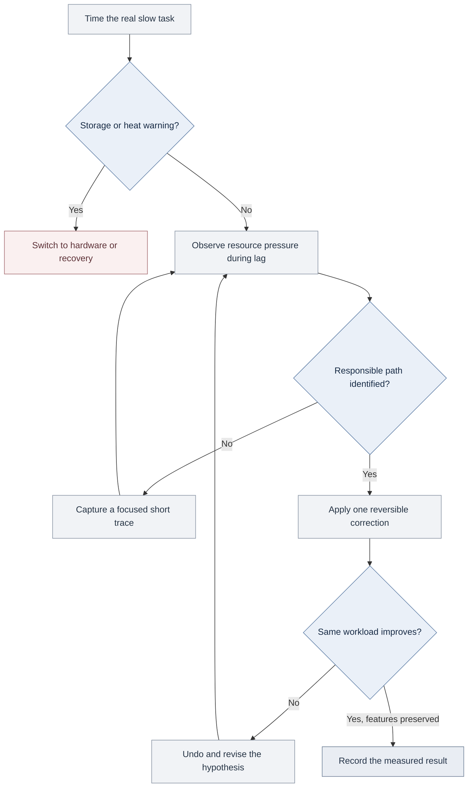

[INTA](https://github.com/Herbertofury/INTA/wiki) / [Decision desk](https://github.com/Herbertofury/INTA/wiki/Decision-Desk) · [Playbooks](https://github.com/Herbertofury/INTA/wiki/Playbooks) · [Tools](https://github.com/Herbertofury/INTA/wiki/Tool-Directory) · [Methods](https://github.com/Herbertofury/INTA/wiki/Methods) · [Open hub](https://herbertofury.github.io/INTA/)

<a id="-diagnose-a-slow-freezing-or-hitching-pc"></a>

# [Diagnose a slow, freezing, or hitching PC](https://github.com/Herbertofury/INTA/wiki/Job-slow-pc)

Find the actual bottleneck and prove the improvement with the same workload.

**[Windows](https://www.microsoft.com/windows) & performance** · Intermediate · 20–60 min · 6 steps

[Quick answer](#quick-answer) · [Decision route](#decision-route) · [Tools](#toolkit) · [Procedure](#walkthrough) · [Verification](#acceptance) · [Sources](#sources) · [Interactive checklist](https://herbertofury.github.io/INTA/#job/slow-pc)

<a id="quick-answer"></a>

## ⚡ Quick answer

<a id="quick-slow-pc"></a>

### 🐢 Fix a slow PC

**Reproduce one slow task and check storage health before applying cleanup or startup changes.**

1. Use [Process Explorer](https://learn.microsoft.com/en-us/sysinternals/downloads/process-explorer) to identify the CPU, memory or I/O bottleneck during that task.
2. Inspect the relevant process or startup entry with [Microsoft Sysinternals Suite](https://learn.microsoft.com/en-us/sysinternals/) and make one justified change.
3. Repeat the same task and compare its duration, resource use and responsiveness.

**[Microsoft Sysinternals Suite](https://learn.microsoft.com/en-us/sysinternals/)** · [Official page](https://learn.microsoft.com/en-us/sysinternals/) · **[Download Windows portable · ZIP](https://download.sysinternals.com/files/SysinternalsSuite.zip)**

<a id="quick-disk-space"></a>

### 📊 Free disk space

**Confirm the disk is healthy and choose the drive to inspect before deleting any files.**

1. Scan that drive with [WinDirStat](https://windirstat.net/) and identify the largest folders and file types.
2. Confirm ownership and recovery options, then remove only approved files or application-managed caches.
3. Recheck free space and open the affected application to confirm it still works.

**[WinDirStat](https://windirstat.net/)** · [Official page](https://windirstat.net/) · **[Download Windows x64 · MSI](https://github.com/windirstat/windirstat/releases/download/release/v2.9.3/WinDirStat-x64.msi)**

> [!NOTE]
> **Start here.** Reproduce the exact slow action and measure it before changing anything. Ask whether the slowdown began after an update, new drive, app, or security product.

<a id="decision-route"></a>

<a id="-choose-the-right-branch"></a>

## 🧭 Choose a route

<details>
<summary>View the decision map and escalation routes</summary>



**Route links:** [Continue this workflow](#walkthrough) · [Acceptance checks](#acceptance) · [Rescue data from a failing or unreadable drive](https://github.com/Herbertofury/INTA/wiki/Job-failing-drive) · [Diagnose crashes, blue screens, and overheating](https://github.com/Herbertofury/INTA/wiki/Job-hardware-bsod) · [Repair Windows component or system-file corruption](https://github.com/Herbertofury/INTA/wiki/Job-windows-repair) · [Run a useful workstation maintenance visit](https://github.com/Herbertofury/INTA/wiki/Job-preventive-maintenance)

</details>

| Checkpoint | What to carry forward |
| --- | --- |
| **Before changing anything** | Save a comparable baseline and check storage health. |
| **Keep during the job** | Workload timings, resource evidence, trace scope, and one change at a time. |
| **Before handing back** | Repeatable improvement with all required functions retained. |

<a id="toolkit"></a>

<a id="-build-the-right-toolkit"></a>

## Recommended tools

Select a tool for the next diagnostic or repair step. Check its platform, access and licensing requirements before use.

| Tool / official page + download | Use it for | Platform & access | Documentation |
| --- | --- | --- | --- |
| **[Microsoft Sysinternals Suite](https://learn.microsoft.com/en-us/sysinternals/)** · [Official page](https://learn.microsoft.com/en-us/sysinternals/) · **[Download Windows portable · ZIP](https://download.sysinternals.com/files/SysinternalsSuite.zip)** | The core portable [Windows](https://www.microsoft.com/windows) troubleshooting kit. | [Windows](https://www.microsoft.com/windows); Free Microsoft utilities | [Open guide](https://learn.microsoft.com/en-us/sysinternals/downloads/) |
| **[CrystalDiskInfo](https://crystalmark.info/en/software/crystaldiskinfo/)** · [Official page](https://crystalmark.info/en/software/crystaldiskinfo/) · **[Get Windows ZIP · 9.9.5](https://sourceforge.net/projects/crystaldiskinfo/files/9.9.5/CrystalDiskInfo9_9_5.zip/download)** | First-pass HDD and SSD health inspection in [Windows](https://www.microsoft.com/windows). | [Windows](https://www.microsoft.com/windows); Free / open source | [Open guide](https://crystalmark.info/en/software/crystaldiskinfo/) |
| **[HWiNFO](https://www.hwinfo.com/)** · [Official page](https://www.hwinfo.com/) · **[Download Windows x64 EXE](https://www.hwinfo.com/files/hwi64_860.exe)** | Investigating temperatures, clocks, power and component identity. | [Windows](https://www.microsoft.com/windows); Pro license for commercial use of 64/ARM64 editions | [Open guide](https://www.hwinfo.com/licenses/) |
| **[Windows Performance Toolkit](https://learn.microsoft.com/en-us/windows-hardware/test/wpt/)** · [Official page](https://learn.microsoft.com/en-us/windows-hardware/test/wpt/) · **[Download Windows ADK setup · EXE](https://go.microsoft.com/fwlink/?linkid=2289980)** | Investigating intermittent CPU, storage or application responsiveness problems with evidence. | [Windows](https://www.microsoft.com/windows); Free Microsoft toolkit | [Open guide](https://learn.microsoft.com/en-us/windows-hardware/test/wpt/) |
| **[WizTree](https://diskanalyzer.com/)** · [Official page](https://diskanalyzer.com/) · **[Download Windows portable · ZIP](https://diskanalyzer.com/files/wiztree_4_34_portable.zip)** | Finding the folders and files responsible for a capacity problem before selecting an approved cleanup. | [Windows](https://www.microsoft.com/windows), [macOS](https://support.apple.com/macos), [Linux](https://www.kernel.org/); Free for personal use; commercial supporter or enterprise license required by business site and staff size. | [Open guide](https://diskanalyzer.com/about) |
| **[WizFile](https://antibody-software.com/wizfile/)** · [Official page](https://antibody-software.com/wizfile/) · **[Download Windows portable · ZIP](https://antibody-software.com/files/wizfile_3_15_portable.zip)** | Locating a known file, log or recently changed group of files without guessing its folder. | [Windows](https://www.microsoft.com/windows); Free for personal use; commercial supporter or enterprise license required by business site and staff size. | [Open guide](https://antibody-software.com/wizfile/quick-start) |

<a id="walkthrough"></a>

<a id="-work-the-case"></a>

## Procedure

Work in order, record the result of each step, and change route when the evidence calls for it.

<a id="step-01"></a>

### 01 · Capture a repeatable baseline

- [ ] Time sign-in and the specific failing task separately. Note AC power, current applications, storage connections, network state, and background updates. Repeat the same short workload after each change so an apparent improvement is comparable.

<a id="step-02"></a>

### 02 · Inspect pressure while the lag happens

- [ ] Use [Task Manager](https://support.microsoft.com/en-us/windows/experience/system-configuration-tools-in-windows) or [Resource Monitor](https://learn.microsoft.com/en-us/windows-server/administration/windows-commands/perfmon) to identify CPU, committed memory, disk response, and network pressure. A high percentage alone is not a diagnosis: correlate it with the lag and the responsible process, path, or service.

**Command for the environment described above:**

```text
resmon
```

**Command legend:** [Resource Monitor](https://learn.microsoft.com/en-us/windows-server/administration/windows-commands/perfmon) · [Return to the step context](#step-02).

<a id="step-03"></a>

### 03 · Check storage and hardware first

- [ ] Review drive health and temperatures. If a disk disappears, clicks, reports I/O errors, or stalls the system when accessed, stop repair scans and use the failing-drive guide. Check a suspect external drive separately after outstanding writes have finished; preserve the user’s files. For a healthy drive with a capacity problem, use [WizTree](https://diskanalyzer.com/) to identify the largest folders and distinguish allocation from the specific files the user needs. Use [WizFile](https://antibody-software.com/wizfile/) when the question is where a named file, log or recently changed file lives. Neither lookup proves that an item should be deleted; record the owner and retention need before using supported cleanup controls.

<a id="step-04"></a>

### 04 · Trace the responsible application

- [ ] Use [Process Explorer](https://learn.microsoft.com/en-us/sysinternals/downloads/process-explorer) for process detail and a short, filtered [Process Monitor](https://learn.microsoft.com/en-us/sysinternals/downloads/procmon) capture for file or registry stalls. Capture only the affected interval, stop recording, and save the trace privately. Inspect missing paths, repeated failures, or excessive work before choosing a fix. [Microsoft Sysinternals Suite](https://learn.microsoft.com/en-us/sysinternals/) supplies these process and I/O diagnostics; it answers a different question from a disk-space treemap or filename lookup.

<a id="step-05"></a>

### 05 · Apply one reversible correction

- [ ] Fix the observed cause: a failing device, incompatible driver, misconfigured backup, unwanted startup app, or software regression. Use vendor-supported settings. Do not apply blanket registry cleaners, remove needed services, or disable endpoint protection simply to improve a benchmark.

<a id="step-06"></a>

### 06 · Measure and keep the evidence

- [ ] Repeat the baseline workload with the same data and conditions. Check functionality, responsiveness, and resource use together. Restore changes that did not help and record the measured before/after result plus anything still reproducible.

<a id="acceptance"></a>

<a id="-prove-the-result"></a>

## Verification

- [ ] The original task is measurably faster or the root cause is clearly identified.
- [ ] Required applications, protection, backup, and peripherals still work.
- [ ] The improvement survives a restart and the normal user workload.
- [ ] If capacity or file location was part of the problem, the identified path, ownership decision and before/after free-space or task result are recorded.

> [!WARNING]
> **Pause this route and escalate when:**
> - Storage-health symptoms appear during testing.
> - A proposed optimization removes required functionality or only hides the symptom.

<a id="-continue-with-the-evidence"></a>

## Related playbooks

| Next playbook | What it resolves |
| --- | --- |
| [Rescue data from a failing or unreadable drive](https://github.com/Herbertofury/INTA/wiki/Job-failing-drive) | Preserve the source, create a recoverable image, and perform recovery on a copy. |
| [Diagnose crashes, blue screens, and overheating](https://github.com/Herbertofury/INTA/wiki/Job-hardware-bsod) | Correlate crash evidence with memory, storage, temperature, power, and driver changes. |
| [Repair Windows component or system-file corruption](https://github.com/Herbertofury/INTA/wiki/Job-windows-repair) | Use [Windows](https://www.microsoft.com/windows) servicing tools in a sensible order and validate the specific broken feature. |
| [Run a useful workstation maintenance visit](https://github.com/Herbertofury/INTA/wiki/Job-preventive-maintenance) | Check security, updates, hardware, backups, and usability without unnecessary cleanup rituals. |

<a id="sources"></a>

<a id="-source-trail"></a>

## Official sources

<details>
<summary>References and review notes</summary>

- [Microsoft Sysinternals: Process Explorer](https://learn.microsoft.com/en-us/sysinternals/downloads/process-explorer/)
- [Microsoft Sysinternals: Process Monitor](https://learn.microsoft.com/en-us/sysinternals/downloads/procmon)
- [Microsoft: Sysinternals Suite](https://learn.microsoft.com/en-us/sysinternals/downloads/sysinternals-suite)
- [WizTree: disk-space analysis and export](https://diskanalyzer.com/about)
- [WizFile: search filters and shutdown](https://antibody-software.com/wizfile/quick-start)

Reviewed **2026-11-26**. Timing is a planning range. A successful command is evidence about that operation; acceptance belongs to the user’s original task.

</details>

---

Editorial review: **2026-11-26** · [Review standard](https://github.com/Herbertofury/INTA/wiki/Knowledge-Standards) · [Suggest a correction](https://github.com/Herbertofury/INTA/issues/new/choose)
