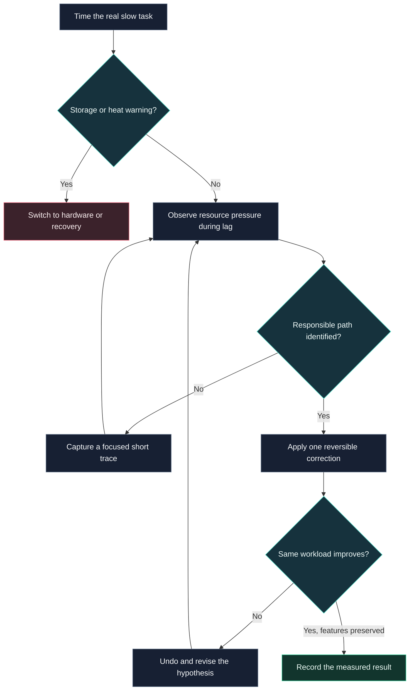

[🏠 Home](https://github.com/Herbertofury/INTA/wiki) · [🧭 Decision desk](https://github.com/Herbertofury/INTA/wiki/Decision-Desk) · [📚 Playbooks](https://github.com/Herbertofury/INTA/wiki/Playbooks) · [🧰 Tool directory](https://github.com/Herbertofury/INTA/wiki/Tool-Directory) · [✨ Open interactive hub](https://herbertofury.github.io/INTA/)

# ⚡ [Diagnose a slow, freezing, or hitching PC](https://github.com/Herbertofury/INTA/wiki/Job-slow-pc)

Find the actual bottleneck and prove the improvement with the same workload.

| Work area | Experience | Plan your time | Workflow |
| --- | --- | --- | --- |
| [Windows](https://www.microsoft.com/windows) & performance | Intermediate | 20–60 min | 6 steps + acceptance |

**[▶ Open the interactive checklist](https://herbertofury.github.io/INTA/#job/slow-pc)** · [Decision route](#decision-route) · [Toolkit](#toolkit) · [Walkthrough](#walkthrough) · [Acceptance](#acceptance) · [Sources](#sources)

> [!TIP]
> **Your starting move:** Reproduce the exact slow action and measure it before changing anything. Ask whether the slowdown began after an update, new drive, app, or security product.

<a id="decision-route"></a>

## 🧭 Choose the right branch



**Diagram routes:** [Continue this workflow](#walkthrough) · [Acceptance checks](#acceptance) · [Rescue data from a failing or unreadable drive](https://github.com/Herbertofury/INTA/wiki/Job-failing-drive) · [Diagnose crashes, blue screens, and overheating](https://github.com/Herbertofury/INTA/wiki/Job-hardware-bsod) · [Repair Windows component or system-file corruption](https://github.com/Herbertofury/INTA/wiki/Job-windows-repair) · [Run a useful workstation maintenance visit](https://github.com/Herbertofury/INTA/wiki/Job-preventive-maintenance)

| Checkpoint | What to carry forward |
| --- | --- |
| **Before changing anything** | Save a comparable baseline and check storage health. |
| **Keep during the job** | Workload timings, resource evidence, trace scope, and one change at a time. |
| **Before handing back** | Repeatable improvement with all required functions retained. |

<a id="toolkit"></a>

## 🧰 Build the right toolkit

Choose the tools that answer the case’s next question. Opening a tool is a separate decision from changing the customer’s system.

| Tool / official download | Use it for | Platform & access | Documentation |
| --- | --- | --- | --- |
| [Microsoft Sysinternals Suite](https://learn.microsoft.com/en-us/sysinternals/downloads/sysinternals-suite) | The core portable [Windows](https://www.microsoft.com/windows) troubleshooting kit. | [Windows](https://www.microsoft.com/windows); Free Microsoft utilities | [Open guide](https://learn.microsoft.com/en-us/sysinternals/downloads/) |
| [CrystalDiskInfo](https://crystalmark.info/en/download/) | First-pass HDD and SSD health inspection in [Windows](https://www.microsoft.com/windows). | [Windows](https://www.microsoft.com/windows); Free / open source | [Open guide](https://crystalmark.info/en/software/crystaldiskinfo/) |
| [HWiNFO](https://www.hwinfo.com/download/) | Investigating temperatures, clocks, power and component identity. | [Windows](https://www.microsoft.com/windows); Pro license for commercial use of 64/ARM64 editions | [Open guide](https://www.hwinfo.com/licenses/) |
| [Windows Performance Toolkit](https://learn.microsoft.com/en-us/windows-hardware/get-started/adk-install) | Investigating intermittent CPU, storage or application responsiveness problems with evidence. | [Windows](https://www.microsoft.com/windows); Free Microsoft toolkit | [Open guide](https://learn.microsoft.com/en-us/windows-hardware/test/wpt/) |

<a id="walkthrough"></a>

## 🪜 Work the case

Work in order, record the result of each step, and change route when the evidence calls for it.

<a id="step-01"></a>

### 01 · Capture a repeatable baseline

- [ ] Time sign-in and the specific failing task separately. Note AC power, current applications, storage connections, network state, and background updates. Repeat the same short workload after each change so an apparent improvement is comparable.

<a id="step-02"></a>

### 02 · Inspect pressure while the lag happens

- [ ] Use [Task Manager](https://support.microsoft.com/en-us/windows/experience/system-configuration-tools-in-windows) or [Resource Monitor](https://learn.microsoft.com/en-us/windows-server/administration/windows-commands/perfmon) to identify CPU, committed memory, disk response, and network pressure. A high percentage alone is not a diagnosis: correlate it with the lag and the responsible process, path, or service.

**Command for the environment described above:**

```text
resmon
```

**Command legend:** [Resource Monitor](https://learn.microsoft.com/en-us/windows-server/administration/windows-commands/perfmon) · [Return to the step context](#step-02).

<a id="step-03"></a>

### 03 · Check storage and hardware first

- [ ] Review drive health and temperatures. If a disk disappears, clicks, reports I/O errors, or stalls the system when accessed, stop repair scans and use the failing-drive guide. Check a suspect external drive separately after outstanding writes have finished; preserve the user’s files.

<a id="step-04"></a>

### 04 · Trace the responsible application

- [ ] Use [Process Explorer](https://learn.microsoft.com/en-us/sysinternals/downloads/process-explorer) for process detail and a short, filtered [Process Monitor](https://learn.microsoft.com/en-us/sysinternals/downloads/procmon) capture for file or registry stalls. Capture only the affected interval, stop recording, and save the trace privately. Inspect missing paths, repeated failures, or excessive work before choosing a fix.

<a id="step-05"></a>

### 05 · Apply one reversible correction

- [ ] Fix the observed cause: a failing device, incompatible driver, misconfigured backup, unwanted startup app, or software regression. Use vendor-supported settings. Do not apply blanket registry cleaners, remove needed services, or disable endpoint protection simply to improve a benchmark.

<a id="step-06"></a>

### 06 · Measure and keep the evidence

- [ ] Repeat the baseline workload with the same data and conditions. Check functionality, responsiveness, and resource use together. Restore changes that did not help and record the measured before/after result plus anything still reproducible.

<a id="acceptance"></a>

## ✅ Prove the result

- [ ] The original task is measurably faster or the root cause is clearly identified.
- [ ] Required applications, protection, backup, and peripherals still work.
- [ ] The improvement survives a restart and the normal user workload.

> [!WARNING]
> **Pause this route and escalate when:**
> - Storage-health symptoms appear during testing.
> - A proposed optimization removes required functionality or only hides the symptom.

## 🔀 Continue with the evidence

| Next playbook | What it resolves |
| --- | --- |
| [Rescue data from a failing or unreadable drive](https://github.com/Herbertofury/INTA/wiki/Job-failing-drive) | Preserve the source, create a recoverable image, and perform recovery on a copy. |
| [Diagnose crashes, blue screens, and overheating](https://github.com/Herbertofury/INTA/wiki/Job-hardware-bsod) | Correlate crash evidence with memory, storage, temperature, power, and driver changes. |
| [Repair Windows component or system-file corruption](https://github.com/Herbertofury/INTA/wiki/Job-windows-repair) | Use [Windows](https://www.microsoft.com/windows) servicing tools in a sensible order and validate the specific broken feature. |
| [Run a useful workstation maintenance visit](https://github.com/Herbertofury/INTA/wiki/Job-preventive-maintenance) | Check security, updates, hardware, backups, and usability without unnecessary cleanup rituals. |

Found a reusable improvement? [Contribute the correction](https://github.com/Herbertofury/INTA/wiki/Contribute) and include the test that proved it.

<a id="sources"></a>

## 🔎 Source trail

<details>
<summary>Official references and editorial review</summary>

- [Microsoft Sysinternals: Process Explorer](https://learn.microsoft.com/en-us/sysinternals/downloads/process-explorer/)
- [Microsoft Sysinternals: Process Monitor](https://learn.microsoft.com/en-us/sysinternals/downloads/procmon)

Reviewed **2026-11-26**. Timing is a planning range. A successful command is evidence about that operation; acceptance belongs to the user’s original task.

</details>

---

**Source review: 2026-11-26.** Guidance review and tool release versions are separate. [Report a correction](https://github.com/Herbertofury/INTA/issues/new/choose) · [How we maintain this guide](https://github.com/Herbertofury/INTA/wiki/Knowledge-Standards)
