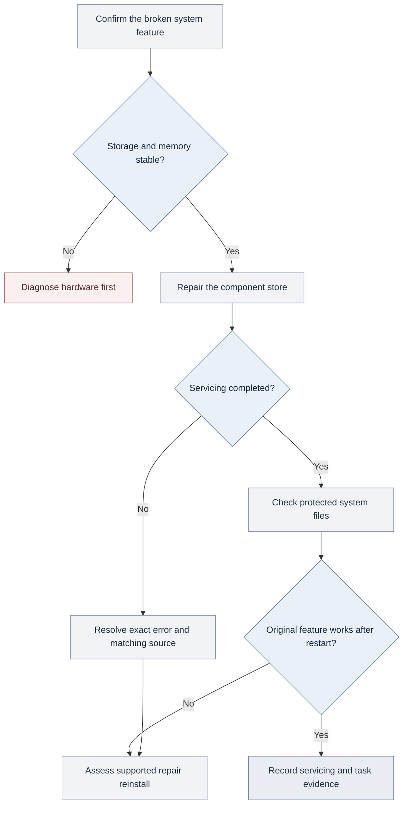

[INTA](https://github.com/Herbertofury/INTA/wiki) / [Decision desk](https://github.com/Herbertofury/INTA/wiki/Decision-Desk) · [Playbooks](https://github.com/Herbertofury/INTA/wiki/Playbooks) · [Tools](https://github.com/Herbertofury/INTA/wiki/Tool-Directory) · [Methods](https://github.com/Herbertofury/INTA/wiki/Methods) · [Open hub](https://herbertofury.github.io/INTA/)

<a id="-repair-windows-component-or-system-file-corruption"></a>

# [Repair Windows component or system-file corruption](https://github.com/Herbertofury/INTA/wiki/Job-windows-repair)

Use [Windows](https://www.microsoft.com/windows) servicing tools in a sensible order and validate the specific broken feature.

**[Windows](https://www.microsoft.com/windows) & performance** · Intermediate · 30–90 min · 6 steps

[Decision route](#decision-route) · [Tools](#toolkit) · [Procedure](#walkthrough) · [Verification](#acceptance) · [Sources](#sources) · [Interactive checklist](https://herbertofury.github.io/INTA/#job/windows-repair)

> [!NOTE]
> **Start here.** Confirm the drive is stable and the affected data is backed up. Repeated corruption or I/O errors need a hardware investigation first.

<a id="decision-route"></a>

<a id="-choose-the-right-branch"></a>

## 🧭 Choose a route

<details>
<summary>View the decision map and escalation routes</summary>



**Route links:** [Continue this workflow](#walkthrough) · [Acceptance checks](#acceptance) · [Fix a failing Windows update](https://github.com/Herbertofury/INTA/wiki/Job-windows-update) · [Recover a Windows PC that will not boot](https://github.com/Herbertofury/INTA/wiki/Job-boot-recovery) · [Diagnose crashes, blue screens, and overheating](https://github.com/Herbertofury/INTA/wiki/Job-hardware-bsod) · [Prove a backup can actually restore](https://github.com/Herbertofury/INTA/wiki/Job-backup-restore)

</details>

| Checkpoint | What to carry forward |
| --- | --- |
| **Before changing anything** | Confirm healthy storage, recoverable data, and the running installation. |
| **Keep during the job** | Servicing results, error codes, and relevant log excerpts. |
| **Before handing back** | The original [Windows](https://www.microsoft.com/windows) feature works after restart. |

<a id="toolkit"></a>

<a id="-build-the-right-toolkit"></a>

## Recommended tools

Select a tool for the next diagnostic or repair step. Check its platform, access and licensing requirements before use.

| Tool / official download | Use it for | Platform & access | Documentation |
| --- | --- | --- | --- |
| [DISM](https://learn.microsoft.com/en-us/windows-hardware/manufacture/desktop/repair-a-windows-image) | Component-store corruption and controlled image servicing. | [Windows](https://www.microsoft.com/windows); Included with [Windows](https://www.microsoft.com/windows) | [Open guide](https://learn.microsoft.com/en-us/windows-hardware/manufacture/desktop/repair-a-windows-image) |
| [System File Checker](https://learn.microsoft.com/en-us/windows-server/administration/windows-commands/sfc) | System-file corruption after establishing disk health and servicing status. | [Windows](https://www.microsoft.com/windows); Included with [Windows](https://www.microsoft.com/windows) | [Open guide](https://learn.microsoft.com/en-us/windows-server/administration/windows-commands/sfc) |
| [Windows Recovery Environment](https://learn.microsoft.com/en-us/windows-hardware/manufacture/desktop/windows-recovery-environment--windows-re--technical-reference) | A [Windows](https://www.microsoft.com/windows) machine that will not boot or needs supported recovery options. | [Windows](https://www.microsoft.com/windows); Included with [Windows](https://www.microsoft.com/windows) | [Open guide](https://learn.microsoft.com/en-us/windows-hardware/manufacture/desktop/windows-recovery-environment--windows-re--technical-reference) |

<a id="walkthrough"></a>

<a id="-work-the-case"></a>

## Procedure

Work in order, record the result of each step, and change route when the evidence calls for it.

<a id="step-01"></a>

### 01 · Record the exact failure

- [ ] Capture the app or [Windows](https://www.microsoft.com/windows) feature that fails, error code, OS build, recent changes, and available disk space. Save relevant event entries before repair. Confirm this is a [Windows](https://www.microsoft.com/windows) component problem rather than an application-only fault.

<a id="step-02"></a>

### 02 · Prepare the online [Windows](https://www.microsoft.com/windows) session

- [ ] Save work, finish a pending restart if practical, connect stable power, and open Terminal or [Command Prompt](https://learn.microsoft.com/en-us/windows-server/administration/windows-commands/cmd) as administrator. These commands target the currently running [Windows](https://www.microsoft.com/windows) installation. Do not paste them into [WinRE](https://learn.microsoft.com/en-us/windows-hardware/manufacture/desktop/windows-recovery-environment--windows-re--technical-reference) expecting them to repair an offline [Windows](https://www.microsoft.com/windows) volume.

<a id="step-03"></a>

### 03 · Repair the component store

- [ ] Run [DISM](https://learn.microsoft.com/en-us/windows-hardware/manufacture/desktop/repair-a-windows-image) and wait for its final result. If the repair source cannot be found, retain the error code and use Microsoft’s matching-source guidance; do not download replacement DLLs from a third-party site.

**Command for the environment described above:**

```text
DISM.exe /Online /Cleanup-Image /RestoreHealth
```

**Command legend:** [DISM](https://learn.microsoft.com/en-us/windows-hardware/manufacture/desktop/repair-a-windows-image) · [Return to the step context](#step-03).

<a id="step-04"></a>

### 04 · Check protected system files

- [ ] After [DISM](https://learn.microsoft.com/en-us/windows-hardware/manufacture/desktop/repair-a-windows-image) completes successfully, run [System File Checker](https://learn.microsoft.com/en-us/windows-server/administration/windows-commands/sfc). Record whether corruption was absent, repaired, or unresolved. Keep the relevant CBS and [DISM](https://learn.microsoft.com/en-us/windows-hardware/manufacture/desktop/repair-a-windows-image) log excerpts privately if escalation is needed.

**Command for the environment described above:**

```text
sfc /scannow
```

**Command legend:** [System File Checker](https://learn.microsoft.com/en-us/windows-server/administration/windows-commands/sfc) · [Return to the step context](#step-04).

<a id="step-05"></a>

### 05 · Reboot and retest the original feature

- [ ] Reproduce the exact failure from intake. Check [Windows Update](https://learn.microsoft.com/en-us/windows/deployment/update/) and [Reliability Monitor](https://learn.microsoft.com/en-us/windows-server/administration/windows-commands/perfmon) for new errors. A successful command exit is evidence about servicing, not proof that the user’s problem is solved.

<a id="step-06"></a>

### 06 · Escalate from the remaining evidence

- [ ] If a stable system still has unresolved servicing problems, evaluate a supported repair reinstall that preserves apps and files. Confirm backup, edition, language, recovery keys, available space, and the actual preservation options before proceeding. Repeated corruption returns to [hardware diagnostics](https://github.com/Herbertofury/INTA/wiki/Job-hardware-bsod).

<a id="acceptance"></a>

<a id="-prove-the-result"></a>

## Verification

- [ ] [DISM](https://learn.microsoft.com/en-us/windows-hardware/manufacture/desktop/repair-a-windows-image) and [SFC](https://learn.microsoft.com/en-us/windows-server/administration/windows-commands/sfc) outcomes are recorded.
- [ ] The originally broken [Windows](https://www.microsoft.com/windows) function works after restart.
- [ ] No new storage or recurring corruption evidence is present.

> [!WARNING]
> **Pause this route and escalate when:**
> - Drive failure, unstable RAM, or overheating is suspected.
> - The proposed reinstall does not clearly preserve the required data and applications.

<a id="-continue-with-the-evidence"></a>

## Related playbooks

| Next playbook | What it resolves |
| --- | --- |
| [Fix a failing Windows update](https://github.com/Herbertofury/INTA/wiki/Job-windows-update) | Diagnose the update code, servicing state, and available space before broad reset scripts. |
| [Recover a Windows PC that will not boot](https://github.com/Herbertofury/INTA/wiki/Job-boot-recovery) | Separate firmware, storage, encryption, and [Windows](https://www.microsoft.com/windows) startup faults before changing the boot configuration. |
| [Diagnose crashes, blue screens, and overheating](https://github.com/Herbertofury/INTA/wiki/Job-hardware-bsod) | Correlate crash evidence with memory, storage, temperature, power, and driver changes. |
| [Prove a backup can actually restore](https://github.com/Herbertofury/INTA/wiki/Job-backup-restore) | Validate recovery credentials, data integrity, application usability, and recovery time. |

<a id="sources"></a>

<a id="-source-trail"></a>

## Official sources

<details>
<summary>References and review notes</summary>

- [Microsoft: using System File Checker](https://support.microsoft.com/en-us/windows/experience/backup-recovery/using-system-file-checker-in-windows)
- [Microsoft: recovery options in Windows](https://support.microsoft.com/en-us/windows/experience/backup-recovery/recovery-options-in-windows)

Reviewed **2026-11-26**. Timing is a planning range. A successful command is evidence about that operation; acceptance belongs to the user’s original task.

</details>

---

Editorial review: **2026-11-26** · [Review standard](https://github.com/Herbertofury/INTA/wiki/Knowledge-Standards) · [Suggest a correction](https://github.com/Herbertofury/INTA/issues/new/choose)
