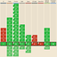

# Website speed & accessibility

Separate performance and accessibility findings into specific changes to verify.

**[Filter these tools in the app](https://herbertofury.github.io/INTA/#online?group=web-quality)** · [All online tools](Online-Tools)

 [WebPageTest](https://www.webpagetest.org/) |  [Google PageSpeed Insights](https://pagespeed.web.dev/) |  [WAVE Web Accessibility Evaluation](https://wave.webaim.org/) |  [W3C Nu HTML Checker](https://validator.w3.org/nu/) |  [W3C Link Checker](https://validator.w3.org/checklink) |  [Can I use](https://caniuse.com/)

##  [WebPageTest](https://www.webpagetest.org/)

Remote browser performance tests with waterfalls, filmstrips, video and configurable test locations.

** [Open service](https://www.webpagetest.org/)** ·  [Official page](https://www.webpagetest.org/) ·  [Documentation](https://www.logicmonitor.com/webpagetest)

**[Open this tool's working notes](https://herbertofury.github.io/INTA/#online?tool=webpagetest)**

**Use for:** Identify slow requests and rendering delays under repeatable browser and network conditions.

**Start here:** Select a representative location and connection, run a public-page test, then inspect waterfall and filmstrip evidence.

**Read the result:** Detailed load diagnostics; test runs count against quota. Verify current retention in-account because official copy conflicts.

**Access:** Free Starter account advertises 150 monthly test runs; paid professional features Account needed for the advertised Starter plan

**Submission behavior:** Remote browsers visit the supplied URL. Private and bulk testing are advertised as professional features.

**Official evidence:**

-  [WebPageTest current product page](https://www.logicmonitor.com/webpagetest): Advertises free Starter, 150 monthly runs, 30 locations and paid private/bulk tests. Retention copy inconsistently says 60 and 6 days, so no retention value is asserted.
-  [WebPageTest FAQ source](https://github.com/catchpoint/WebPageTest.docs/blob/main/src/webpagetest-faqs.md): Official project explains test-run counting and Starter versus paid features; some plan details lag the current product page.

Reviewed 2026-11-26. [Back to all online tools](Online-Tools).

##  [Google PageSpeed Insights](https://pagespeed.web.dev/)

Combines Lighthouse lab diagnostics with  [Chrome](https://www.google.com/chrome/) real-user performance data when available.

** [Open service](https://pagespeed.web.dev/)** ·  [Official page](https://pagespeed.web.dev/) ·  [Documentation](https://developers.google.com/speed/docs/insights/v5/about)

**[Open this tool's working notes](https://herbertofury.github.io/INTA/#online?tool=pagespeed-insights)**

**Use for:** Prioritize website performance fixes while separating current lab results from historical visitor experience.

**Start here:** Analyze the exact public page and inspect mobile and desktop, then separate lab findings from 28-day field data.

**Read the result:** Performance diagnostics and, when sufficient data exists, Core Web Vitals field results; a lab score is not a live-user guarantee.

**Access:** Public browser analyzer; API has separate quotas No account required for the public analyzer

**Submission behavior:** Google fetches the public URL for lab testing; field metrics are aggregated from the CrUX dataset.

**Official evidence:**

-  [PageSpeed Insights](https://pagespeed.web.dev/): Observed public analyzer.
-  [About PageSpeed Insights](https://developers.google.com/speed/docs/insights/v5/about): Official explanation of lab/field distinction, 28-day field period and missing-data fallback.

Reviewed 2026-11-26. [Back to all online tools](Online-Tools).

##  [WAVE Web Accessibility Evaluation](https://wave.webaim.org/)

Adds visual accessibility findings to a web page to support human evaluation.

** [Open service](https://wave.webaim.org/)** ·  [Official page](https://wave.webaim.org/) ·  [Documentation](https://wave.webaim.org/help)

**[Open this tool's working notes](https://herbertofury.github.io/INTA/#online?tool=wave-accessibility)**

**Use for:** Find missing labels, contrast issues and structural problems in a public page.

**Start here:** Enter the public page and inspect each error in context, then test keyboard use and reading order manually.

**Read the result:** Actionable automated findings; zero errors does not establish accessibility conformance.

**Access:** Public single-page checker; subscription API and standalone engine are separate No account required for public single-page evaluation

**Submission behavior:** Online checking fetches a public URL. The browser extension is the separate route for local or authenticated pages.

**Official evidence:**

-  [WAVE](https://wave.webaim.org/): Official page distinguishes public checker, browser extension and paid API/engine.
-  [WAVE Help](https://wave.webaim.org/help): Documents visual findings and the limits of automated accessibility checks.

Reviewed 2026-11-26. [Back to all online tools](Online-Tools).

##  [W3C Nu HTML Checker](https://validator.w3.org/nu/)

Reports document markup errors and warnings that can affect parsing, interoperability and usability.

** [Open service](https://validator.w3.org/nu/)** ·  [Official page](https://validator.w3.org/nu/) ·  [Documentation](https://validator.w3.org/nu/about.html)

**[Open this tool's working notes](https://herbertofury.github.io/INTA/#online?tool=w3c-html-checker)**

**Use for:** Locate malformed HTML behind inconsistent browser behavior before changing layout or application logic.

**Start here:** Check the affected public document, review the earliest structural error and compare it with the actual browser DOM.

**Read the result:** Located markup findings that can be corrected and checked again alongside the real user interaction.

**Access:** Free public checker; local execution available The public checker does not require an account; the project documents local web and command-line use.

**Submission behavior:** A URL check fetches the document remotely. Pasted markup, uploads and serialized DOM sent to the hosted checker leave the browser.

**Official evidence:**

-  [Nu HTML Checker](https://validator.w3.org/nu/): Provides the hosted document checker.
-  [About Nu HTML Checker](https://validator.w3.org/nu/about.html): Explains intended use, changing checks, DOM submission and local execution.

Reviewed 2026-11-26. [Back to all online tools](Online-Tools).

##  [W3C Link Checker](https://validator.w3.org/checklink)

Checks links, anchors and referenced objects in a public document, with optional recursive checking.

** [Open service](https://validator.w3.org/checklink)** ·  [Official page](https://validator.w3.org/checklink) ·  [Documentation](https://validator.w3.org/checklink)

**[Open this tool's working notes](https://herbertofury.github.io/INTA/#online?tool=w3c-link-checker)**

**Use for:** Find the actual broken navigation or resource destination after a site migration or documentation change.

**Start here:** Start with the exact affected public page, inspect broken targets and redirects, and use recursion only for the intended site scope.

**Read the result:** Specific link or anchor failures to repair, followed by a repeat check and a successful click through the real route.

**Access:** Free public link checker The public checker does not require an account.

**Submission behavior:** Submitted URLs and linked resources are retrieved by the remote checker. Recursive mode broadens the set of pages contacted.

**Official evidence:**

-  [W3C Link Checker](https://validator.w3.org/checklink): Documents link/anchor/resource checks, headers and optional recursion controls.

Reviewed 2026-11-26. [Back to all online tools](Online-Tools).

##  [Can I use](https://caniuse.com/)

Provides browser-version support tables and qualification notes for web platform features.

** [Open service](https://caniuse.com/)** ·  [Official page](https://caniuse.com/) ·  [Documentation](https://caniuse.com/ciu/about)

**[Open this tool's working notes](https://herbertofury.github.io/INTA/#online?tool=caniuse)**

**Use for:** Explain why a UI, media format or browser API behaves differently on a customer’s actual browser version.

**Start here:** Search the exact feature and inspect the customer’s browser/version cell plus every applicable support note.

**Read the result:** A documented support boundary that guides a fallback or a targeted reproduction on the actual device.

**Access:** Free public support tables; optional supporter features No account is required to read the public browser-support data.

**Submission behavior:** Ordinary lookup retrieves public feature data; optional analytics imports and external testing services are separate features.

**Official evidence:**

-  [Can I use support tables](https://caniuse.com/): Provides browser support search and links to related compatibility resources.
-  [Can I use methodology](https://caniuse.com/ciu/about): Explains testing, data updates and the limits of a supported classification.

Reviewed 2026-11-26. [Back to all online tools](Online-Tools).
