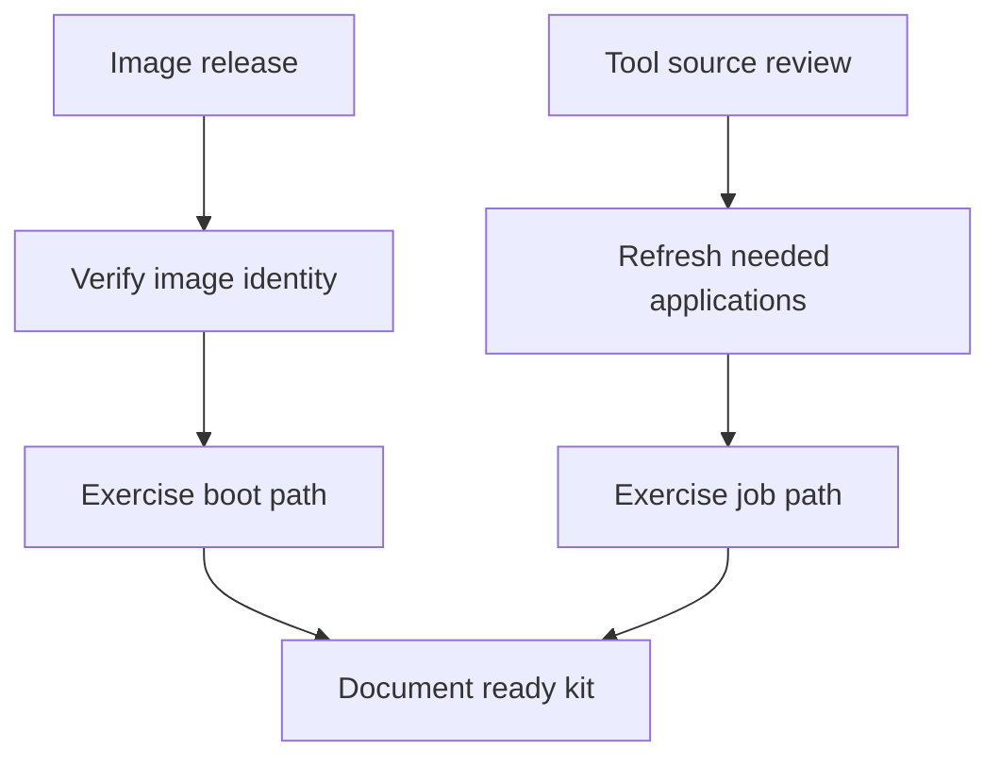

[INTA](https://github.com/Herbertofury/INTA/wiki) / [Decision desk](https://github.com/Herbertofury/INTA/wiki/Decision-Desk) · [Playbooks](https://github.com/Herbertofury/INTA/wiki/Playbooks) · [Tools](https://github.com/Herbertofury/INTA/wiki/Tool-Directory) · [Methods](https://github.com/Herbertofury/INTA/wiki/Methods) · [Open hub](https://herbertofury.github.io/INTA/)

# 💽 Rescue media that is ready for the job

[Home](https://github.com/Herbertofury/INTA/wiki) › **Rescue media**

**Prepare the right environment, verify the exact image and test the path you will need at the bench.** Start with [INTA releases](https://github.com/Herbertofury/INTA/releases), [build results](https://github.com/Herbertofury/INTA/actions) and the [boot-media preparation guide](https://github.com/Herbertofury/INTA/wiki/Job-boot-usb).

## 🧭 Choose the environment

| Environment | Best fit | Boundary to check |
| --- | --- | --- |
| [INTA Rescue](https://github.com/Herbertofury/INTA) | Offline drive inspection, imaging, recovery, hardware evidence and a rescue desktop with AI access. | A [Debian](https://www.debian.org/) live environment; confirm the actual package manifest and required hardware. |
| [Windows Recovery Environment](https://learn.microsoft.com/en-us/windows-hardware/manufacture/desktop/windows-recovery-environment--windows-re--technical-reference) or [Microsoft installation media](https://www.microsoft.com/software-download/windows11) | Supported [startup recovery](https://github.com/Herbertofury/INTA/wiki/Job-boot-recovery) and image servicing. | Match the installed system, encryption state and intended operation. |
| [Hiren's BootCD PE](https://www.hirensbootcd.org/download/) | A familiar [Windows PE](https://learn.microsoft.com/en-us/windows-hardware/manufacture/desktop/winpe-intro) utility environment. | Review the bundled software list and release age; individual tools may be older. |
| [SystemRescue](https://www.system-rescue.org/Download/) | A specialist recovery environment with storage and administration tools. | Verify the selected release and the exact filesystem or hardware path needed. |
| [Rescuezilla](https://rescuezilla.com/download) | A graphical disk-imaging and restore workflow. | Confirm source/destination direction and recovery compatibility. |
| Running [Windows](https://support.microsoft.com/windows) | [Remote support](https://github.com/Herbertofury/INTA/wiki/Job-remote-support), live process evidence, application fixes and normal endpoint maintenance. | Capture live evidence before a restart when it matters to the diagnosis. |

A catalog entry describes a useful option. It does not change that application's supported operating system or prove the application is bundled in an image. Use [the Tool Directory](https://github.com/Herbertofury/INTA/wiki/Tool-Directory) for suitability and the build's own manifest for actual contents.

## 🛠 Prepare the image and USB

### 1 · Open the media application

On a supported host with [Python](https://www.python.org/downloads/) 3.11+ and [Tk](https://docs.python.org/3/library/tkinter.html), launch the application from the source checkout:

```sh
python3 media/inta-media.py
```

Command legend: [Python](https://www.python.org/downloads/) launches [INTA Media Creator](https://github.com/Herbertofury/INTA/blob/main/media/inta-media.py). On [Windows](https://support.microsoft.com/windows), use the configured interpreter command, commonly `python`, for the same script.

### 2 · Acquire a verified image

Choose **Download or update INTA ISO** in [INTA Media Creator](https://github.com/Herbertofury/INTA/blob/main/media/inta-media.py). The application checks the published SHA-256 value before replacing the local image. Retain the exact release identity and checksum result with the kit record. Apply [publisher and checksum verification](https://github.com/Herbertofury/INTA/wiki/Job-boot-usb) to other acquired images as well.

### 3 · Choose the intended layout

| Layout | Action | Check before writing |
| --- | --- | --- |
| Several rescue images on one USB | Initialize the intended drive with official [Ventoy](https://www.ventoy.net/en/download.html), then use **Install or update ISO on [Ventoy](https://www.ventoy.net/) USB** in [INTA Media Creator](https://github.com/Herbertofury/INTA/blob/main/media/inta-media.py) and select its mounted data volume. | Initial [Ventoy](https://www.ventoy.net/en/doc_start.html) installation can erase the selected device. Copying the verified image afterward preserves other images on the data volume. |
| One dedicated image | Open [Rufus](https://rufus.ie/en/) from [INTA Media Creator](https://github.com/Herbertofury/INTA/blob/main/media/inta-media.py) on [Windows](https://support.microsoft.com/windows), select the verified image and the intended USB. | [Rufus](https://rufus.ie/en/) writes the device and erases its existing contents; confirm the target identity. |

[INTA Media Creator](https://github.com/Herbertofury/INTA/blob/main/media/inta-media.py) coordinates the official upstream media utilities. Their bootloader behavior and firmware compatibility remain part of the chosen tool's operating boundary.

### 4 · Boot the actual kit

Use representative hardware and record firmware mode, keyboard, networking, storage visibility and access to a separate export destination. [Secure Boot behavior](https://www.ventoy.net/en/doc_secure.html) is platform-specific. A virtual-machine check is useful evidence; physical hardware still needs the intended boot path exercised.

## 🔁 Keep both update lifecycles visible



Diagram legend: [Boot-media preparation](https://github.com/Herbertofury/INTA/wiki/Job-boot-usb), [publisher and checksum verification](https://github.com/Herbertofury/INTA/wiki/Job-boot-usb), [manual freshness review](https://github.com/Herbertofury/INTA/wiki/Job-preventive-maintenance), and [post-change acceptance](https://github.com/Herbertofury/INTA/wiki/Job-client-handoff). Syntax: [Mermaid](https://mermaid.js.org/intro/).

An updated boot menu, a replaced image and a refreshed application are three different changes. Record which one occurred. The [Hiren's BootCD PE contents page](https://www.hirensbootcd.org/download/) illustrates why a usable image can still contain older applications.

## 📖 Take the complete hub offline

Copy `site/index.html` to the [Ventoy](https://www.ventoy.net/en/doc_start.html) data volume or a separate technician drive and open it in a browser. The catalog and checklists are embedded. External documentation, downloads and online AI services require a connection. Replace the HTML independently when you want a newer knowledge snapshot.

For the actual contents of a particular [INTA Rescue](https://github.com/Herbertofury/INTA) image, use its package manifest and `/opt/inta-ai/package-lock.json`. The [base package recipe](https://github.com/Herbertofury/INTA/blob/main/live/package-lists/inta.list.chroot) describes requested packages. A browser link to [ChatGPT](https://chatgpt.com/) is online access; it is not an offline model. Follow the [AI triage guide](https://github.com/Herbertofury/INTA/wiki/Job-ai-triage) when working with case evidence.

## 🧪 Bench readiness checklist

- [ ] Source and destination storage identities are verified by model, size and serial.
- [ ] Recovery writes and recovered files have a separate destination.
- [ ] Hibernated or dirty filesystems are handled through the appropriate [recovery guide](https://github.com/Herbertofury/INTA/wiki/Job-failing-drive) before writes.
- [ ] [BitLocker recovery readiness](https://github.com/Herbertofury/INTA/wiki/Job-boot-recovery) is established where applicable.
- [ ] Required tools and detection data have their own freshness record.
- [ ] Important evidence can be exported before the live session shuts down.
- [ ] The offline knowledge copy opens and the needed hardware is visible.
- [ ] Online AI and remote sessions are signed out or closed before handoff.

## 📚 Original references

[Ventoy installation and updates](https://www.ventoy.net/en/doc_start.html) · [Ventoy image checksums](https://www.ventoy.net/en/doc_checksum.html) · [Rufus](https://rufus.ie/en/) · [Microsoft installation media](https://www.microsoft.com/software-download/windows11) · [SystemRescue downloads](https://www.system-rescue.org/Download/) · [Rescuezilla downloads](https://rescuezilla.com/download)

**➜ Continue:** [Build a rescue USB](https://github.com/Herbertofury/INTA/wiki/Job-boot-usb) · [Decision Desk](https://github.com/Herbertofury/INTA/wiki/Decision-Desk) · [Backup and restore proof](https://github.com/Herbertofury/INTA/wiki/Job-backup-restore)

---

Editorial review: **2026-11-26** · [Review standard](https://github.com/Herbertofury/INTA/wiki/Knowledge-Standards) · [Suggest a correction](https://github.com/Herbertofury/INTA/issues/new/choose)
